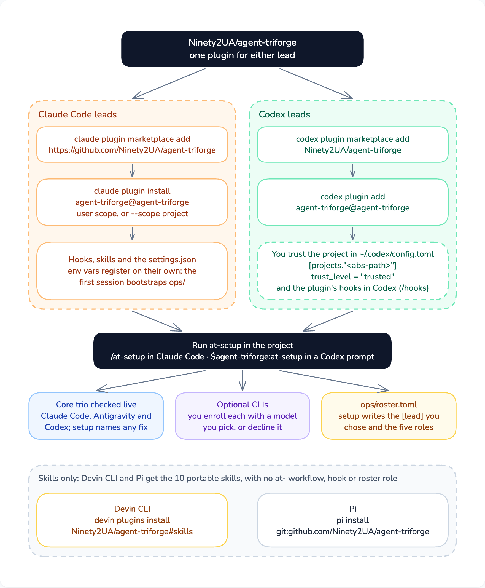

<p align="center">
  
</p>

<p align="center">
  <strong>A multi-agent build framework where one AI coding CLI leads (Claude Code or Codex) and the others build, review, test, analyze and document.</strong>
</p>

<p align="center">
  <a href="#whats-new">What's new</a> ·
  <a href="#install">Install</a> ·
  <a href="#getting-started">Getting started</a> ·
  <a href="#documentation">Documentation</a> ·
  <a href="#recent-changes">Release history</a> ·
  <a href="#faq">FAQ</a>
</p>

---

## Why Agent Triforge

Agent Triforge puts several AI coding CLIs on one sprint. One CLI leads an eight-CLI builder pool, and a roster you can edit, [`ops/roster.toml`](templates/ops/roster.toml), gives each role a CLI, a model and an effort. Any member can implement code; Devin builds only if you opt in.

- The lead is [Claude Code](https://docs.anthropic.com/en/docs/claude-code) or [Codex](https://github.com/openai/codex). You choose it in [`at-setup`](skills/at-setup/SKILL.md), which records it in the roster's `[lead]` table; without the table, Claude Code leads. The lead plans, resolves the roster, dispatches builders and merges reviewed work. Claude's model ladder is Fable 5.1 → Opus 5.5 → Sonnet 5.5.
- The core trio is required: Claude, [Antigravity](https://antigravity.google/cli) (`agy`, Gemini 3.8 Flash (High) by default, 1M context) and [Codex](https://github.com/openai/codex) (`gpt-6-astra`, sandboxed).
- The optional tier is detected automatically: OpenCode (OpenRouter `glm-5.3`), Kimi Code (`kimi-code/k3`), Cursor (Grok 4.6) and Grok Build (`grok-4.7`; builder, reviewer or analyst). You enroll them through [`at-setup`](skills/at-setup/SKILL.md), and one you don't enroll is skipped cleanly. Devin (`swe-1-6-slow`, reviewer or analyst) joins only after you record your consent in `at-setup`.
- 19 specialist personas cover [security](personas/security-sentinel.md), [performance](personas/performance-oracle.md), [architecture](personas/architecture-strategist.md) and more. One manifest sets each persona's tools, model tier and turn budget.

Every implementation task, the lead's own included, is built under a per-task lease in its own git worktree and merges only after a pinned reviewer, never its builder, has cross-reviewed it. Safety comes from that isolation and cross-review; any member may write code. Work is tracked in shared markdown files under `ops/`, reviews run in parallel, and what one sprint learns is written down for the next.

> *Each sprint should make the next sprint easier.*

When the lead solves a problem whose reasoning would otherwise be lost, it writes a note to [`ops/solutions/`](ops/solutions/), or to [`ops/decisions/`](ops/decisions/) for an architectural decision. The [`learnings-researcher`](personas/learnings-researcher.md) persona searches both before new work is planned ([the knowledge loop](docs/team-work.md#the-knowledge-loop-at-compound)).

<a name="whats-new"></a>
## What's new (v4.1.1)

This release changes the documentation and the release tooling. Nothing changes in how you run Triforge.

- **The README follows agent-blueprint's order.** It starts with what Triforge is, then covers install for either lead, getting started, unattended runs, upgrading from 3.x and updating, and ends with the reference sections. It shows only the latest What's new; older releases are in the collapsed [Release history](#recent-changes).
- **The diagrams are light.** The 13 dark diagrams became 15 light ones that read on GitHub's light and dark themes, and on a phone a tap opens each one full size. Two are new: the install routes and the unattended-run loop. Checking every label against the code corrected a few stale facts: there are five quality gates, at-ship reviews in five lanes, the kill grace is 10 s, and test fix cycles stop at 3.
- **Each release has its own notes file.** A version's notes live in `docs/releases/v<version>.md`, and the release workflow publishes that file as the GitHub release.
- **The maintainer gates are stricter.** `validate-versions.sh` fails a version bump that has no notes file and rejects Liquid delimiters under `docs/`, which break the GitHub Pages build. It also fails when a diagram source changed without a re-render, or when a diagram names a stale pin, a wrong count or a Codex invocation without its `agent-triforge:` prefix.

---

## Install

<p align="center">
  
</p>

Triforge installs as a plugin into the CLI that leads: one command adds the marketplace, one installs the plugin. The same repository serves both leads, because Codex also reads the `.claude-plugin/` manifests (D-048).

If you are coming from Triforge 3.x, read [Upgrading from 3.x](docs/upgrading.md) first. The slash commands are now `at-` workflows, and a `CLAUDE.md` left from the 3.x template hides the project's `AGENTS.md` from Claude Code.

You need the core trio (Claude Code, Antigravity `agy` and Codex) installed and logged in, Python 3, and on macOS GNU coreutils. Then install the plugin into the CLI that leads:

```bash
# Claude Code leads
claude plugin marketplace add https://github.com/Ninety2UA/agent-triforge
claude plugin install agent-triforge@agent-triforge

# Codex leads
codex plugin marketplace add Ninety2UA/agent-triforge
codex plugin add agent-triforge@agent-triforge
```

A Codex lead also needs a trust entry for the project in `~/.codex/config.toml`. [Install and update](docs/installation.md) has the version floor and READY probe for each CLI, that entry, project-scope installs, the portable skills in Devin and Pi, and how to update.

## Getting started

From nothing to a first sprint in five steps:

1. Install the core trio (Claude Code, Antigravity `agy` and Codex) and log in to each. The version floors and READY probes are under [Prerequisites](docs/installation.md#prerequisites).
2. Install the plugin: `claude plugin marketplace add https://github.com/Ninety2UA/agent-triforge`, then `claude plugin install agent-triforge@agent-triforge` ([Installation](docs/installation.md#installation)).
3. Start `claude` in your project. The first session bootstraps `ops/`.
4. Run `/at-setup`. It checks the core trio, asks which CLI leads the project, lets you keep or change the role assignments in `ops/roster.toml`, and offers each optional CLI. It also offers to add Triforge's pointer block to the project's root `AGENTS.md`, and it changes that file or a `CLAUDE.md` only after you say yes.
5. Run `/at-ship <goal>` for an autonomous sprint, or run the phases one at a time ([Typical session flow](#typical-session-flow)).

To lead from Codex instead, install the plugin with the Codex lines under [Installation](docs/installation.md#installation), add the project trust entry, start `codex` in the project, and run `$agent-triforge:at-setup` and then `$agent-triforge:at-ship <goal>` in a Codex prompt. Setup prints the full-access launch line for a Codex lead, and you type it yourself.

If you are upgrading from 3.x, the slash commands are now `at-` workflows (`/ship` is `/at-ship`); see [Upgrading from 3.x](docs/upgrading.md).

### Typical session flow

In a supervised session you run each phase and check its output before the next:

```bash
claude
> /at-plan add user authentication      # Phase 0-1.5: analyze, research, plan, validate
> /at-build                              # Phase 2: wave orchestration
> /at-review                             # Phase 3-4: parallel review + synthesis
> /at-test                               # Phase 5: Codex TDD
> /at-compound JWT session handling      # Document solution for future sprints
> /at-wrap                               # Phase 6: compound knowledge, write STATE.md
```

In an autonomous run one command runs every phase, in one session:

```bash
claude
> /at-ship add user authentication with JWT refresh tokens
```

To run the sprint from a terminal across fresh sessions, with recovery when a context window fills up, use `scripts/coordinate.sh` ([Unattended runs](docs/unattended-runs.md)).

In a Codex prompt the same workflows are `$agent-triforge:at-<name>`. From a shell, wrap the prompt in single quotes so the shell leaves `$agent-triforge:at-ship` alone: `codex exec '$agent-triforge:at-ship add user authentication'`.

## Documentation

| Page | What it covers |
|---|---|
| [Install and update](docs/installation.md) | Version floors and READY probes for all eight CLIs, the install steps for either lead, Codex project trust, the portable skills in Devin and Pi, checking and updating an install |
| [Unattended runs](docs/unattended-runs.md) | `at-ship` in one session, `scripts/coordinate.sh` across sessions, what the loop checks, and its exit codes |
| [Upgrading from 3.x](docs/upgrading.md) | What changed in 4.0, the map from 3.x commands to `at-` workflows, rolling back to 3.3.3 |
| [Workflow](docs/workflows.md) | The sprint phases, the planning, test and debugging pipelines, the five quality gates, and every lead workflow with its arguments |
| [Team work and swarms](docs/team-work.md) | The builder pool and its leases, the coordination modes, wave orchestration, the review and research swarms, the knowledge loop |
| [Model and effort](docs/models.md) | Each role's shipped CLI, model and effort, how each CLI takes its pin, the Claude ladder, the assignment heuristic |
| [Skills reference](docs/skills.md) | The 10 portable skills, and which path each CLI reads them from |
| [Personas reference](docs/personas.md) | The 19 personas in their three groups, and what the manifest sets for each |
| [Project layout and customization](docs/project-layout.md) | The plugin and project trees, what the bootstrap creates, the shared `ops/` files, and what you can change |
| [How it works under the hood](docs/how-it-works.md) | Skill injection, the context-recovery layers, the key constraints, data egress and credentials |
| [Compatibility](docs/compatibility.md) | The floor and tested version for each CLI, and why each floor is where it is |
| [Design document](docs/agent-triforge.md) | The full design: phases, coordination modes, the shared `ops/` files, the security model |

## When NOT to use this framework

| Situation | What to do instead |
|---|---|
| Trivial task (< 30 minutes) | Use Claude Code directly, or [`at-quick`](skills/at-quick/SKILL.md) |
| Pure exploration / brainstorming | Single agent conversation |
| Tight deadline, no tests needed | Claude Code solo, skip review + test |
| Non-code deliverables | [Antigravity CLI](https://antigravity.google/cli) solo with its large context |

<a name="recent-changes"></a>
## Release history

Each version's full notes are one file in [`docs/releases/`](docs/releases/), and the release workflow publishes that file as the GitHub release.

<details>
<summary>All releases</summary>

| Version | Date | Summary |
|---|---|---|
| [v4.1.1](docs/releases/v4.1.1.md) | 2026-10-13 | The README in agent-blueprint's order, light diagrams, release notes per version |
| [v4.1.0](docs/releases/v4.1.0.md) | 2026-10-13 | The 4.0 review's residuals fixed: a small reader, bounded reads, process-group time bounds, watched promotion targets, CLAUDE_CONFIG_DIR |
| [v4.0.0](docs/releases/v4.0.0.md) | 2026-10-12 | Lead choice (Claude Code or Codex), at- lead workflows, personas, AGENTS.md, Grok Build and Devin |
| [v3.3.3](docs/releases/v3.3.3.md) | 2026-10-01 | Protected-path registry, digest-stamped skills, lead git integrity |
| [v3.3.2](docs/releases/v3.3.2.md) | 2026-09-28 | Release gate green, OpenCode V2 guard, Cursor Grok 4.7 ids |
| [v3.3.1](docs/releases/v3.3.1.md) | 2026-09-12 | Mechanical no-push backstop, quota failure class, split control-plane files |
| [v3.3.0](docs/releases/v3.3.0.md) | 2026-09-11 | September 2026 models, trustworthy completion signals, native agent formats |
| [v3.2.0](docs/releases/v3.2.0.md) | 2026-09-11 | Watch commands become repo-local maintainer tooling |
| [v3.1.0](docs/releases/v3.1.0.md) | 2026-07-22 | Role customization in guided onboarding |
| [v3.0.1](docs/releases/v3.0.1.md) | 2026-07-21 | Landing-page copy + release hygiene |
| [v3.0.0](docs/releases/v3.0.0.md) | 2026-07-18 | CLI modernization + six-CLI builder pool |
| [v2.4.3](docs/releases/v2.4.3.md) | 2026-05-12 | Sequential downgrade ladder for narrow runtime tasks |
| [v2.4.2](docs/releases/v2.4.2.md) | 2026-05-12 | Third audit pass — both prior passes missed siblings of the same anti-pattern |
| [v2.4.1](docs/releases/v2.4.1.md) | 2026-05-12 | Second audit pass — surviving blocker + 27 findings actioned |
| [v2.4.0](docs/releases/v2.4.0.md) | 2026-04-20 | Framework self-audit — two blockers + four HIGH fixes |
| [v2.3.0](docs/releases/v2.3.0.md) | 2026-04-20 | Subagent hardening pass (Gemini + Codex docs alignment) |
| [v2.2.0](docs/releases/v2.2.0.md) | 2026-04-06 | Opus max effort, reliability patterns, and framework audit |
| [unversioned](docs/releases/2026-04-02-reliability-hardening-and-tactical-enhancements.md) | 2026-04-02 | Reliability hardening and tactical enhancements |
| [v2.0.0](docs/releases/v2.0.0.md) | 2026-03-31 | Claude Code plugin conversion |
| [unversioned](docs/releases/2026-03-31-four-pass-audit-and-blueprint-alignment.md) | 2026-03-31 | Four-pass audit and Blueprint alignment |

</details>

## FAQ

<details>
<summary><strong>Can I use this with an existing project?</strong></summary>

Yes. Install the plugin as described under <a href="docs/installation.md#installation">Installation</a> and start a session in the project. The framework is additive: it adds <code>ops/</code> and doesn't modify your existing code.
</details>

<details>
<summary><strong>Do I need all the CLIs?</strong></summary>

The core trio (Claude, Antigravity, Codex) is the supported baseline; run <a href="skills/at-setup/SKILL.md"><code>at-setup</code></a> to get them live. From the optional tier (OpenCode, Kimi, Cursor, Devin, Grok Build) you enroll any subset through <code>at-setup</code>, and an absent one is skipped cleanly in every roster fallback chain. Claude alone can still run the pipeline in a degraded mode, without the multi-model review, test and analysis lanes.
</details>

<details>
<summary><strong>Do I need all the skills?</strong></summary>

No. Skills activate contextually. If you never cut scope, the <a href="skills/scope-cutting/SKILL.md">scope-cutting</a> skill won't activate. You can delete any skill directory you don't want.
</details>

<details>
<summary><strong>How do personas differ from skills?</strong></summary>

Skills are methodology documents that guide an agent's behavior. Personas are separate processes that <code>dispatch_persona</code> starts, each with its own context and only the tools its manifest entry allows. Skills can be injected into any agent (including external ones like Antigravity and Codex).
</details>

<details>
<summary><strong>What are Agent Teams?</strong></summary>

<a href="personas/team-lead.md">Agent Teams</a> spawn multiple Claude Code instances that collaborate through a shared task list and messaging. Review swarms only analyze; Agent Teams are peers that divide file ownership and coordinate builds. Enable them with <code>CLAUDE_CODE_EXPERIMENTAL_AGENT_TEAMS: "1"</code> in settings.json.
</details>

<details>
<summary><strong>Do small bug fixes need the full pipeline?</strong></summary>

No. Use <a href="skills/at-quick/SKILL.md"><code>at-quick</code></a> for changes touching fewer than 3 files. It skips Phase 0, plan validation, and the full review swarm.
</details>

<details>
<summary><strong>Can a sprint run with nobody watching?</strong></summary>

Yes. <code>at-ship</code> runs every phase in one session, and <code>scripts/coordinate.sh</code> runs the sprint from a terminal across fresh sessions until <code>ops/.sprint-complete</code> exists or the session limit is reached. A Codex lead needs your <code>--allow-full-access</code> on the command line. See <a href="docs/unattended-runs.md">Unattended runs</a>.
</details>

<details>
<summary><strong>How does context exhaustion recovery work?</strong></summary>

Two layers. Inside a session, the <code>ops/.sprint-complete</code> sentinel is the authoritative completion signal, created only after the verification checklist passes. Under a Claude Code lead, the native <code>/goal</code> checklist is a best-effort assist on top: <a href="scripts/coordinate.sh"><code>coordinate.sh</code></a> leads every composed prompt with a <code>/goal</code> line, and <code>at-ship</code>/<code>at-coordinate</code> print a copyable one for interactive runs, but headless gating depends on model behavior (probe CC-03 passed 1 of 3 runs in the 2026-09 cycle, D-030), so nothing relies on it. Outside a session, <a href="scripts/coordinate.sh"><code>coordinate.sh</code></a> spawns fresh lead processes with clean context windows and detects completion through the sentinel; state persists via git and <code>ops/STATE.md</code>. A PreCompact hook checkpoints STATE.md before context compaction.
</details>

<details>
<summary><strong>What is knowledge compounding?</strong></summary>

After solving a non-trivial problem, <a href="skills/at-compound/SKILL.md"><code>at-compound</code></a> saves it as a structured document in <a href="ops/solutions/"><code>ops/solutions/</code></a>. Later <a href="skills/at-plan/SKILL.md"><code>at-plan</code></a> and <a href="skills/at-deep-research/SKILL.md"><code>at-deep-research</code></a> runs search this directory before they start new work.
</details>

<details>
<summary><strong>How do I update Triforge?</strong></summary>

Refresh the marketplace, then update the plugin: <code>claude plugin marketplace update agent-triforge</code> and <code>claude plugin update agent-triforge</code> under Claude Code, or <code>codex plugin marketplace upgrade agent-triforge</code> and <code>codex plugin add agent-triforge@agent-triforge</code> under Codex. See <a href="docs/installation.md#update">Update</a>.
</details>

<details>
<summary><strong>How do I move a project from 3.x?</strong></summary>

Follow <a href="docs/upgrading.md">Upgrading from 3.x</a>: the slash commands became <code>at-</code> workflows (<a href="docs/upgrading.md#command-map">command map</a>), the project's instruction file is now its root <code>AGENTS.md</code>, and the agents became personas. <a href="docs/upgrading.md#rolling-back-to-333">Rolling back to 3.3.3</a> covers the way back.
</details>

## Contributing

Pull requests to `main` and the `release/` branches run the gates in [`.github/workflows/gates.yml`](.github/workflows/gates.yml) on macOS: the shell syntax check, both validators and their self-tests, and the SELF probe rows. [`AGENTS.md`](AGENTS.md) lists every check to run before you open one, and the [PR template](.github/PULL_REQUEST_TEMPLATE.md) asks for an evidence table and the validator results.

### Development (for contributors)

```bash
git clone https://github.com/Ninety2UA/agent-triforge.git
claude --plugin-dir ./agent-triforge
```

CI cuts the releases. When a version bump lands on `main`, [`release.yml`](.github/workflows/release.yml) tags `v<version>` and publishes the GitHub release, using `docs/releases/v<version>.md` as the notes; `bash scripts/release-notes.sh --body` previews them. The short checklist is under "Release" in [`AGENTS.md`](AGENTS.md), the full one under "Release checklist" in [`docs/agent-triforge.md`](docs/agent-triforge.md).

## License

MIT

---

<p align="center">
  <sub>Built for teams that believe AI-assisted development should get better with every sprint.</sub>
</p>

<p align="center">
  <a href="docs/agent-triforge.md">Design document</a> ·
  <a href="AGENTS.md">AGENTS.md</a> ·
  <a href="https://antigravity.google/cli">Antigravity CLI</a> ·
  <a href="https://github.com/openai/codex">Codex CLI</a>
</p>
