<p align="center">
  
</p>

<p align="center">
  <strong>A multi-agent build framework where one AI coding CLI leads (Claude Code or Codex) and the others build, review, test, analyze and document.</strong>
</p>

<p align="center">
  <a href="#whats-new">What's new</a> ·
  <a href="#install">Install</a> ·
  <a href="#getting-started">Getting started</a> ·
  <a href="#unattended-runs">Unattended runs</a> ·
  <a href="#upgrading-from-3x">Upgrading from 3.x</a> ·
  <a href="#workflow">Workflow</a> ·
  <a href="#team-work-and-swarms">Team work</a> ·
  <a href="#model-and-effort">Model and effort</a> ·
  <a href="#lead-workflows-reference">Workflows</a> ·
  <a href="#skills-reference">Skills</a> ·
  <a href="#personas-reference">Personas</a> ·
  <a href="#compatibility">Compatibility</a> ·
  <a href="#recent-changes">Release history</a> ·
  <a href="#faq">FAQ</a>
</p>

---

## Why Agent Triforge

Agent Triforge puts several AI coding CLIs on one sprint. One CLI leads an eight-CLI builder pool, and a roster you can edit, [`ops/roster.toml`](templates/ops/roster.toml), gives each role a CLI, a model and an effort. Any member can implement code; Devin builds only if you opt in.

- The lead is [Claude Code](https://docs.anthropic.com/en/docs/claude-code) or [Codex](https://github.com/openai/codex). You choose it in [`at-setup`](skills/at-setup/SKILL.md), which records it in the roster's `[lead]` table; without the table, Claude Code leads. The lead plans, resolves the roster, dispatches builders and merges reviewed work. Claude's model ladder is Fable 5.1 → Opus 5.5 → Sonnet 5.5.
- The core trio is required: Claude, [Antigravity](https://antigravity.google/cli) (`agy`, Gemini 3.8 Flash (High) by default, 1M context) and [Codex](https://github.com/openai/codex) (`gpt-6-astra`, sandboxed).
- The optional tier is detected automatically: OpenCode (OpenRouter `glm-5.3`), Kimi Code (`kimi-code/k3`), Cursor (Grok 4.6) and Grok Build (`grok-4.7`; builder, reviewer or analyst). You enroll them through [`at-setup`](skills/at-setup/SKILL.md), and one you don't enroll is skipped cleanly. Devin (`swe-1-6-slow`, reviewer or analyst) joins only after you record your consent in `at-setup`.
- 19 specialist personas cover [security](personas/security-sentinel.md), [performance](personas/performance-oracle.md), [architecture](personas/architecture-strategist.md) and more. One manifest sets each persona's tools, model tier and turn budget.

Every implementation task, the lead's own included, is built under a per-task lease in its own git worktree and merges only after a pinned reviewer, never its builder, has cross-reviewed it. Safety comes from that isolation and cross-review; any member may write code. Work is tracked in shared markdown files under `ops/`, reviews run in parallel, and what one sprint learns is written down for the next.

> *Each sprint should make the next sprint easier.*

When the lead solves a problem whose reasoning would otherwise be lost, it writes a note to [`ops/solutions/`](ops/solutions/), or to [`ops/decisions/`](ops/decisions/) for an architectural decision. The [`learnings-researcher`](personas/learnings-researcher.md) persona searches both before new work is planned ([the knowledge loop](#the-knowledge-loop-at-compound)).

<a name="whats-new"></a>
## What's new (v4.1.1)

This release changes the documentation and the release tooling. Nothing changes in how you run Triforge.

- **The README follows agent-blueprint's order.** It starts with what Triforge is, then covers install for either lead, getting started, unattended runs, upgrading from 3.x and updating, and ends with the reference sections. It shows only the latest What's new; older releases are in the collapsed [Release history](#recent-changes).
- **The diagrams are light.** The 13 dark diagrams became 15 light ones that read on GitHub's light and dark themes, and on a phone a tap opens each one full size. Two are new: the install routes and the unattended-run loop. Checking every label against the code corrected a few stale facts: there are five quality gates, at-ship reviews in five lanes, the kill grace is 10 s, and test fix cycles stop at 3.
- **Each release has its own notes file.** A version's notes live in `docs/releases/v<version>.md`, and the release workflow publishes that file as the GitHub release.
- **The maintainer gates are stricter.** `validate-versions.sh` fails a version bump that has no notes file and rejects Liquid delimiters under `docs/`, which break the GitHub Pages build. It also fails when a diagram source changed without a re-render, or when a diagram names a stale pin, a wrong count or a Codex invocation without its `agent-triforge:` prefix.

---

## Install

<p align="center">
  
</p>

Triforge installs as a plugin into the CLI that leads: one command adds the marketplace, one installs the plugin. The same repository serves both leads, because Codex also reads the `.claude-plugin/` manifests (D-048).

If you are coming from Triforge 3.x, read [Upgrading from 3.x](#upgrading-from-3x) first. The slash commands are now `at-` workflows, and a `CLAUDE.md` left from the 3.x template hides the project's `AGENTS.md` from Claude Code.

### Prerequisites

You need the core trio installed and logged in, Python 3, and on macOS GNU coreutils. The commands below are the READY probes [`at-setup`](skills/at-setup/SKILL.md) runs for you; run them yourself to check a CLI before you install the plugin. Floors and tested versions are under [Compatibility](#compatibility).

Core trio:

```bash
# Claude Code ≥ 2.1.277 — the first build that reads a root AGENTS.md (D-037);
# 2.1.267 first honored `effort:` frontmatter on pinned-default models and the
# `fable` alias resolves to Fable 5.1 from 2.1.257
claude --version

# Antigravity CLI ≥ 1.1.27 — https://antigravity.google/cli (run `agy` once interactively to log in)
agy --model "Gemini 3.8 Flash (High)" -p "Respond with only: READY"   # pin the model — agy's own default is a (Medium) variant

# Codex CLI ≥ 0.153.0 (gpt-6-astra's minimal client version) — https://github.com/openai/codex
codex exec "Respond with only: READY"

# Python 3 (used by hook handlers for JSON parsing)
python3 --version

# GNU timeout (on macOS: brew install coreutils, which provides gtimeout); without one
# the helper refuses to call an external CLI (rc 96) and session start warns
command -v timeout || command -v gtimeout
```

Optional tier. You can add these later through `at-setup` to use them as builders or reviewers; an absent one is skipped cleanly in every roster fallback chain:

```bash
# OpenCode ≥ 1.18.20 — needs the OpenRouter provider connected (OPENROUTER_API_KEY or `opencode auth login`)
opencode run --format json -m openrouter/z-ai/glm-5.3 "Respond with only: READY"

# Kimi Code ≥ 0.33.0 — OAuth device-code or API key (`kimi login`)
kimi -p "Respond with only: READY"

# Cursor (date-versioned) — pin the suffixed Grok id, never the Auto router (`cursor-agent login`);
# the binary is `cursor-agent` (legacy symlink) or `agent` (primary since 2026.09.10)
cursor-agent -p --trust --model cursor-grok-4.6-xhigh "Respond with only: READY"

# Devin CLI ≥ 3000.10.31 (`devin auth login`) — a reviewer and analyst; at-setup asks for your
# consent before enrolling it, and it builds only after a separate opt-in
devin --model swe-1-6-slow --respect-workspace-trust false -p "Respond with only: READY"

# Grok Build ≥ 1.0.34 (builder, reviewer or analyst) — `grok login` (`grok login --device-code` without a browser) or XAI_API_KEY
grok --model grok-4.7 --output-format json -p "Respond with only: READY"
```

### Installation

1. Check the [prerequisites](#prerequisites) above.

2. Install the plugin into the CLI that leads.

   Claude Code leads:

   ```bash
   # Register the repository as a single-plugin marketplace once (it ships .claude-plugin/marketplace.json)
   claude plugin marketplace add https://github.com/Ninety2UA/agent-triforge

   # User scope (available in all your projects)
   claude plugin install agent-triforge@agent-triforge

   # Or project scope (shared with team via .claude/settings.json)
   claude plugin install agent-triforge@agent-triforge --scope project
   ```

   Codex leads. Codex reads the same `.claude-plugin/` manifests:

   ```bash
   codex plugin marketplace add Ninety2UA/agent-triforge
   codex plugin add agent-triforge@agent-triforge
   ```

   Claude Code registers the hooks, the env vars in `settings.json` and the skills (the 10 portable skills and the 17 lead workflows) on its own. Codex registers the skills and the hooks, and runs the hooks only after you trust them in Codex; `at-setup` checks that and names the step. Nothing else needs configuring by hand.

3. Codex leads: trust the project. Since Codex 0.147.0, `codex exec` reads a project's own `.codex/` files (`config.toml`, `hooks.json`, `.rules`) only in a trusted project. Add this entry to `~/.codex/config.toml` yourself, with the project's absolute path:

   ```toml
   [projects."/absolute/path/to/your-project"]
   trust_level = "trusted"
   ```

   `at-setup` checks for the entry and prints it, with the path filled in, when it is missing. Triforge never writes your user-level config. Without the entry the root `AGENTS.md` still loads, but Codex skips the project's `.codex/` files; a project you mark `untrusted` loses the root `AGENTS.md` as well. [`templates/.codex/config.toml`](templates/.codex/config.toml) is the project file that entry unlocks.

4. Start the lead (`claude` or `codex`) in your project. The first session bootstraps the project's `ops/` directory ([Automatic project bootstrapping](#automatic-project-bootstrapping)).

5. Run `/at-setup` (`$agent-triforge:at-setup` in a Codex prompt). After checking that the core trio is live (it names the fix for any CLI that isn't), it asks which CLI leads the project, Claude Code or Codex. For Codex it shows the project trust entry, the hook trust and the full-access launch line, which you type yourself. Role assignment comes next: keep the shipped defaults (recommended) or change any role's CLI, model and effort. You then enroll each optional CLI with a model you choose, or decline it. Setup lists the instruction files in the project and the directories above it. It offers to add the pointer block from [`templates/AGENTS.md`](templates/AGENTS.md) to the project's root `AGENTS.md` (Triforge ships no `CLAUDE.md`), and when a `CLAUDE.md` would hide `AGENTS.md` from Claude Code, it also offers the `@AGENTS.md` import line. It changes a file only after you say yes. Before it writes the lead, it lists which providers receive your code. It is idempotent, so you can rerun it any time.

### Portable skills in Devin and Pi

Devin CLI and Pi can install the 10 portable skills straight from this repository. They get the skills only: no lead workflow (`at-*`), hook or agent. One of them, `wave-orchestration`, calls Triforge's lease helpers, which come only with the Triforge plugin. Without the plugin its wave rules still work as a manual method, but no lease, pinned review or integrity check runs. Installing the skills does not enroll the CLI, because `ops/roster.toml` assigns roles only to the CLIs in [the builder pool](#the-builder-pool).

| Harness | Install | Manifest | Invoke |
|---|---|---|---|
| Devin CLI | `devin plugins install Ninety2UA/agent-triforge#skills` (from a clone: `devin plugins install --local ./agent-triforge/skills`) | [`skills/.devin-plugin/plugin.json`](skills/.devin-plugin/plugin.json), plugin root `skills/` | `/agent-triforge:<name>` |
| Pi | `pi install git:github.com/Ninety2UA/agent-triforge` (`-l` writes the project's `.pi/settings.json` instead of `~/.pi/agent/settings.json`) | [`package.json`](package.json), the `pi.skills` list | `/skill:<name>` |

Run `devin auth login` before any `devin plugins` command. Install the Devin plugin from `#skills`, not from the repository root: at the root, Devin falls back to `.claude-plugin/plugin.json` and also loads the 17 lead workflows, this repository's `AGENTS.md` as an always-on rule, and the Claude Code hooks.

### Verify installation

Start Claude Code in a project. The session-start banner lists the lead workflows, and `/at-status` prints the sprint report:

```bash
claude

# You should see:
# "Multi-agent framework ready."
# "Lead workflows (/at-<name> here, $agent-triforge:at-<name> in a Codex prompt): at-setup at-ship at-plan ..."

/at-status
```

Under a Codex lead the banner appears once you have trusted the plugin's hooks. `$agent-triforge:at-status` prints the same report either way, because every `at-` workflow runs the project bootstrap itself.

## Getting started

From nothing to a first sprint in five steps:

1. Install the core trio (Claude Code, Antigravity `agy` and Codex) and log in to each. The version floors and READY probes are under [Prerequisites](#prerequisites).
2. Install the plugin: `claude plugin marketplace add https://github.com/Ninety2UA/agent-triforge`, then `claude plugin install agent-triforge@agent-triforge` ([Installation](#installation)).
3. Start `claude` in your project. The first session bootstraps `ops/`.
4. Run `/at-setup`. It checks the core trio, asks which CLI leads the project, lets you keep or change the role assignments in `ops/roster.toml`, and offers each optional CLI. It also offers to add Triforge's pointer block to the project's root `AGENTS.md`, and it changes that file or a `CLAUDE.md` only after you say yes.
5. Run `/at-ship <goal>` for an autonomous sprint, or run the phases one at a time ([Typical session flow](#typical-session-flow)).

To lead from Codex instead, install the plugin with the Codex lines under [Installation](#installation), add the project trust entry, start `codex` in the project, and run `$agent-triforge:at-setup` and then `$agent-triforge:at-ship <goal>` in a Codex prompt. Setup prints the full-access launch line for a Codex lead, and you type it yourself.

If you are upgrading from 3.x, the slash commands are now `at-` workflows (`/ship` is `/at-ship`); see [Upgrading from 3.x](#upgrading-from-3x).

### Typical session flow

In a supervised session you run each phase and check its output before the next:

```bash
claude
> /at-plan add user authentication      # Phase 0-1.5: analyze, research, plan, validate
> /at-build                              # Phase 2: wave orchestration
> /at-review                             # Phase 3-4: parallel review + synthesis
> /at-test                               # Phase 5: Codex TDD
> /at-compound JWT session handling      # Document solution for future sprints
> /at-wrap                               # Phase 6: compound knowledge, write STATE.md
```

In an autonomous run one command runs every phase, in one session:

```bash
claude
> /at-ship add user authentication with JWT refresh tokens
```

To run the sprint from a terminal across fresh sessions, with recovery when a context window fills up, use `scripts/coordinate.sh` ([Unattended runs](#unattended-runs)).

In a Codex prompt the same workflows are `$agent-triforge:at-<name>`. From a shell, wrap the prompt in single quotes so the shell leaves `$agent-triforge:at-ship` alone: `codex exec '$agent-triforge:at-ship add user authentication'`.

## Unattended runs

<p align="center">
  
</p>

A sprint can run with nobody watching in two ways. `at-ship` runs every phase in one lead session. [`scripts/coordinate.sh`](scripts/coordinate.sh) drives the same sprint from a terminal through as many fresh lead sessions as it needs, so a full context window doesn't end the run. Either way the sprint is done only when `ops/.sprint-complete` exists. The lead creates that file as its last step, after the verification checklist passes.

### In one session: `at-ship`

Run `/at-ship <goal>` under Claude Code or `$agent-triforge:at-ship <goal>` in a Codex prompt. `--convergence` sets when review stops: `fast` once no P1 finding is left, `standard` (the default) once no P1 or P2 is left, and `deep` once, on top of that, fewer than 3 P3 findings remain. `--team` builds in agent-team mode, for 5 or more tasks or interdependent ones.

At the start `at-ship` prints a copyable completion line. Under Claude Code it is a `/goal` gate: type it, and Claude Code holds the session to the checklist. A Codex lead has no `/goal`, so it completes on the marker alone. The checklist:

1. Every phase is done, or skipped with a stated reason.
2. The `verification-before-completion` checklist passes with evidence.
3. `ops/STATE.md` is written for the next session.
4. Temporary review files are archived to `ops/archive/`.
5. `ops/.sprint-complete` is created last, only after 1 to 4 hold.

If any item fails, the lead creates no marker and records the blocker in `ops/TASKS.md` and `ops/STATE.md`.

### Across sessions: `scripts/coordinate.sh`

1. Open a terminal in the project's top directory. The script ships in the plugin install, and session start records that path as the last line of `.agents/triforge-plugin-root.local`:

   ```bash
   TRIFORGE="$(tail -n 1 .agents/triforge-plugin-root.local)"
   ```

2. Preview the run. `--dry-run` prints the lead's launch line and the prompt for the first session, and runs nothing; add `--lead codex` or `--lead claude` to compose it for the other lead:

   ```bash
   bash "$TRIFORGE/scripts/coordinate.sh" "Build the authentication module" --dry-run
   ```

3. Start it. `--max N` caps the sessions (default 5), and `--convergence` and `--team` pass through to the sprint:

   ```bash
   # Full autonomous sprint with context recovery
   bash "$TRIFORGE/scripts/coordinate.sh" "Build the authentication module" --max 5 --convergence deep --team

   # With completion notification via webhook
   NOTIFY_WEBHOOK_URL="https://hooks.slack.com/..." bash "$TRIFORGE/scripts/coordinate.sh" "Build auth" --max 5

   # Under a Codex lead: preview the launch line and prompt, then run with full access acknowledged
   bash "$TRIFORGE/scripts/coordinate.sh" "Build auth" --dry-run --lead codex
   bash "$TRIFORGE/scripts/coordinate.sh" "Build auth" --max 5 --allow-full-access
   ```

Run it from a terminal or from the lead's own shell. Under nohup, cron or CI there is no terminal, so the script stops with exit 45 before any session starts.

### What the loop does

1. It resolves the lead from `[lead]` in `ops/roster.toml`, checks that the lead's CLI is on `PATH` and that `TMPDIR` is private, and deletes any stale `ops/.sprint-complete`.
2. Before every session it runs the lead's git integrity check. When `.git/config`, the hooks, the refs, a worktree pointer or the lease ledger changed in a way the lead did not make, it restores what it can, escalates the open leases and stops with exit 44 before the session starts. Check the change, accept it with `lease_rebaseline` if you made it, then rerun.
3. Each session is a fresh lead process started with the registry's launch line plus the `[lead]` model and effort. Under Claude Code the prompt opens with the `/goal` checklist. Under Codex it opens with `$agent-triforge:at-ship` and carries the checklist as text. The session reads `ops/STATE.md` first. When `ops/leases.toml` still holds open leases, the prompt tells the session to rebuild the wave from the ledger instead of starting it again, and to bring up any failed or escalated lease for a decision.
4. After each session the loop looks for `ops/.sprint-complete`. If it exists, the sprint is complete. If the session failed in a way every new session would repeat (not logged in, quota spent, binary missing), the loop stops with exit 69 and prints the fix. Otherwise it starts the next session.
5. When the sprint completes, stops on a failure or runs out of sessions, the loop posts a message to `NOTIFY_WEBHOOK_URL` when you set one, and shows a desktop notification (`osascript` on macOS, `notify-send` on Linux).

### Under a Codex lead

A Codex lead's launch line runs with full access: `-s danger-full-access` and no approval prompts. `coordinate.sh` runs it only when you pass `--allow-full-access`. Without the flag it prints the line and the statements of what confines it, then exits 77 having run nothing. `at-setup` prints the same line for an interactive session, and typing it is your step. The "Confinement, stated as it is" section of [`AGENTS.md`](AGENTS.md) says what confines a full-access lead and what doesn't.

### When a run stops

| Exit | Meaning |
|---|---|
| 0 | The sprint is complete, the dry run printed, or the sessions ran out without completion (the closing lines say which) |
| 1 | Usage error, a lead that can't be resolved, its CLI not on `PATH`, the helper library missing, or a `TMPDIR` other users could change |
| 44 | The integrity check found a change before a session (restored and escalated; inspect it, then `lease_rebaseline`) or could not run |
| 45 | This shell may not run the lead's loop: another CLI's shell, or no terminal (nohup, cron, CI) |
| 69 | The lead failed in a way that would repeat (not logged in, quota spent, binary missing); the fix is printed |
| 77 | The launch line needs full access and `--allow-full-access` was not given; nothing ran |

When the sessions run out, `ops/STATE.md` and `ops/TASKS.md` hold the progress. Run the script again to continue, or review by hand.

## Upgrading from 3.x

- Each 3.x slash command is now a lead workflow with an `at-` prefix: `/setup` became `/at-setup`, `/ship` became `/at-ship`, and so on for the whole set (`$agent-triforge:at-setup`, `$agent-triforge:at-ship` in a Codex prompt). The plugin no longer ships a `commands/` directory. The [command map](#command-map) below pairs each one with its new name, and the [Lead workflows reference](#lead-workflows-reference) describes every workflow.
- Triforge 4 ships no `CLAUDE.md`. The project's instruction file is its root `AGENTS.md`, which Claude Code reads from 2.1.277, and only while no `CLAUDE.md`, `.claude/CLAUDE.md` or `CLAUDE.local.md` sits in the project or above it. If your project kept a `CLAUDE.md` from the 3.x template, add an import line to it (`@AGENTS.md` in a root `CLAUDE.md`, `@../AGENTS.md` in `.claude/CLAUDE.md`), or replace its Triforge content with the pointer block from [`templates/AGENTS.md`](templates/AGENTS.md). Session start prints a warning naming the exact line on every session until you do; it never edits the file.
- The `test-driven-development` and `systematic-debugging` skills are gone. Their rules now sit inline in `at-test`, `at-quick`, `at-debug` and the Codex `test_writer` and `debugger` agents.
- If your project's `.codex/hooks.json` is still the unchanged 3.x copy, the first 4.0 session replaces it with the empty 4.0 template and prints a notice naming the file. The 3.x hook appended a line to `ops/CHANGELOG.md` from every Codex session, lease workers included; attribution now comes from the lease ledger. Session start leaves a copy you edited alone ([decision record](ops/decisions/2026-10-04-codex-hook-trust-bypass-retired.md)).
- The 19 agents are now personas: prompt files in [`personas/`](personas/) with no frontmatter. Their tools, model tier and turn budget live in [`personas/manifest.toml`](personas/manifest.toml). The plugin ships no `agents/` directory, so Claude Code's agent list no longer shows them. The workflows run them through `dispatch_persona` under either lead. PR comment resolution now runs as a lease and lands as one reviewed commit on the PR branch.
- On resume, `lease_heartbeat_check` now collects the builders that finished while no lead was watching and adopts the ones still running; builders run detached in 4.0 and outlive the lead's turn. In 3.x it printed `run: lease_collect <task>` and left the collect to you.
- Triforge now sets up the project in the repository's top directory, the nearest one above that holds `.git`, wherever the session starts. A project that 3.x bootstrapped in a subdirectory of a larger repository keeps its `<subdir>/ops/`, and the first 4.0 session creates a new skeleton at the top. The lease ledger and the `[lead]` table already live in the top-level `ops/`, so move your other `ops/` files there and delete the subdirectory copy. Until you move it, session start and `at-setup` warn about the subdirectory's `ops/roster.toml` each time they run from that subdirectory or below it, and on the run that creates the top-level skeleton.

### Command map

A 3.x command also ran in its namespaced form, `/agent-triforge:<name>`. From a shell, put the Codex form in single quotes so the shell leaves the `$` alone: `codex exec '$agent-triforge:at-ship <goal>'`.

| 3.x command | 4.0 under Claude Code | 4.0 in a Codex prompt |
|---|---|---|
| `/analyze` | `/at-analyze` | `$agent-triforge:at-analyze` |
| `/build` | `/at-build` | `$agent-triforge:at-build` |
| `/compound` | `/at-compound` | `$agent-triforge:at-compound` |
| `/coordinate` | `/at-coordinate` | `$agent-triforge:at-coordinate` |
| `/debug` | `/at-debug` | `$agent-triforge:at-debug` |
| `/deep-research` | `/at-deep-research` | `$agent-triforge:at-deep-research` |
| `/pause` | `/at-pause` | `$agent-triforge:at-pause` |
| `/plan` | `/at-plan` | `$agent-triforge:at-plan` |
| `/quick` | `/at-quick` | `$agent-triforge:at-quick` |
| `/resolve-pr` | `/at-resolve-pr` | `$agent-triforge:at-resolve-pr` |
| `/resume` | `/at-resume` | `$agent-triforge:at-resume` |
| `/review` | `/at-review` | `$agent-triforge:at-review` |
| `/setup` | `/at-setup` | `$agent-triforge:at-setup` |
| `/ship` | `/at-ship` | `$agent-triforge:at-ship` |
| `/status` | `/at-status` | `$agent-triforge:at-status` |
| `/test` | `/at-test` | `$agent-triforge:at-test` |
| `/wrap` | `/at-wrap` | `$agent-triforge:at-wrap` |

### Rolling back to 3.3.3

Settle every open lease while 4.0 is still installed. A 4.0 builder runs detached, and 3.3.3's heartbeat check can't match the start time 4.0 records for it, so 3.3.3 would take a builder that is still running for dead and remove its worktree. Run `lease_wait` until it prints no `still building:` line (`lease_stop <task>` stops a builder you don't want to wait for), then merge each lease or reclaim it with `lease_reclaim`. 3.3.3 can't merge a lease whose pinned reviewer is Devin or Grok Build, and it doesn't read the approvals recorded with `lease_approve`.

Then reinstall 3.3.3 from a checkout of its tag:

```bash
git clone --branch v3.3.3 https://github.com/Ninety2UA/agent-triforge.git agent-triforge-3.3.3
claude plugin uninstall agent-triforge@agent-triforge
claude plugin marketplace remove agent-triforge
claude plugin marketplace add ./agent-triforge-3.3.3
claude plugin install agent-triforge@agent-triforge
```

If you installed at project scope, pass the same `--scope` to `uninstall` and `install`. 3.3.3 has no Codex lead, so also remove a Codex install with `codex plugin remove agent-triforge@agent-triforge`. To return to the current release later, remove the local marketplace and add the GitHub URL again.

Last, check what 4.0 left in each project:

- `ops/roster.toml`: 3.3.3 ignores the `[lead]` table and always leads from Claude Code. It rejects `[members.devin]` and `[members.grok]` as unknown members, and that error stops every role from resolving, so delete both tables and take `devin` and `grok` out of every role and fallback chain.
- The instruction file: 3.3.3's session start looks only for `CLAUDE.md` and `.claude/CLAUDE.md`. When it finds neither, it prints a `cp` line for its `templates/CLAUDE.md`, and once that file exists Claude Code stops reading `AGENTS.md`. The pointer block in your `AGENTS.md` names the 4.0 `at-` workflows, which 3.3.3 doesn't have. Restore the project's 3.x `CLAUDE.md` from git history or run the printed copy line, and move anything you still need from `AGENTS.md` into it.
- `personas/`: nothing to undo. Personas live in the plugin, not in your project, and 3.3.3 brings back its 19 subagents in `agents/`.
- `.codex/hooks.json`: if 4.0 replaced it with the empty template, 3.3.3 keeps the empty file, because it copies its template only where none exists. Delete the file and the next session restores the 3.x hook, which logs every Codex session to `ops/CHANGELOG.md`.
- `.agents/skills/`: nothing to do. 3.3.3's session start sees the version change, adds `test-driven-development` and `systematic-debugging` back, and replaces only the copies that still match their recorded digest.
- `ops/` itself: 3.3.3 sets up the project in the directory where the session starts, so start Claude Code in the repository's top directory, where 4.0 keeps `ops/`.

## Update

| Install route | How to update |
|---|---|
| Claude Code plugin | `claude plugin marketplace update agent-triforge`, then `claude plugin update agent-triforge`. Start a new Claude Code session to load the new version. |
| Codex plugin | `codex plugin marketplace upgrade agent-triforge`, then `codex plugin add agent-triforge@agent-triforge`, which installs the version the refreshed marketplace carries. When an update changes a hook, Codex asks you to review the hooks again (`/hooks`). |

```bash
# Claude Code leads
claude plugin marketplace update agent-triforge
claude plugin update agent-triforge

# Codex leads
codex plugin marketplace upgrade agent-triforge
codex plugin add agent-triforge@agent-triforge
```

Each project picks up the new version at its next session: session start refreshes the portable skills in `.agents/skills/` when the plugin version changes, and keeps any copy you edited ([Portable skills across the eight CLIs](#portable-skills-across-the-eight-clis)). Before you move to a new major version, read its notes in [Release history](#recent-changes); from 3.x, read [Upgrading from 3.x](#upgrading-from-3x).

## What you get

### Project structure

The plugin provides personas, skills and hooks. Your project gets an `ops/` directory for state:

```
agent-triforge/                     (plugin — installed automatically)
├── .claude-plugin/plugin.json        Plugin manifest
├── package.json                      Pi package manifest: the portable skills only
├── personas/                         19 persona prompts plus manifest.toml (tools, model tier, turns)
├── skills/                           27 skills in one tree
│   ├── .devin-plugin/plugin.json       Devin plugin manifest (plugin root skills/): the portable skills only
│   ├── <name>/SKILL.md                 10 portable skills, copied to .agents/skills/ and lease worktrees
│   │   └── references/                 where a skill is split (wave-orchestration, verification-before-completion)
│   └── at-<name>/                      17 lead workflows (/at-<name> in Claude Code, $agent-triforge:at-<name> in a Codex prompt); never copied
│       ├── SKILL.md                      the router: goal, done condition, safe failure, invocation
│       ├── references/                   the detail the router points to
│       ├── scripts/locate-triforge.sh    finds the plugin root from either lead
│       └── agents/openai.yaml            Codex skill metadata
├── hooks/
│   ├── hooks.json                    Hook registration
│   └── handlers/                     4 lifecycle hook scripts, plus monitors.py (the monitors' state and classifier)
├── settings.json                     Default env vars
├── AGENTS.md                         The plugin's own instructions: checks, conventions, confinement, human-only actions
├── templates/                        Project bootstrapping templates (AGENTS.md pointer block, ops/ skeleton, per-CLI files)
├── scripts/coordinate.sh            Outer loop for context recovery
└── scripts/validate-*.sh            Release gates: skill structure; version lockstep + ladder one-definition + stale-pin sweep

your-project/                       (your repo — bootstrapped on first session)
├── AGENTS.md                         Your instruction file, with Triforge's pointer block (templates/AGENTS.md)
├── ops/                              Shared coordination files
│   ├── AGENTS.md                       Master operating protocol for all agents
│   ├── GOALS.md                        High-level product goals
│   ├── MEMORY.md                       Decisions, patterns, gotchas
│   ├── CHANGELOG.md                    Audit trail with agent attribution
│   ├── STATE.md                        Session continuity checkpoint
│   ├── solutions/                      Documented solved problems
│   ├── decisions/                      Architecture decision records
│   └── archive/                        Archived review + test files
└── src/                              Your source code
```

### Automatic project bootstrapping

Triforge sets up a project through one helper, `triforge_bootstrap` (`scripts/lib/bootstrap.sh`). The `session-start.sh` hook runs it at the start of every session, and `at-setup`, `at-build` and `at-review` run it too, so a project led from Codex is set up before you trust the plugin's hooks. Each run only fills in what is missing. It works in the repository's top directory, the nearest one above that holds `.git`, so a run from a subdirectory sets up the repository. It refuses to set up your home directory or any directory that contains it, and the roster writers and the lease helpers refuse such a project too. It:

- Creates `ops/solutions/`, `ops/decisions/` and `ops/archive/`, copies the skeleton `MEMORY.md`, `CHANGELOG.md`, `AGENTS.md` and `GOALS.md` from the plugin templates into `ops/`, and adds `ops/roster.toml`
- Copies the 10 portable skills into `.agents/skills/` and each CLI's project files (`.codex/` always; `.opencode/`, `.kimi-code/` and `.cursor/` for the CLIs you have installed)
- Writes `.agents/triforge-plugin-root.local`, a per-user file naming the plugin's install path, which the `at-` skills read when the lead does not export one. If no ignore rule covers the file, Triforge adds one to `.agents/.gitignore` so git never tracks it. If git tracks `.agents/.gitignore`, Triforge leaves it alone and prints the line to add instead

The hook also keeps its session state in `.claude/` (it writes nothing through a `.claude` that is a symlink) and prints a `cp` command for Triforge's pointer block when the project has no root `AGENTS.md`.

Your project's own instruction file is its root `AGENTS.md`. Add the marked pointer block from [`templates/AGENTS.md`](templates/AGENTS.md) to it yourself, or let `at-setup` add it after you say yes; session start never writes into an existing `AGENTS.md`. The plugin ships no `CLAUDE.md`, because a `CLAUDE.md`, `.claude/CLAUDE.md` or `CLAUDE.local.md` in or above the project stops Claude Code from reading `AGENTS.md`.

### Shared file protocol

All agents coordinate through markdown files in [`ops/`](ops/), the source of truth:

| File | Purpose | Owner |
|---|---|---|
| `TASKS.md` (runtime) | Work queue with `[ ]`/`[x]` status tracking | The lead generates, all agents read |
| [`AGENTS.md`](templates/ops/AGENTS.md) | Master operating protocol read by all agents | Manual |
| [`GOALS.md`](templates/ops/GOALS.md) | High-level product goals for sprint planning | Manual |
| [`MEMORY.md`](ops/MEMORY.md) | Architectural decisions, patterns, interface proposals | All agents append |
| [`CHANGELOG.md`](ops/CHANGELOG.md) | Audit trail with `[agent-name]` attribution | All agents append |
| [`STATE.md`](ops/STATE.md) | Session continuity: current phase, progress, next actions | The lead writes on pause/wrap |
| [`solutions/`](ops/solutions/) | Documented solved problems for institutional knowledge | The lead writes via [`at-compound`](skills/at-compound/SKILL.md) |
| [`decisions/`](ops/decisions/) | Architecture decision records (ADRs) | The lead writes via [`at-compound`](skills/at-compound/SKILL.md) |

## Workflow

Every goal goes through the same phases, and each phase has a lead workflow.

### Sprint Pipeline (`at-ship`)

Run [`at-ship`](skills/at-ship/SKILL.md) (`/at-ship <goal>` under a Claude Code lead, `$agent-triforge:at-ship <goal>` in a Codex prompt) to run every phase autonomously, or run each phase's lead workflow yourself.

<p align="center">
  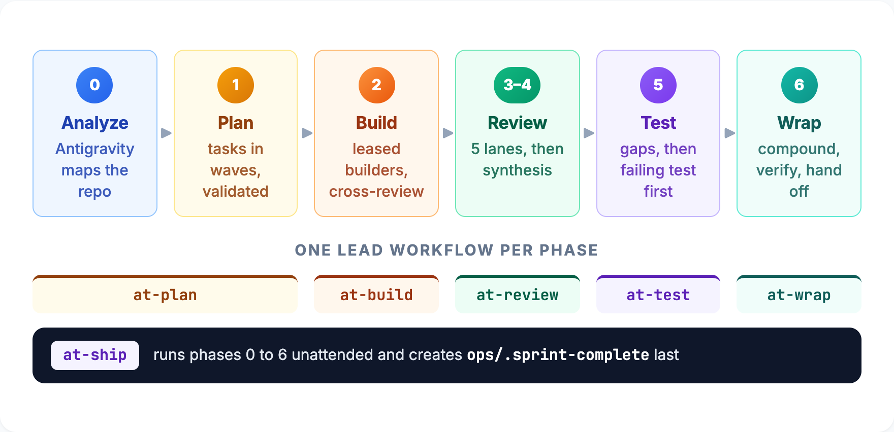
</p>

| Phase | What happens | Agents | Lead workflow |
|:---|:---|:---|:---|
| 0, Analyze | Full-repo scan: architecture, patterns, contracts, debt | Antigravity CLI + [`codebase-mapping`](skills/codebase-mapping/SKILL.md) | [`at-plan`](skills/at-plan/SKILL.md) |
| Pre-plan | Search institutional knowledge for relevant past solutions | [`learnings-researcher`](personas/learnings-researcher.md) | [`at-plan`](skills/at-plan/SKILL.md) |
| 1, Plan | Decompose the goal into tasks with shadow paths and error maps, grouped into waves | Lead + [`writing-plans`](skills/writing-plans/SKILL.md) | [`at-plan`](skills/at-plan/SKILL.md) |
| 1.1, Ambiguity | Surface the 3 most critical unverified assumptions and ask you to confirm or correct them | Lead | [`at-plan`](skills/at-plan/SKILL.md), [`at-ship`](skills/at-ship/SKILL.md) |
| 1.5, Validate | Validate assignments, dependencies, scope and shadow paths, up to 3 rounds | [`plan-checker`](personas/plan-checker.md) | [`at-plan`](skills/at-plan/SKILL.md) |
| 2, Build | Wave orchestration over leased builders, with integration verification between waves | Leased builders, or the [`team-lead`](personas/team-lead.md) persona | [`at-build`](skills/at-build/SKILL.md) |
| 3 and 4, Review | Five lanes at once (Antigravity, Codex, `security-sentinel`, `performance-oracle`, `code-simplicity-reviewer`), then synthesis with confidence tiers; up to 3 cycles | Antigravity + Codex + three [review personas](#review-specialists-6) | [`at-review`](skills/at-review/SKILL.md) |
| 5, Test | Gap analysis, tests written failing first, up to 3 fix cycles, then escalation to you | Codex CLI ([`test_writer`](codex-agents/agents.toml)) | [`at-test`](skills/at-test/SKILL.md) |
| 6, Wrap | Document solutions, archive reviews, verify, write STATE.md, create `ops/.sprint-complete` last | Lead + [`knowledge-compounding`](skills/knowledge-compounding/SKILL.md) | [`at-wrap`](skills/at-wrap/SKILL.md) |

### Planning Pipeline (`at-plan`)

[`at-plan`](skills/at-plan/SKILL.md) analyzes the full codebase with Antigravity's 1M-token context, searches institutional knowledge, decomposes the goal with shadow paths and error maps, asks you to confirm the riskiest assumptions, and then validates the plan with [`plan-checker`](personas/plan-checker.md). It writes `ops/TASKS.md` with its `Ceremony:` line.

<p align="center">
  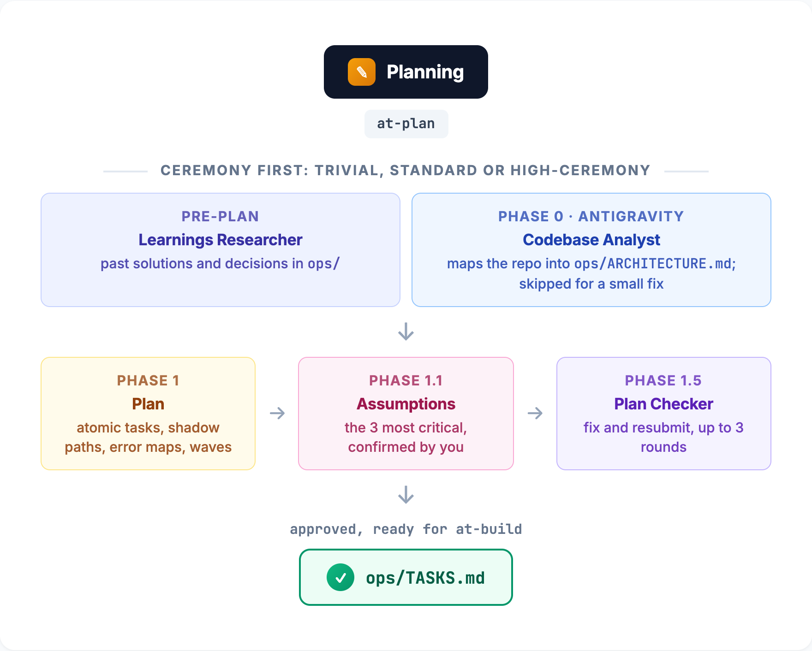
</p>

### Test Pipeline (`at-test`)

[`test-gap-analyzer`](personas/test-gap-analyzer.md) finds the untested code paths, then the roster's tester (Codex by default) writes and runs the tests in its sandbox, starting each one with a failing test. `ops/TEST_RESULTS.md` quotes the red run and the green run. Failures go through up to 3 fix cycles, and what still fails after that is escalated to you.

<p align="center">
  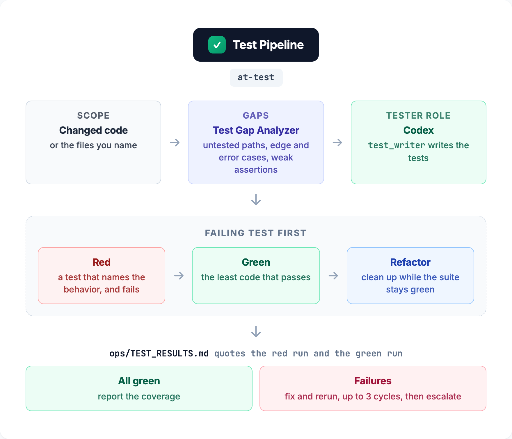
</p>

### Debugging (`at-debug`)

[`at-debug`](skills/at-debug/SKILL.md) reproduces the bug first, finds the root cause with evidence, and only then fixes it. A report it can't reproduce goes back to you with a request for details, and a bug that is already fixed is reported with the fixing commit. A circuit breaker limits the attempts. After two failed fixes the agent stops and re-checks the assumption behind them; after a third failure on the same error it stops and writes an escalation report (the error signature, what was tried, a suggested next step).

<p align="center">
  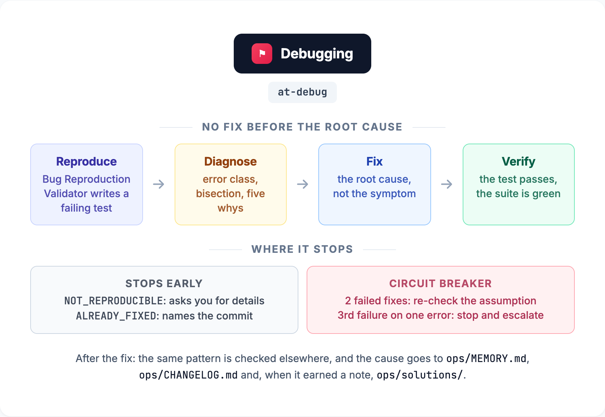
</p>

### Quality Gates

Five gates hold at every stage:

<p align="center">
  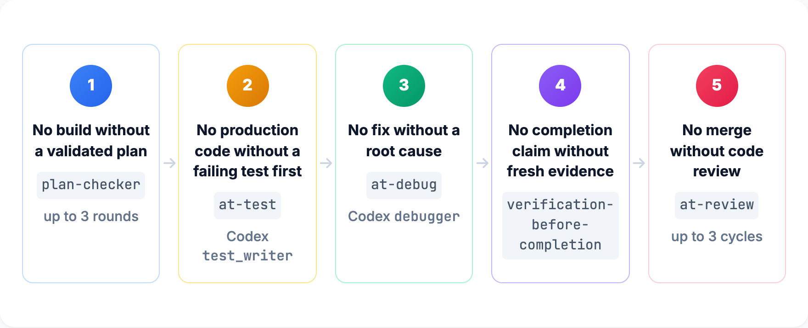
</p>

| Gate | Enforced by | Rule |
|---|---|---|
| 1, Plan validated | [`plan-checker`](personas/plan-checker.md) persona | No build without a validated plan (max 3 iterations) |
| 2, Failing test first | [`at-test`](skills/at-test/SKILL.md) workflow, Codex [`test_writer`](codex-agents/agents.toml) | No production code without a failing test |
| 3, Root cause first | [`at-debug`](skills/at-debug/SKILL.md) workflow, Codex [`debugger`](codex-agents/agents.toml) | No fix without diagnosis |
| 4, Evidence first | [`verification-before-completion`](skills/verification-before-completion/SKILL.md) skill | No "done" without proof |
| 5, Review first | [`at-review`](skills/at-review/SKILL.md) workflow, which merges findings with the [`review-synthesis`](skills/review-synthesis/SKILL.md) skill | No merge without code review (max 3 cycles) |

## Team work and swarms

Work fans out in two shapes. In team work each task goes to one builder in its own lease and worktree, and the lead merges the results one task at a time. In a swarm several read-only lanes look at the same input through different lenses, and a synthesizer merges what they report.

### The builder pool

A wave reads [`ops/roster.toml`](templates/ops/roster.toml), leases each task to a builder CLI in its own git worktree, and merges a task only after a pinned reviewer who did not build it approves. The lead then promotes the sprint integration branch to `main` through a protected-path gate.

<p align="center">
  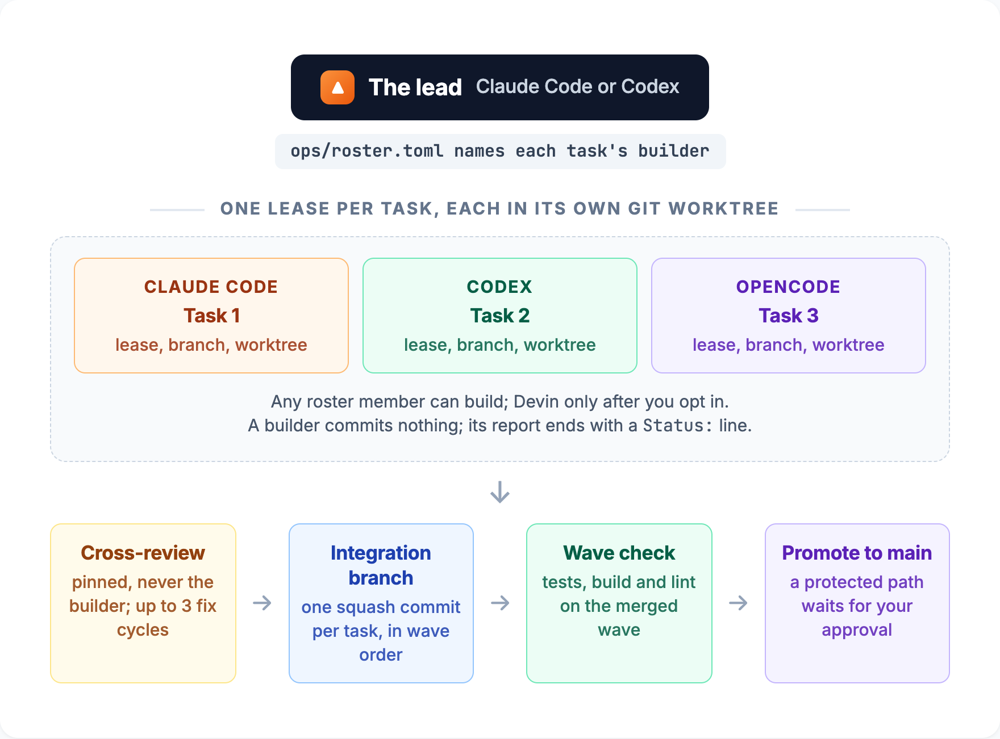
</p>

The roster decides who does what. Five roles (builder, reviewer, tester, analyst, documenter) each map to a CLI, a model and an effort, with an ordered fallback chain that must end at a core-trio member. The shipped posture has Claude building, Codex reviewing and testing, and Antigravity analyzing and documenting; the roster can override any of it. Optional members carry an `enabled` flag and are absent everywhere when it is off. The shipped pins put the newest Gemini at its highest thinking level on `agy` (`"Gemini 3.8 Flash (High)"` today, Pro or Flash, whichever is newest; D-022) and `cursor-grok-4.6-xhigh` on Cursor. [Model and effort](#model-and-effort) has every pin and how to change it, and `at-setup`'s role step walks keep current, customize or restore the shipped defaults with validated writes.

Every builder runs under a lease. The lead-owned ledger `ops/leases.toml` (runtime state) tracks each task through its lifecycle, with heartbeat-based orphan detection, a single requeue to a different builder, and escalation when a task can't converge. The pinned reviewer gets at most 3 fix cycles with the builder before the task escalates to you, and an approved task lands as one squash commit of the lead's own snapshot on the sprint integration branch.

<p align="center">
  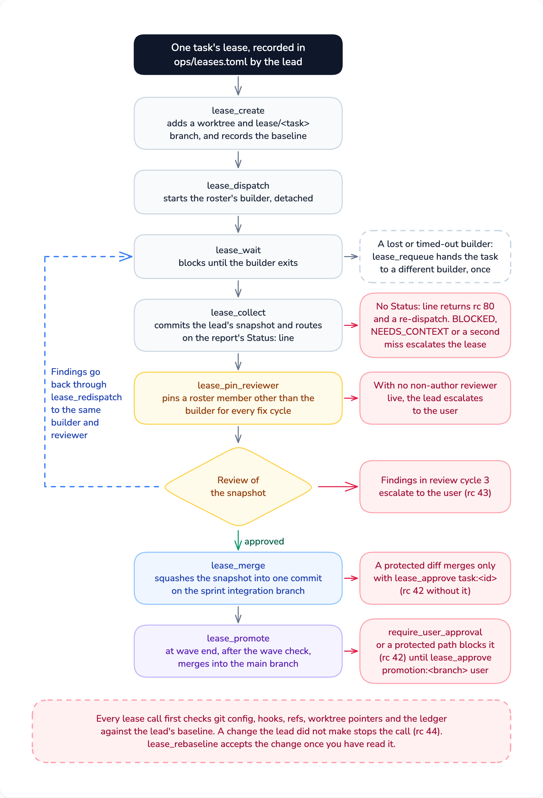
</p>

Three mechanisms keep this safe, and none of them restricts who may write code:

- Per-task worktrees with lead-side checks. A builder starts in its own worktree and is contracted to stay out of the canonical `ops/` tree. The worktree limits where it starts, not where it writes, so the lead detects changes to git state and the ledger and merges only its own collect snapshot. It detects those changes without preventing them, and it does not see a write elsewhere in the main checkout.
- A per-adapter environment allowlist. No builder receives another provider's credential environment variables; credential files under `$HOME` are shared.
- Mandatory cross-review before any merge. No agent merges its own build.

### Four coordination modes

| Mode | Mechanism | When to use |
|---|---|---|
| File-based | Shared markdown in [`ops/`](ops/) | Persistent state across sessions, audit trails |
| Direct invocation | `agy -p` / `codex exec` via bash | Real-time external agent delegation |
| Personas | `dispatch_persona` runs a [`personas/`](personas/) prompt with the tools, model and turn budget its manifest entry sets | Reviews, research, verification |
| Agent teams | Multi-Claude with shared task lists ([`team-lead`](personas/team-lead.md)) | Complex builds with 5+ interdependent tasks |

### Wave Orchestration (`at-build`)

[`at-build`](skills/at-build/SKILL.md) groups the plan's tasks by dependency into waves. Independent tasks within a wave run in parallel, each in its own lease and worktree, and tasks that modify the same files never share a wave. An [`integration-verifier`](personas/integration-verifier.md) runs the tests, build and lint between waves. Each task merges after its pinned review as one squash commit, in wave order, and after the check `lease_promote` takes the result to the main branch through the promotion gate.

<p align="center">
  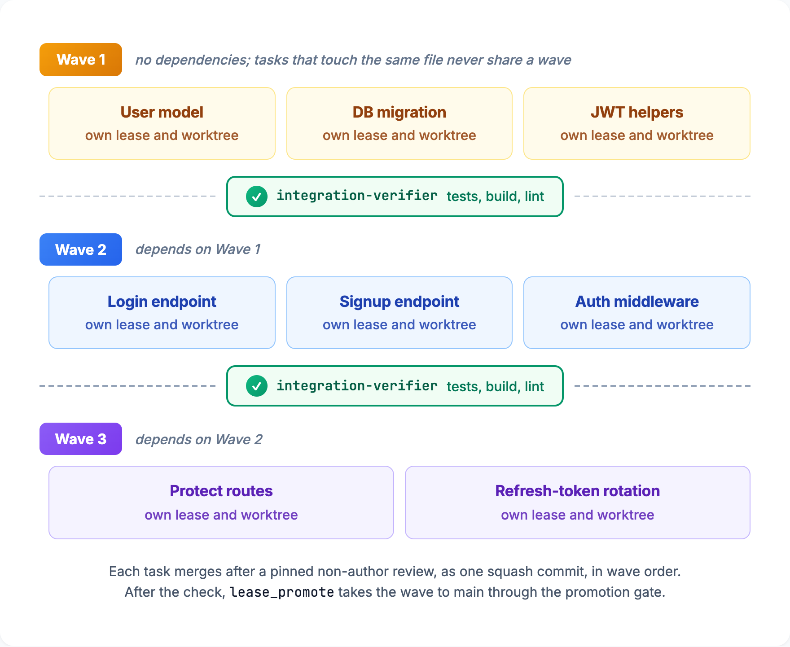
</p>

### Review Swarm (`at-review`)

[`at-review`](skills/at-review/SKILL.md) starts every lane at once. The two core lanes always run: Antigravity's `architecture-reviewer` (architecture, design) and Codex's `logic_reviewer` (logic, security, tests). Every optional member you have enrolled reviews too. The flags add specialist personas: `--security`, `--perf`, `--simple` and `--conventions` add one each, and `--full` runs all five, with [`architecture-strategist`](personas/architecture-strategist.md) as the fifth. [`learnings-researcher`](personas/learnings-researcher.md) joins when an `ops/solutions/` entry names a changed module. A [`findings-synthesizer`](personas/findings-synthesizer.md) then merges and deduplicates every `ops/REVIEW_*.md`, giving each finding a confidence tier and a priority (P1, P2, P3). The lead fixes P1 and P2, logs P3, and escalates to you after 3 cycles without convergence.

<p align="center">
  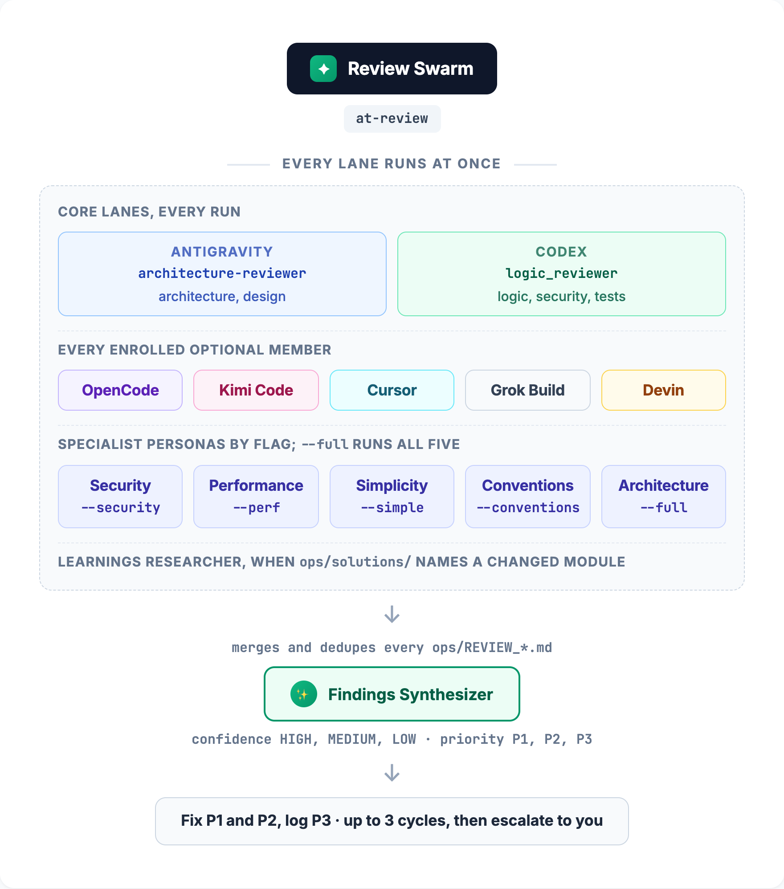
</p>

#### Confidence tiering

Every finding gets a confidence score, so nobody spends time on phantom issues:

| Tier | Criteria | Rule |
|---|---|---|
| HIGH | Verified in codebase via grep/read. Deterministic. | Can be any priority |
| MEDIUM | Pattern-aggregated detection. Some false positive risk. | Can be any priority |
| LOW | Requires intent verification. Heuristic-only. | Can never be P1 |

#### Suppressions

Each reviewer has a "Do Not Flag" list to reduce noise: readability-aiding redundancy, documented thresholds, sufficient test assertions, consistency-only style changes, and issues already addressed in the current diff. Each persona file in [`personas/`](personas/) lists its own suppressions.

### Deep Research (`at-deep-research`)

[`at-deep-research`](skills/at-deep-research/SKILL.md) runs five research lenses in parallel before planning: past solutions and decisions, current framework docs for the stack, git history, Antigravity's targeted codebase analysis, and industry practice. [`research-synthesizer`](personas/research-synthesizer.md) merges them into one research brief that lists contradictions without resolving them, and hands off to `at-plan`.

<p align="center">
  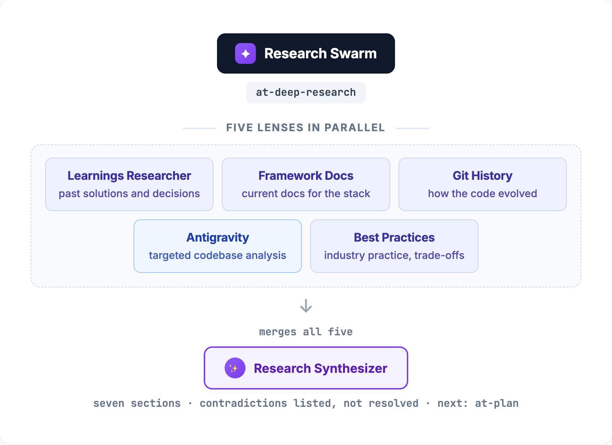
</p>

### The knowledge loop (`at-compound`)

After a non-trivial problem is solved, [`at-compound`](skills/at-compound/SKILL.md) records it in [`ops/solutions/`](ops/solutions/), or a decision in [`ops/decisions/`](ops/decisions/), when it clears the counterfactual bar: a future agent without the note would repeat the mistake or work the decision out again. Otherwise it says in one line why it wrote nothing. Before new work is planned, [`learnings-researcher`](personas/learnings-researcher.md) searches both directories.

<p align="center">
  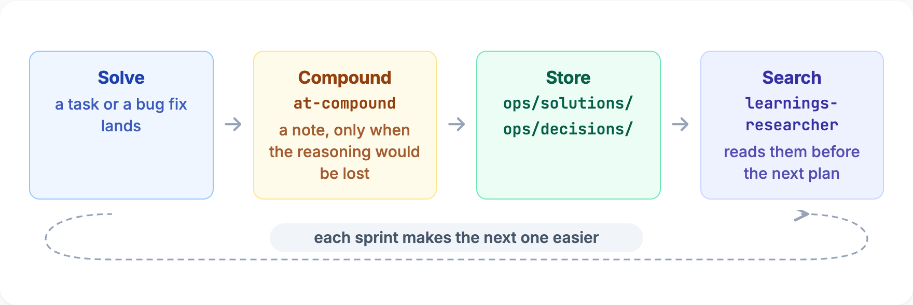
</p>

## Model and effort

Each role's CLI, model and effort come from `ops/roster.toml`. A field you leave unset inherits the shipped default (the role table in `scripts/lib/roster.sh` and the CLI registry in `scripts/lib/registry.sh`), so deleting the file is safe. `at-setup`'s role step edits it for you (`at-setup roles` jumps straight there), and a hand edit is checked when the roster loads.

<p align="center">
  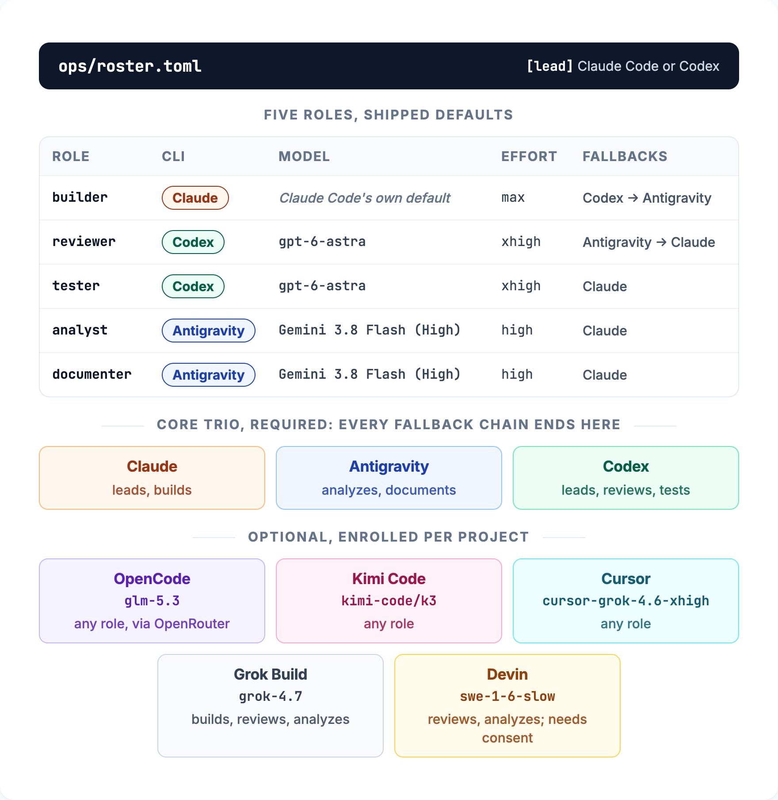
</p>

| Role | CLI | Model | Effort | Fallbacks |
|---|---|---|---|---|
| builder | Claude | Claude Code's own default (the roster's `model` is empty) | `max` | Codex → Antigravity |
| reviewer | Codex | `gpt-6-astra` | `xhigh` | Antigravity → Claude |
| tester | Codex | `gpt-6-astra` | `xhigh` | Claude |
| analyst | Antigravity | `Gemini 3.8 Flash (High)` | `high` | Claude |
| documenter | Antigravity | `Gemini 3.8 Flash (High)` | `high` | Claude |

How each CLI takes its model and effort:

- Antigravity always gets an explicit `--model`, because its own default is a (Medium) variant. The shipped pin is the newest Gemini at its highest thinking level, Pro or Flash (D-022). The suffix is agy's effort control, so a role's `effort` maps into it: `low` to (Low), `medium` to (Medium), `high`, `xhigh` and `max` to (High).
- To run the Pro line, set a role's `model` to `"Gemini 3.1 Pro (High)"` (or `(Low)`; 3.1 Pro has no Medium tier). It stays the documented one-line opt-in.
- The July 2026 plan's never-Flash rule (AE2) is superseded by D-022; if you work from that plan, read the September ADR (`ops/decisions/2026-09-11-cli-deprecation-watch.md`).
- Codex runs `gpt-6-astra` at `xhigh` (D-021). A role can pick another Codex model, such as `gpt-6.1-sol`, which answered on Codex 0.160.0 and was refused on 0.155.1.
- Cursor runs a suffixed Grok id, `cursor-grok-4.6-xhigh`, never the Auto router. Its effort is the id's suffix (`low`, `medium`, `high`, `xhigh`).
- The claude builder lane runs Claude Code's own default model at `max` effort. Claude personas and sub-agents follow the ladder below.
- The optional members' pins are OpenCode `openrouter/z-ai/glm-5.3`, Kimi `kimi-code/k3`, Devin `swe-1-6-slow` and Grok Build `grok-4.7` (its effort rides in `--effort`).
- A role that sets only `effort` keeps its default CLI and model. Roster model overrides reach each CLI through its registry `model_env`.

The lead takes its model and effort from the `[lead]` table (`cli`, `model`, `effort`). Left out, a Codex lead runs `gpt-6-astra` at `xhigh`, and a Claude Code lead runs your session's model and effort setting. `coordinate.sh` and the launch line `at-setup` prints add them as flags.

Claude personas and sub-agents step down one ladder for narrow runtime tasks: Fable 5.1 at `max` for the lead and the never-downgrade tier (the latest Opus at `max` where Fable isn't available), then Opus 5.5 at `xhigh` (Claude Code ≥ 2.1.280), Opus 5.5 at `high`, and Sonnet 5.5 at `high`. `security-sentinel`, `plan-checker` and `findings-synthesizer` are never downgraded. Each persona's starting tier is in [`personas/manifest.toml`](personas/manifest.toml). The ladder has one definition, `TRIFORGE_MODEL_LADDER` in [`scripts/lib/registry.sh`](scripts/lib/registry.sh); `triforge_ladder` prints it, and `validate-versions.sh` fails when another file restates it.

### Assignment heuristic

Roles come from `ops/roster.toml` (`resolve_role <role>`). The defaults below are the shipped posture and restrict no one: any member can be the builder, and every build merges only after cross-review.

| Question | Role (default; roster-assignable) |
|---|---|
| Produces code? | builder role: default Claude, assignable to any member; built under a lease and cross-reviewed before merge |
| Evaluates existing code? | reviewer role ([Codex](https://github.com/openai/codex) + [Antigravity](https://antigravity.google/cli)) + [review personas](#review-specialists-6) in parallel |
| Runs/executes something? | tester role (default [Codex CLI](https://github.com/openai/codex)) |
| Produces documentation? | documenter role (default [Antigravity CLI](https://antigravity.google/cli)) |
| Touches shared interfaces? | builder implements under a lease → pinned non-author reviewer cross-reviews → tester validates |
| Ambiguous? | the lead takes it as builder, flags for parallel review |

## Lead workflows reference

The 17 lead workflows are skills under [`skills/at-*/`](skills/) that only the lead runs. Type `/at-<name>` under a Claude Code lead or `$agent-triforge:at-<name>` inside a Codex prompt. They stay in the lead's plugin install and are never copied into `.agents/skills/` or a lease worktree (KTD12). Each `SKILL.md` states the workflow's goal, its done condition and the direction it fails safe; the detail is in its `references/` folder. In 3.x these were slash commands without the prefix (`/ship`, `/setup`); see [Upgrading from 3.x](#upgrading-from-3x).

| Lead workflow | Claude Code · Codex | Arguments | What it does |
|---|---|---|---|
| [`at-ship`](skills/at-ship/SKILL.md) | `/at-ship` · `$agent-triforge:at-ship` | `<goal> [--convergence fast\|standard\|deep] [--team]` | Fully autonomous sprint: analyze, plan, build, review, test, wrap; prints a copyable completion line (the `/goal` gate under Claude Code) at the start and creates `ops/.sprint-complete` last. `fast` = P1 only, `deep` = P1 + P2 + P3 below 3; `--team` for 5+ or interdependent tasks. |
| [`at-coordinate`](skills/at-coordinate/SKILL.md) | `/at-coordinate` · `$agent-triforge:at-coordinate` | `<goal>` | The plain Phase 0 to 6 sprint cycle that [`scripts/coordinate.sh`](scripts/coordinate.sh) drives across fresh sessions; same pipeline as `at-ship` without convergence or team flags. |
| [`at-plan`](skills/at-plan/SKILL.md) | `/at-plan` · `$agent-triforge:at-plan` | `[goal]` | Phases 0 → 1.5: codebase analysis, knowledge search, shadow paths, waves, the three-assumption ambiguity check, [`plan-checker`](personas/plan-checker.md) validation. Writes `ops/TASKS.md` with its `Ceremony:` line. |
| [`at-build`](skills/at-build/SKILL.md) | `/at-build` · `$agent-triforge:at-build` | `[--team] [--wave N]` | Phase 2: [wave orchestration](skills/wave-orchestration/SKILL.md) over leased builder-pool tasks, cross-review by a pinned reviewer, one squash commit per task, `integration-verifier` per wave, the `[promotion]` gate. |
| [`at-review`](skills/at-review/SKILL.md) | `/at-review` · `$agent-triforge:at-review` | `[--full] [--security] [--perf] [--simple] [--conventions]` | Phases 3 and 4: parallel roster lanes plus the selected specialists, [synthesis](personas/findings-synthesizer.md), P1/P2 fixes, `## Review dispositions — Cycle N` in `ops/TASKS.md`; escalates after 3 cycles. |
| [`at-test`](skills/at-test/SKILL.md) | `/at-test` · `$agent-triforge:at-test` | `[--gaps-only] [scope]` | Phase 5: [gap analysis](personas/test-gap-analyzer.md), tests from the roster tester with the failing run first, results in `ops/TEST_RESULTS.md`, up to 3 fix cycles, then escalation to you. `--gaps-only` stops after the report. |
| [`at-wrap`](skills/at-wrap/SKILL.md) | `/at-wrap` · `$agent-triforge:at-wrap` | (none) | Phase 6: [compound knowledge](skills/knowledge-compounding/SKILL.md), update the `ops/` files, archive review files to `ops/archive/<today>/`, write [`STATE.md`](ops/STATE.md), print the sprint summary with its rulings, create the completion marker last. |
| [`at-quick`](skills/at-quick/SKILL.md) | `/at-quick` · `$agent-triforge:at-quick` | `[change description]` | A change touching fewer than 3 files with no shared interface or protected path: TDD, self-review, no swarm; hands off to `at-review --security` / `--perf` when a lens needs it. |
| [`at-debug`](skills/at-debug/SKILL.md) | `/at-debug` · `$agent-triforge:at-debug` | `[bug description or error message]` | Reproduce, root-cause with evidence, fix, find sibling instances, record in `ops/MEMORY.md` and `ops/CHANGELOG.md`; after two failed fixes it re-checks the assumption, and a third failure on the same error ends in an escalation report. |
| [`at-setup`](skills/at-setup/SKILL.md) | `/at-setup` · `$agent-triforge:at-setup` | `[lead\|opencode\|kimi\|cursor\|devin\|grok\|roles]` | Guided project setup: lead chosen, core trio live, Codex trust detected, roles kept, customized or restored, each optional CLI enrolled or declined, instruction files checked and changed only on a yes, egress listed; closes with the status table and a verdict. Idempotent. |
| [`at-deep-research`](skills/at-deep-research/SKILL.md) | `/at-deep-research` · `$agent-triforge:at-deep-research` | `[topic or goal]` | Five parallel research lenses plus [`research-synthesizer`](personas/research-synthesizer.md), every endpoint a recorded primary source; writes `ops/RESEARCH_ANTIGRAVITY.md` and hands off to `at-plan`. |
| [`at-analyze`](skills/at-analyze/SKILL.md) | `/at-analyze` · `$agent-triforge:at-analyze` | `[github-url or local-path]` | Read-only judgment of an external repo or resource: extractable patterns, prompt-engineering insights, verdict matrix, ranked recommendations. Nothing written. |
| [`at-status`](skills/at-status/SKILL.md) | `/at-status` · `$agent-triforge:at-status` | (none) | One report from `ops/`, git and the review files: phase, task counts, blockers, recent activity, pending reviews, uncommitted changes, available workflows. Writes nothing. |
| [`at-pause`](skills/at-pause/SKILL.md) | `/at-pause` · `$agent-triforge:at-pause` | (none) | Write the [`STATE.md`](ops/STATE.md) checkpoint a later session resumes from, and nothing else. |
| [`at-resume`](skills/at-resume/SKILL.md) | `/at-resume` · `$agent-triforge:at-resume` | (none) | Restore [`STATE.md`](ops/STATE.md), re-prove the baseline when HEAD moved, summarize, continue the recorded phase. |
| [`at-compound`](skills/at-compound/SKILL.md) | `/at-compound` · `$agent-triforge:at-compound` | `[solution \| decision] <description>` | Record a solved problem in [`ops/solutions/`](ops/solutions/) or a decision in [`ops/decisions/`](ops/decisions/) when it clears the counterfactual bar; otherwise one line saying why nothing was written. |
| [`at-resolve-pr`](skills/at-resolve-pr/SKILL.md) | `/at-resolve-pr` · `$agent-triforge:at-resolve-pr` | `<PR number or URL>` | Work through GitHub PR review comments via [`pr-comment-resolver`](personas/pr-comment-resolver.md): implement, answer or defer each, run the tests, update `ops/CHANGELOG.md`. |

## Skills reference

The plugin ships 27 skills in one `skills/` tree: the 10 portable skills below, which any agent can use (`wave-orchestration` also needs the plugin's lease helpers), and the 17 lead workflows [listed above](#lead-workflows-reference), which only the lead runs. The portable skills are embedded in the native Antigravity and Codex agent definitions (`antigravity-agents/agents/`, `codex-agents/`) at install time. When a CLI doesn't surface native agent definitions, the helper injects the agent body as a prompt prefix instead.

| Skill | Primary consumer | What it teaches the agent |
|---|---|---|
| [`codebase-mapping`](skills/codebase-mapping/SKILL.md) | [Antigravity](https://antigravity.google/cli) (Phase 0) | Full-repo analysis: structure, data flow, patterns, debt |
| [`writing-plans`](skills/writing-plans/SKILL.md) | Lead (Phase 1) | Task decomposition with shadow paths, error maps, interface context |
| [`shadow-path-tracing`](skills/shadow-path-tracing/SKILL.md) | Lead (Phase 1) | Enumerate every failure path alongside the happy path |
| [`wave-orchestration`](skills/wave-orchestration/SKILL.md) | Lead (Phase 2) | Dependency-grouped parallel execution with integration checks |
| [`iterative-refinement`](skills/iterative-refinement/SKILL.md) | Lead (Phase 4) | Review-fix-review loops with convergence modes |
| [`review-synthesis`](skills/review-synthesis/SKILL.md) | Lead (Phase 4) | Merge multi-reviewer findings with confidence tiering |
| [`verification-before-completion`](skills/verification-before-completion/SKILL.md) | All agents | Evidence-based completion checklist |
| [`knowledge-compounding`](skills/knowledge-compounding/SKILL.md) | Lead (Phase 6) | Document solutions to [`ops/solutions/`](ops/solutions/) for future sprints |
| [`session-continuity`](skills/session-continuity/SKILL.md) | Lead | Save and resume via [`STATE.md`](ops/STATE.md) across sessions |
| [`scope-cutting`](skills/scope-cutting/SKILL.md) | Lead | Systematically cut scope by unblocking value and risk |

### Portable skills across the eight CLIs

The project bootstrap (`triforge_bootstrap`, run at session start and by `at-setup`, `at-build` and `at-review`) copies the 10 portable skills from the plugin's `skills/` into `.agents/skills/`, the agentskills.io path, and refreshes the copy whenever the plugin version changes. The stamp `.agents/skills/.triforge-plugin-version` records a content digest for each directory Triforge wrote, and only Triforge's own unchanged copies are replaced or retired. An edited copy, or your own directory under a shipped name, is kept with a notice; customizations are safest in a directory with a different name. Fixture evidence from the 2026-09-11 watch cycle ([`ops/research/2026-09-11-cli-updates.md`](ops/research/2026-09-11-cli-updates.md) §3.1) shows which path each CLI reads:

| Path | Claude Code | agy | Codex | OpenCode | Cursor | Kimi (docs) |
|---|---|---|---|---|---|---|
| `.agents/skills/` (Triforge's copy) | ✗ | ✓ (workspace bound via `--add-dir` or trust) | ✓ | ✓ | ✓ | ✓ |
| `.claude/skills/` | ✓ | ✗ | ✗ | ✓ | ✓ | ✗ |
| `.codex/skills/` | ✗ | ✗ | ✓ | ✗ | ✓ | ✗ |
| `.opencode/skill(s)/` | ✗ | ✗ | ✗ | ✓ | ✗ | ✗ |
| `.cursor/skills/` | ✗ | ✗ | ✗ | ✗ | ✓ | ✗ |
| `.kimi-code/skills/` | ✗ | ✗ | ✗ | ✗ | ✗ | ✓ |

Claude Code is the one CLI that does not read `.agents/skills/`; it reads the plugin's skills directly. Grok Build reads `.agents/skills/` too, and a Grok Build worker gets this copy in its lease worktree (SELF-06g). Devin (`devin skills paths`), which Triforge can also enroll as a worker, and Pi (per its skills docs) read `.agents/skills/` as well, so inside a Triforge project they see this copy; a Devin worker gets it in its lease worktree like the others (SELF-06h). Elsewhere they install the skills [from their own manifests](#portable-skills-in-devin-and-pi).

Each harness invokes a skill in its own form: Claude `/name` · agy `agy --add-dir "$PWD" -p "/name"` (headless expansion; `agy -p "/skills"` lists them without a model call) · Codex `$name` · OpenCode `/name` through its native `skill` tool (commands via `opencode run --command <name>` from `.opencode/command/`) · Cursor `/name` in `-p` · Kimi `/skill:name` (live verification pending `kimi login`).

The 17 lead workflows (`skills/at-*/`) are not in this copy. A lead gets them only from its plugin install (KTD12) and runs them as `/at-<name>` under Claude Code or `$agent-triforge:at-<name>` in a Codex prompt. They are skills rather than slash commands because slash commands are per-harness: Codex custom prompts are deprecated and not expanded under `codex exec`. Agent definitions are never deployed into `.agents/agents/`, because agy and Kimi both scan it with incompatible tool vocabularies; agy stays on `agy plugin install`, and Kimi loads its definitions through `--agent-file`.

## Personas reference

19 personas in [`personas/`](personas/). A persona is a prompt with no frontmatter. Its entry in [`personas/manifest.toml`](personas/manifest.toml) sets a tool class (`read`, `read-web` or `exec`), a starting model tier and a turn budget, and `dispatch_persona` enforces all three. Each persona runs in its own context. The never-downgrade trio (`plan-checker`, `security-sentinel`, `findings-synthesizer`) always runs as top-tier Claude, whichever CLI leads.

### Core workflow (7)

| Persona | Phase | What it does |
|---|---|---|
| [`plan-checker`](personas/plan-checker.md) | 1.5 | Validates task plans for completeness, assignments, dependencies |
| [`findings-synthesizer`](personas/findings-synthesizer.md) | 4 | Merges review outputs with deduplication and confidence tiering |
| [`integration-verifier`](personas/integration-verifier.md) | 2 | Runs build, tests, lint between waves |
| [`learnings-researcher`](personas/learnings-researcher.md) | Pre-1 | Searches [`ops/solutions/`](ops/solutions/) and [`ops/decisions/`](ops/decisions/) for relevant patterns |
| [`team-lead`](personas/team-lead.md) | 2 | Orchestrates agent team workers with file ownership and quality gates |
| [`research-synthesizer`](personas/research-synthesizer.md) | 0 | Merges parallel research outputs into unified analysis |
| [`continuous-reviewer`](personas/continuous-reviewer.md) | 2 | Per-task quality gate during team builds; reviews every completed task |

### Review specialists (6)

| Persona | Lens | What it catches |
|---|---|---|
| [`security-sentinel`](personas/security-sentinel.md) | Security | SQL injection, XSS, auth bypass, data exposure, OWASP |
| [`performance-oracle`](personas/performance-oracle.md) | Performance | O(n²) loops, N+1 queries, memory leaks, scalability |
| [`code-simplicity-reviewer`](personas/code-simplicity-reviewer.md) | Complexity | Over-engineering, YAGNI violations, unnecessary abstraction |
| [`convention-enforcer`](personas/convention-enforcer.md) | Conventions | Naming, file organization, code style consistency |
| [`architecture-strategist`](personas/architecture-strategist.md) | Structure | SOLID principles, coupling/cohesion, module boundaries |
| [`test-gap-analyzer`](personas/test-gap-analyzer.md) | Coverage | Untested code paths, missing edge cases, weak assertions |

### Research and verification (6)

| Persona | What it does |
|---|---|
| [`best-practices-researcher`](personas/best-practices-researcher.md) | Industry-wide patterns, anti-patterns, tradeoff analysis |
| [`framework-docs-researcher`](personas/framework-docs-researcher.md) | Current documentation for specific frameworks and libraries |
| [`git-history-analyzer`](personas/git-history-analyzer.md) | Code evolution and architectural decisions via git history |
| [`bug-reproduction-validator`](personas/bug-reproduction-validator.md) | Validates bugs are reproducible before fixes begin |
| [`deployment-verifier`](personas/deployment-verifier.md) | Post-deployment health checks, smoke tests, error monitoring |
| [`pr-comment-resolver`](personas/pr-comment-resolver.md) | Reads GitHub PR review comments and implements changes, as a lease builder |

## Customization

| To change | Do this |
|---|---|
| A role's CLI, model or effort | Run `at-setup roles` to keep, customize or restore the shipped defaults with validated writes, or edit `[roles.<role>]` in `ops/roster.toml`. [Model and effort](#model-and-effort) lists the pins and the opt-ins. |
| Which optional CLIs take part | Run `at-setup` (or `at-setup opencode`, `kimi`, `cursor`, `devin`, `grok`) to enroll or decline each. `enabled = false` under `[members.<cli>]` removes a member from every role and fallback chain, and setting it back to `true` restores it. The core trio can't be disabled. |
| Devin's role | Devin joins only with your consent on record, and reviews and analyzes by default. It builds only after a separate opt-in: `opt_in = ["builder"]` in `[members.devin]`. |
| Which CLI leads | Run `at-setup lead`. The switch refuses while leases are open; `--force` hands them to the new lead without spending a requeue. |
| Whether promotion waits for you | Set `require_user_approval = true` under `[promotion]` in `ops/roster.toml`, and the lead pauses at the end of each wave for your approval before promoting to `main`. A diff that touches a protected path needs that approval regardless. |
| A portable skill | Copy it to a directory with a different name under `.agents/skills/`. Triforge refreshes only its own unchanged copies, so an edited copy under a shipped name is kept with a notice but no longer updated. You can delete any skill directory you don't want. |
| Your project's instructions | Edit the project's root `AGENTS.md`. Keep Triforge's marked pointer block from [`templates/AGENTS.md`](templates/AGENTS.md) in it. |
| Agent-team builds | Set `CLAUDE_CODE_EXPERIMENTAL_AGENT_TEAMS: "1"` in Claude Code's `settings.json` ([What are Agent Teams?](#faq)). |

## How it works under the hood

### Portable skill injection

Skills are model-agnostic markdown files that any agent can consume, so the methodology an agent follows is decoupled from the model that executes it:

```bash
# All external-agent invocations go through the unified helper
source ${CLAUDE_PLUGIN_ROOT}/scripts/invoke-external.sh

# Antigravity via native agent definition (skill embedded in the agent body)
invoke_antigravity "codebase-analyst" \
  "Analyze the full codebase. Write findings to ops/ARCHITECTURE.md." \
  "$AGY_OUT" 600

# Codex via native agent definition (skill embedded in the agent body)
invoke_codex "test_writer" \
  "Write tests for changed files." \
  "$CODEX_OUT" 900
```

`TRIFORGE_AGY_MODE` (`injection` | `native` | `auto`; default `auto` since 4.0) governs how the helper routes Antigravity. The agent pack (`antigravity-agents/`) ships in agy's Markdown-agent format (`mainAgent`/`subagent`/`commandExecutionPolicy`, agy tool names), and session start reinstalls it whenever the plugin version changes. `native` passes `--agent <name>` when `agy agents` lists it, `auto` goes native only when it is listed, and `injection` prepends the agent body (with its embedded skill) to the prompt. The default became `auto` after the native round-trip (AGY-12) and the native-mode negative (AGY-16) passed in two consecutive probe records (D-042); a regression in either row reverts it. Codex definitions deploy as `.codex/triforge-agents.toml`, never under `.codex/agents/`, which Codex ≥ 0.147 sweeps as standalone role files.

### Context Recovery

Seven safeguards keep long sprints from dying to context limits:

<p align="center">
  
</p>

| Layer | Mechanism | Guards against |
|---|---|---|
| Completion gating | The `ops/.sprint-complete` sentinel, created only after verification passes, is the authoritative signal. Under a Claude Code lead the native `/goal` checklist adds a best-effort gate: [`coordinate.sh`](scripts/coordinate.sh) leads every session prompt with it and `at-ship` / `at-coordinate` print a copyable `/goal` line, but headless gating is flaky (probe CC-03 1 of 3, D-030). A Codex lead has no `/goal`, so its sessions complete on the sentinel alone | The lead declaring victory early |
| Outer loop | [`scripts/coordinate.sh`](scripts/coordinate.sh) starts a fresh lead session per iteration with the lead's registry launch line and the `[lead]` model and effort, runs the git integrity check before each session, stops after one session on a login or quota failure, detects completion through the sentinel, and notifies you. A Codex lead's launch line needs `--allow-full-access` (otherwise it prints the line and exits 77), and under nohup, cron or CI the script exits 45. [Unattended runs](#unattended-runs) walks through it | Context window filling up |
| PreCompact | [`pre-compact.sh`](hooks/handlers/pre-compact.sh) checkpoints `STATE.md` before context compaction | State loss during mid-sprint compaction |
| Analysis paralysis | [`context-monitor.sh`](hooks/handlers/context-monitor.sh) warns at 8+ consecutive reads without writes. The lead's tool vocabulary in the registry decides what counts as a read; under a Codex lead, a shell command that only reads (`cat`, `sed -n`, `git log`) counts | Reading without producing |
| Tool failure monitor | [`tool-failure-monitor.sh`](hooks/handlers/tool-failure-monitor.sh) warns at 5 consecutive or 10 total tool failures in a session | Silent failure accumulation |
| Subprocess timeouts | Every Antigravity and Codex call runs under `timeout -k 10s`: SIGTERM at its limit, SIGKILL 10 s later | Hung external agents blocking the pipeline |
| Risk scoring | Per-builder risk accumulation; a builder is halted at risk above 20 % or more than 50 changed files | Runaway builders |

### Key constraints

- `CONTRACTS.md` is never modified directly during review; changes are proposed in [`MEMORY.md`](ops/MEMORY.md) first.
- Any roster member is an eligible builder, and the single-writer rule is retired. Safety comes from per-task leases, worktree isolation and mandatory cross-review by a pinned non-author reviewer. No agent self-merges, and the lead promotes to the main branch only after the wave's integration check.
- Parallel reviews are safe because reviewers write to separate `ops/REVIEW_*.md` files.
- A task gets at most 3 review cycles before it escalates to you.
- Phase 0 can be skipped for small bug fixes, same-session continuations, or unchanged codebases (use [`at-quick`](skills/at-quick/SKILL.md)).
- Completion requires creating the `ops/.sprint-complete` runtime marker only after the [verification checklist](skills/verification-before-completion/SKILL.md) passes.

### Data egress and credentials

Each dispatched CLI sends its task prompt and the code context it is handed to that CLI's model provider. Under the shipped defaults, your code and task context reach Anthropic (Claude), Google (Antigravity, Gemini 3.8 Flash) and OpenAI (Codex) for the core trio. Each optional member you enroll adds its provider: Zhipu / Z.ai for GLM, routed through the OpenRouter intermediary, which also sees the traffic; Moonshot for Kimi; xAI for Grok Build, and for Grok through Cursor; and Cognition for Devin (a model outside Cognition's SWE family also reaches that model's provider). Cognition may train on that data unless the account opts out, so `at-setup` records your consent before Devin joins the roster.

`ops/roster.toml` is the control surface: disable a member (`enabled = false`) or drop a provider's model from every role to take that provider out of the egress set. The core trio always stays.

Credentials never live in the repo. Each adapter reads its own from the OS or vendor store: CLI logins, `OPENROUTER_API_KEY`, `CURSOR_API_KEY`, `kimi login` (OAuth or API key), the `devin auth login` token in `~/.local/share/devin/`, `grok login` or `XAI_API_KEY`. The lease environment allowlist scopes them per adapter, and captured output is scrubbed before it lands in `ops/`. Rotation follows each vendor's own token flow: revoke, log in again or set a new key, then rerun `at-setup`.

## Compatibility

Floors and tested versions come from the newest capability probe record, [`ops/research/2026-09-probe-record.md`](ops/research/2026-09-probe-record.md), generated 2026-09-27. "The current record" always means the newest `ops/research/*-probe-record.md`. No full probe run has been recorded since. The rows added after that record ran live during development with `probe-capabilities.sh --only`: DVN-01 to DVN-07, CC-21 to CC-25, CDX-20 to CDX-23, GRK-02 to GRK-12 and SELF-06g. Where the table says "dev-time rows", it gives the version those rows ran on. A full run would currently record Grok Build as QUOTA-FAIL (the xAI quota ran out) and Kimi as AUTH-FAIL. The core trio is required, and the optional tier is enrolled through `at-setup`. This baseline supersedes the July 2026 one (D-034).

| CLI | Tier | Floor (KTD-13) | Tested | READY probe |
|---|---|---|---|---|
| Claude Code (`claude`) | core | ≥ 2.1.277 (a claude worker: ≥ 2.1.285; a persona: a build with `--safe-mode`) | 2.1.283; dev-time rows on 2.1.289 and 2.1.291 | `claude --version` |
| Antigravity (`agy`) | core | ≥ 1.1.27 | 1.2.12 | `agy --model "Gemini 3.8 Flash (High)" -p "Respond with only: READY"` |
| Codex (`codex`) | core | ≥ 0.153.0 | 0.155.1; dev-time rows on 0.160.0 | `codex exec "Respond with only: READY"` |
| OpenCode (`opencode`) | optional | ≥ 1.18.20 | 1.18.30 | `opencode run --format json -m openrouter/z-ai/glm-5.3 "…"` |
| Kimi Code (`kimi`) | optional | ≥ 0.33.0 | 0.42.0 (AUTH-FAIL on the probe host; live rows PENDING-AUTH until `kimi login`) | `kimi -p "…"` |
| Cursor (`cursor-agent`; `agent` fallback) | optional | date-versioned | 2026.09.10 | `cursor-agent -p --trust --model cursor-grok-4.6-xhigh "…"` |
| Devin CLI (`devin`) | optional | ≥ 3000.10.31 | 3000.11.3 (dev-time rows) | `devin --model swe-1-6-slow --respect-workspace-trust false -p "…"` |
| Grok Build (`grok`) | optional | ≥ 1.0.34 | 1.0.34 (dev-time rows) | `grok --model grok-4.7 -p "…"` |

Why these floors:

- Claude Code 2.1.277 is the first build that reads a root `AGENTS.md`, Triforge's only instruction file (D-037). It includes the 2.1.267 fix that honors `effort:` frontmatter on pinned-default models.
- A claude worker needs 2.1.285, the first build that ignores the repository settings that loosen its sandbox. It refuses to start on an older one unless `TRIFORGE_CLAUDE_SANDBOX=off` is set.
- Every persona runs with Claude Code's `--safe-mode`, so `dispatch_persona` refuses a `claude` without the flag (rc 69) and prints the fix, `claude update`. The persona lane was tested on 2.1.289 and 2.1.291, and an exec persona, which runs Bash, also needs the 2.1.285 sandbox floor.
- agy 1.1.27 adds `denied_actions` to the JSON envelope that `invoke_antigravity` reads as its completion signal.
- Codex 0.153.0 is `gpt-6-astra`'s minimal client. `gpt-6.1-sol`, which a role can pick, answered on Codex 0.160.0 and was refused on 0.155.1.
- OpenCode 1.18.20 answers subagent permission asks under `run`.
- Kimi 0.33.0 is the agent-core-v2 engine with `--agent-file`.
- Devin 3000.10.31 is the first build where a deny rule wins over an allow rule, which its per-run config relies on. Its versions jumped from 2026.x to 3000.x in July 2026.
- Grok Build 1.0.34 is the build the GRK probe rows passed on: `dontAsk` with deny rules, the workspace sandbox, streaming JSON, and the switches that stop it reading Claude Code's config.

The Gemini CLI floor was removed with the Antigravity migration, after Google's hosted service stopped serving consumer tiers on 2026-06-18; legacy Gemini users pin plugin `v2.4.3`. An absent or declined optional CLI is skipped silently, because every fallback chain ends at a core-trio member, which can't be disabled.

## When NOT to use this framework

| Situation | What to do instead |
|---|---|
| Trivial task (< 30 minutes) | Use Claude Code directly, or [`at-quick`](skills/at-quick/SKILL.md) |
| Pure exploration / brainstorming | Single agent conversation |
| Tight deadline, no tests needed | Claude Code solo, skip review + test |
| Non-code deliverables | [Antigravity CLI](https://antigravity.google/cli) solo with its large context |

<a name="recent-changes"></a>
## Release history

Each version's full notes are one file in [`docs/releases/`](docs/releases/), and the release workflow publishes that file as the GitHub release.

<details>
<summary>All releases</summary>

| Version | Date | Summary |
|---|---|---|
| [v4.1.1](docs/releases/v4.1.1.md) | 2026-10-13 | The README in agent-blueprint's order, light diagrams, release notes per version |
| [v4.1.0](docs/releases/v4.1.0.md) | 2026-10-13 | The 4.0 review's residuals fixed: a small reader, bounded reads, process-group time bounds, watched promotion targets, CLAUDE_CONFIG_DIR |
| [v4.0.0](docs/releases/v4.0.0.md) | 2026-10-12 | Lead choice (Claude Code or Codex), at- lead workflows, personas, AGENTS.md, Grok Build and Devin |
| [v3.3.3](docs/releases/v3.3.3.md) | 2026-10-01 | Protected-path registry, digest-stamped skills, lead git integrity |
| [v3.3.2](docs/releases/v3.3.2.md) | 2026-09-28 | Release gate green, OpenCode V2 guard, Cursor Grok 4.7 ids |
| [v3.3.1](docs/releases/v3.3.1.md) | 2026-09-12 | Mechanical no-push backstop, quota failure class, split control-plane files |
| [v3.3.0](docs/releases/v3.3.0.md) | 2026-09-11 | September 2026 models, trustworthy completion signals, native agent formats |
| [v3.2.0](docs/releases/v3.2.0.md) | 2026-09-11 | Watch commands become repo-local maintainer tooling |
| [v3.1.0](docs/releases/v3.1.0.md) | 2026-07-22 | Role customization in guided onboarding |
| [v3.0.1](docs/releases/v3.0.1.md) | 2026-07-21 | Landing-page copy + release hygiene |
| [v3.0.0](docs/releases/v3.0.0.md) | 2026-07-18 | CLI modernization + six-CLI builder pool |
| [v2.4.3](docs/releases/v2.4.3.md) | 2026-05-12 | Sequential downgrade ladder for narrow runtime tasks |
| [v2.4.2](docs/releases/v2.4.2.md) | 2026-05-12 | Third audit pass — both prior passes missed siblings of the same anti-pattern |
| [v2.4.1](docs/releases/v2.4.1.md) | 2026-05-12 | Second audit pass — surviving blocker + 27 findings actioned |
| [v2.4.0](docs/releases/v2.4.0.md) | 2026-04-20 | Framework self-audit — two blockers + four HIGH fixes |
| [v2.3.0](docs/releases/v2.3.0.md) | 2026-04-20 | Subagent hardening pass (Gemini + Codex docs alignment) |
| [v2.2.0](docs/releases/v2.2.0.md) | 2026-04-06 | Opus max effort, reliability patterns, and framework audit |
| [unversioned](docs/releases/2026-04-02-reliability-hardening-and-tactical-enhancements.md) | 2026-04-02 | Reliability hardening and tactical enhancements |
| [v2.0.0](docs/releases/v2.0.0.md) | 2026-03-31 | Claude Code plugin conversion |
| [unversioned](docs/releases/2026-03-31-four-pass-audit-and-blueprint-alignment.md) | 2026-03-31 | Four-pass audit and Blueprint alignment |

</details>

## FAQ

<details>
<summary><strong>Can I use this with an existing project?</strong></summary>

Yes. Install the plugin as described under <a href="#installation">Installation</a> and start a session in the project. The framework is additive: it adds <code>ops/</code> and doesn't modify your existing code.
</details>

<details>
<summary><strong>Do I need all the CLIs?</strong></summary>

The core trio (Claude, Antigravity, Codex) is the supported baseline; run <a href="skills/at-setup/SKILL.md"><code>at-setup</code></a> to get them live. From the optional tier (OpenCode, Kimi, Cursor, Devin, Grok Build) you enroll any subset through <code>at-setup</code>, and an absent one is skipped cleanly in every roster fallback chain. Claude alone can still run the pipeline in a degraded mode, without the multi-model review, test and analysis lanes.
</details>

<details>
<summary><strong>Do I need all the skills?</strong></summary>

No. Skills activate contextually. If you never cut scope, the <a href="skills/scope-cutting/SKILL.md">scope-cutting</a> skill won't activate. You can delete any skill directory you don't want.
</details>

<details>
<summary><strong>How do personas differ from skills?</strong></summary>

Skills are methodology documents that guide an agent's behavior. Personas are separate processes that <code>dispatch_persona</code> starts, each with its own context and only the tools its manifest entry allows. Skills can be injected into any agent (including external ones like Antigravity and Codex).
</details>

<details>
<summary><strong>What are Agent Teams?</strong></summary>

<a href="personas/team-lead.md">Agent Teams</a> spawn multiple Claude Code instances that collaborate through a shared task list and messaging. Review swarms only analyze; Agent Teams are peers that divide file ownership and coordinate builds. Enable them with <code>CLAUDE_CODE_EXPERIMENTAL_AGENT_TEAMS: "1"</code> in settings.json.
</details>

<details>
<summary><strong>Do small bug fixes need the full pipeline?</strong></summary>

No. Use <a href="skills/at-quick/SKILL.md"><code>at-quick</code></a> for changes touching fewer than 3 files. It skips Phase 0, plan validation, and the full review swarm.
</details>

<details>
<summary><strong>Can a sprint run with nobody watching?</strong></summary>

Yes. <code>at-ship</code> runs every phase in one session, and <code>scripts/coordinate.sh</code> runs the sprint from a terminal across fresh sessions until <code>ops/.sprint-complete</code> exists or the session limit is reached. A Codex lead needs your <code>--allow-full-access</code> on the command line. See <a href="#unattended-runs">Unattended runs</a>.
</details>

<details>
<summary><strong>How does context exhaustion recovery work?</strong></summary>

Two layers. Inside a session, the <code>ops/.sprint-complete</code> sentinel is the authoritative completion signal, created only after the verification checklist passes. Under a Claude Code lead, the native <code>/goal</code> checklist is a best-effort assist on top: <a href="scripts/coordinate.sh"><code>coordinate.sh</code></a> leads every composed prompt with a <code>/goal</code> line, and <code>at-ship</code>/<code>at-coordinate</code> print a copyable one for interactive runs, but headless gating depends on model behavior (probe CC-03 passed 1 of 3 runs in the 2026-09 cycle, D-030), so nothing relies on it. Outside a session, <a href="scripts/coordinate.sh"><code>coordinate.sh</code></a> spawns fresh lead processes with clean context windows and detects completion through the sentinel; state persists via git and <code>ops/STATE.md</code>. A PreCompact hook checkpoints STATE.md before context compaction.
</details>

<details>
<summary><strong>What is knowledge compounding?</strong></summary>

After solving a non-trivial problem, <a href="skills/at-compound/SKILL.md"><code>at-compound</code></a> saves it as a structured document in <a href="ops/solutions/"><code>ops/solutions/</code></a>. Later <a href="skills/at-plan/SKILL.md"><code>at-plan</code></a> and <a href="skills/at-deep-research/SKILL.md"><code>at-deep-research</code></a> runs search this directory before they start new work.
</details>

<details>
<summary><strong>How do I update Triforge?</strong></summary>

Refresh the marketplace, then update the plugin: <code>claude plugin marketplace update agent-triforge</code> and <code>claude plugin update agent-triforge</code> under Claude Code, or <code>codex plugin marketplace upgrade agent-triforge</code> and <code>codex plugin add agent-triforge@agent-triforge</code> under Codex. See <a href="#update">Update</a>.
</details>

<details>
<summary><strong>How do I move a project from 3.x?</strong></summary>

Follow <a href="#upgrading-from-3x">Upgrading from 3.x</a>: the slash commands became <code>at-</code> workflows (<a href="#command-map">command map</a>), the project's instruction file is now its root <code>AGENTS.md</code>, and the agents became personas. <a href="#rolling-back-to-333">Rolling back to 3.3.3</a> covers the way back.
</details>

## Contributing

Pull requests to `main` and the `release/` branches run the gates in [`.github/workflows/gates.yml`](.github/workflows/gates.yml) on macOS: the shell syntax check, both validators and their self-tests, and the SELF probe rows. [`AGENTS.md`](AGENTS.md) lists every check to run before you open one, and the [PR template](.github/PULL_REQUEST_TEMPLATE.md) asks for an evidence table and the validator results.

### Development (for contributors)

```bash
git clone https://github.com/Ninety2UA/agent-triforge.git
claude --plugin-dir ./agent-triforge
```

CI cuts the releases. When a version bump lands on `main`, [`release.yml`](.github/workflows/release.yml) tags `v<version>` and publishes the GitHub release, using `docs/releases/v<version>.md` as the notes; `bash scripts/release-notes.sh --body` previews them. The short checklist is under "Release" in [`AGENTS.md`](AGENTS.md), the full one under "Release checklist" in [`docs/agent-triforge.md`](docs/agent-triforge.md).

## License

MIT

---

<p align="center">
  <sub>Built for teams that believe AI-assisted development should get better with every sprint.</sub>
</p>

<p align="center">
  <a href="docs/agent-triforge.md">Full Documentation</a> ·
  <a href="AGENTS.md">AGENTS.md</a> ·
  <a href="https://antigravity.google/cli">Antigravity CLI</a> ·
  <a href="https://github.com/openai/codex">Codex CLI</a>
</p>
