<p align="center">
  
</p>

<p align="center">
  <strong>A multi-agent build framework where one AI coding CLI leads (Claude Code or Codex) and the others build, review, test, analyze and document.</strong>
</p>

<p align="center">
  <a href="#what-is-this">Overview</a> ·
  <a href="#recent-changes">Recent changes</a> ·
  <a href="#project-structure">Structure</a> ·
  <a href="#sprint-pipeline-at-ship">Pipeline</a> ·
  <a href="#planning-pipeline-at-plan">Plan</a> ·
  <a href="#deep-research-at-deep-research">Research</a> ·
  <a href="#wave-orchestration-at-build">Build</a> ·
  <a href="#review-swarm-at-review">Review</a> ·
  <a href="#test-pipeline-at-test">Test</a> ·
  <a href="#debugging-at-debug">Debug</a> ·
  <a href="#quality-gates">Gates</a> ·
  <a href="#context-recovery">Context</a> ·
  <a href="#getting-started">Quick Start</a> ·
  <a href="#lead-workflows-reference">Workflows</a> ·
  <a href="#faq">FAQ</a>
</p>

---

## What is this?

A production-grade framework in which one AI coding CLI leads an **eight-CLI builder pool**. Instead of one model doing everything — or a fixed role for each CLI — a user-editable roster ([`ops/roster.toml`](templates/ops/roster.toml)) decides which CLI, model, and effort handles each role, and any member can implement code (Devin only if you opt in):

- **The lead** is **[Claude Code](https://docs.anthropic.com/en/docs/claude-code)** or **[Codex](https://github.com/openai/codex)**, chosen in [`at-setup`](skills/at-setup/SKILL.md) and recorded in the roster's `[lead]` table (Claude Code when the table is absent). It plans, resolves the roster, dispatches builders and merges reviewed work. Claude's model ladder is Fable 5.1 → Opus 5.5 → Sonnet 5.5.
- **Core trio (required):** Claude · **[Antigravity](https://antigravity.google/cli)** (`agy`, Gemini 3.8 Flash (High) by default, 1M context) · **[Codex](https://github.com/openai/codex)** (`gpt-6-astra`, sandboxed)
- **Optional tier (auto-detected):** **OpenCode** (OpenRouter `glm-5.3`) · **Kimi Code** (`kimi-code/k3`) · **Cursor** (Grok 4.6) · **Grok Build** (`grok-4.7`; builder, reviewer or analyst), enrolled through [`at-setup`](skills/at-setup/SKILL.md) and skipped cleanly when not enrolled. **Devin** (`swe-1-6-slow`, reviewer or analyst) joins only after you record your consent in `at-setup`
- **19 specialist personas** cover [security](personas/security-sentinel.md), [performance](personas/performance-oracle.md), [architecture](personas/architecture-strategist.md) and more. One manifest sets each persona's tools, model tier and turn budget.

Every non-lead build runs under a **per-task lease in an isolated git worktree** and merges only after **cross-review by a pinned non-author reviewer** — safety is isolation + cross-review, not write-restriction. Work is tracked in shared markdown files. Reviews run in parallel. Knowledge compounds across sessions.

> *Each sprint should make the next sprint easier — not harder.*

The framework achieves this through **institutional knowledge compounding**: every non-trivial problem solved gets documented in [`ops/solutions/`](ops/solutions/), every architectural decision in [`ops/decisions/`](ops/decisions/), and a [`learnings-researcher`](personas/learnings-researcher.md) persona searches these before planning new work.

<p align="center">
  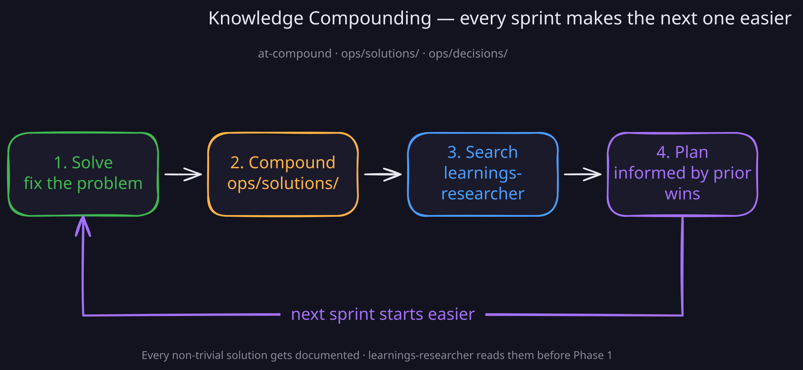
</p>

---

## What's new (v4.1.0)

This release fixes what the 4.0 review left open, and what the review of those fixes found. Nothing changes in how you run Triforge.

- **The import reader stays small.** On a CLAUDE.md built to stress it, the check that asks whether a file imports `AGENTS.md` used up to 2.4 GB; it now stays under 100 MiB on every hostile 4 MiB shape in the tests, with the same answers (4.5 million generated documents compared against 4.0's reader and 6.6 million more after the review's fixes, 1.4 million token by token against marked). Setup and session start read each such file once.
- **No instruction file is read whole.** `AGENTS.md`, `AGENTS.override.md`, Codex's `config.toml` and the pointer template are read to 4 MiB at most, and their sizes come from the file itself. A `CLAUDE.md` past a reading bound is named as such (`past-bound` in setup's file list, its own line at session start) instead of being offered an import that would then be refused.
- **A time bound stops everything a command started.** When setup or session start runs a command under a time bound, nothing the command started outlives the call. At the bound its whole process group is stopped, and so is anything it left running when it returns early, with or without the `timeout` binary. The watchdog's temp directory never stays behind. Session start's warning names the real reason a check did not finish.
- **Promotion targets are watched.** A promotion into a branch other than the default one records that branch when you approve it, and a move of it stops the next lease call (rc 44); an approval refuses to drop or replace a watched branch that moved. A default branch that appears where none was on record (a `git checkout main` that creates it, say) also stops the next lease call until `lease_rebaseline` accepts it. A merge whose integration branch moved during it says so, and the recovery steps it prints keep your uncommitted edits (`git reset --keep` or `--merge`, never `--hard`).
- **`CLAUDE_CONFIG_DIR` is honored.** When you move Claude Code's config home with `CLAUDE_CONFIG_DIR` (an absolute path outside the project), setup reads your user-level `CLAUDE.md` from there, never writes it, keeps a claude worker on the same config home, and denies its `.credentials.json` to the read-only lanes. Unset, `~/.claude` as before. Set to anything else (empty, relative or inside the project), setup lists that `CLAUDE.md` as a project file but never writes it or any file beside it.
- **The maintainer tools ignore planted modules**, like the rest of the helpers since 4.0: the validators, the release notes and the probe harness.
- **Five diagrams redrawn** so no arrow crosses a label.

## What's new (v4.0.0)

Codex can lead a Triforge project now. You pick the lead in `at-setup`, which records it in a `[lead]` table in `ops/roster.toml`; a project without that table keeps Claude Code. The scripts, skills and templates read the lead from that table and the CLI registry; outside the registry and the roster loader, no script branches on the lead's name (KTD1). The work followed `docs/plans/2026-09-28-1946-feat-lead-choice-v4-plan.md`, Phases 0 to 6.

- **Codex can lead.** `triforge_bootstrap` sets up a project from either lead, before you have trusted the plugin's hooks. `scripts/coordinate.sh` runs the lead's launch line from the registry with the `[lead]` model and effort, and the context and tool-failure monitors read the lead's own tool names. In a Codex prompt the lead workflows are `$agent-triforge:at-<name>`. SELF-17 runs the same two-task fixture sprint under each lead, and the two ledgers differ only in the lead CLI and the reviewer class.
- **The slash commands are lead workflows.** Each 3.x command is now an `at-` skill (`/at-ship` under Claude Code, `$agent-triforge:at-ship` in a Codex prompt), and `commands/` ships empty. The 17 lead workflows share one `skills/` tree with the 10 portable skills. A plugin-root resolver and a skill locator find the plugin from either lead, and `scripts/validate-skills.sh` checks every skill in strict mode. The [command map](#command-map) lists each 3.x command and its 4.0 name.
- **`AGENTS.md` replaces the `CLAUDE.md` files.** The plugin ships no `CLAUDE.md`, and [`docs/rule-inventory.md`](docs/rule-inventory.md) shows where each retired rule went. The Claude Code floor rises to 2.1.277, the first build that reads a root `AGENTS.md`. Session start warns when Claude Code is older than that, or when a project still carries a 3.x `CLAUDE.md`.
- **One CLI registry.** `scripts/lib/registry.sh` holds one entry per CLI with its tier, binary, model, install hint, environment allowlist, lane, egress and lead fields. Every other script reads it, and `validate-versions.sh` fails when one keeps a copy.
- **The 19 agents are personas.** Each is a prompt file in `personas/`, and `personas/manifest.toml` sets its tools, model tier and turn budget. `dispatch_persona` runs them the same way under either lead, and `agents/` ships empty.
- **Builders outlive the lead's turn.** Lease builders run detached. `lease_wait` waits on them within a time budget, and on resume `lease_heartbeat_check` collects the builders that finished and adopts the ones still running. A worker marker keeps workers out of the lead-only helpers (rc 45). The `claude -p` worker lane runs Bash in Claude Code's sandbox and needs 2.1.285 or later. Each ledger row records the lead CLI, the reviewer class and the approvals given for it.
- **Grok Build and Devin join the optional tier.** Grok Build builds, reviews or analyzes. Devin reviews and analyzes once you consent to Cognition seeing your code, and builds only after a separate opt-in. `at-review` checks the change's integrity first and then gives every lane the same review package.
- **`at-setup` asks who leads.** It also lists the instruction files in the project and the directories above it, and changes one only after you say yes. Before it writes the lead, it shows which providers will receive your code, and it lets you pick Devin's model.
- **Lead-side Python ignores the working directory.** Inline Python in the helpers no longer imports modules from the directory it runs in. A builder could have planted a `json.py` in its worktree, and the lead's output parser would have run it outside the builder's sandbox.
- **Two lease-integrity fixes.** A lease left open by 3.3.x now merges after the upgrade; 3.3.3 read it as a deleted baseline and escalated it on the first lease call. A ledger whose digest and saved copy were both deleted stops the next lease call with rc 44, so a worker can't delete them and then forge an approval into the ledger.
- **Watch-cycle carry-ins.** The watch cycle's research workers run through the persona lane in the `read-web` class. Antigravity routing defaults to `auto` (D-042), and the `AGY_ERROR` line agy prints on exit 3 now feeds the failure class (D-043). The Cursor probe rows compose Grok 4.7 model ids with the same helper dispatch uses.

Upgrading: read [Upgrading from 3.x](#upgrading-from-3x) first. It maps each 3.x command to its workflow, lists what changes in a project, and explains how to [go back to 3.3.3](#rolling-back-to-333). v4.0.0 ships without a regenerated probe record. The newest one is still [`ops/research/2026-09-probe-record.md`](ops/research/2026-09-probe-record.md) from 2026-09-27. The new rows for the persona lane, the Codex lead, Devin and Grok Build ran live during development with `--only`, and [Compatibility](#compatibility) lists them.

## What's new (v3.3.3)

A safety hotfix, shipped before the lead-choice redesign (plan `docs/plans/2026-09-28-1946-feat-lead-choice-v4-plan.md`, Phase H):

- **Promotion catches every control-plane change.** `lease_promote`'s protected list missed `scripts/lib/`, `scripts/lease-git-hooks/` and `scripts/probe-self-tests.sh`, saw only the new name of a renamed file, and read a scan error as "nothing protected". The lists now live in `scripts/lib/registry.sh`: a framework list that applies only in the Triforge checkout, and a project list that applies everywhere (`ops/roster.toml`, `.claude/`, `.codex/`, `.agents/` and the other CLI config trees, and every `AGENTS.md`, `AGENTS.override.md`, `CLAUDE.md`, `CLAUDE.local.md` and `.mcp.json` at any depth). The scan is case-folded, sees both sides of a rename, and blocks promotion (rc 42) when it can't run.
- **Your own skills survive the refresh.** Session start used to delete any `.agents/skills/` directory whose name matched a shipped skill. The stamp now records a content digest for each directory Triforge wrote, and a directory is replaced or retired only while it still matches. An edited copy, or your own directory under a shipped name, is kept with a notice. A 3.3.0–3.3.2 stamp is migrated against the digests of every released copy (`scripts/lib/skill-digests.txt`). Lease worktrees follow the same rule and no longer write through a committed `.agents/skills` symlink.
- **A builder can't steer the lead's git.** A worktree limits where a builder starts, not where it writes. Every git call in the lease lifecycle now goes through `_lead_git`: system config off, a trusted global config captured on first use, and hooks, fsmonitor, the global attributes file, signing and pager turned off. Before the lease functions act, they compare `.git/config`, `.git/config.worktree`, `.git/hooks/`, `.git/info/`, the global git config, the ledger, the default branch and each lease's worktree pointer with the lead's recorded baseline. A change the lead didn't make is restored where possible, the open leases are escalated, and the call returns 44. `lease_rebaseline` accepts a change you made yourself. This is detection, not prevention.
- **Only the lead's snapshot merges.** `lease_collect` now takes the snapshot (one lead-made commit on the recorded base) that the review and the merge bind to. `lease_merge` squashes that SHA and refuses, by name, a builder's own commit, an edit to `ops/`, or a worktree changed after collect. It also refuses when the integration branch moved since the lead's last merge.
- **The SELF rows are a gate.** `bash scripts/probe-capabilities.sh --self-only` runs only the static SELF rows, writes its record to a scratch path, and exits 3 on any SELF FAIL. `.github/workflows/gates.yml` runs it with both validators on macOS for every PR to `main` and `release/4.0`. New rows: SELF-10 (protected paths) and SELF-18 (lead git integrity); SELF-08b covers the digest refresh.

Upgrading: open 3.3.x leases keep working. A lease collected by 3.3.2 has no collect snapshot, so it is snapshotted at merge under the new checks; review its worktree as it stands at merge time. Behavior changes to know about:

- `lease_merge`'s commit no longer runs repository hooks and is never GPG-signed (`_lead_git` turns hooks, fsmonitor and signing off), so a branch-protection rule that requires signed commits needs the squash signed by hand.
- If you commit on the integration branch between merges, switch the lead's checkout to another branch, or promote by hand after a blocked `lease_promote`, the next lease call refuses with rc 44 until you run `lease_rebaseline`. A `.git/config` or hook change you made yourself (`git remote add`, `pre-commit install`) is also reverted at the next lease call and saved as `<lease root>/lead/<name>.changed-<UTC time>`: copy it back, then run `lease_rebaseline`. Each acceptance is recorded in `ops/leases.toml` `[baseline]`.
- More promotions are gated in user projects. `lease_promote` now blocks (rc 42, lead or user cross-review required) on any change under `.claude/`, `.codex/`, `.agents/`, `.antigravity/`, `.gemini/`, `.opencode/`, `.kimi-code/` or `.cursor/`, on the root `opencode.json`, `opencode.jsonc`, `.cursorrules` and `.gitmodules`, on `ops/roster.toml`, and on any `AGENTS.md`, `AGENTS.override.md`, `CLAUDE.md`, `CLAUDE.local.md` or `.mcp.json` at any depth — paths 3.3.2 promoted without a gate. A submodule entry recorded at one of those paths is listed even when `.gitmodules` says `ignore = all`.
- Deleting an integrity anchor is a change, not a reset: a missing ledger digest, a ledger whose `[baseline]` table is gone, or a deleted `ops/leases.toml` while `<lease root>/lead/` still holds the lead's copies refuses with rc 44 and names the recovery (`lease_rebaseline`, or removing the lead state dir when you removed the ledger on purpose).

## What's new (v3.3.2)

A hotfix from the 2026-09-27 watch cycle (D-039, D-049, D-050, S28), shipped before the lead-choice redesign:

- **The release gate is green again.** Claude Code 2.1.281 started warning on an unquoted `${CLAUDE_PLUGIN_ROOT}` in shell-form hooks, and `--strict` turns warnings into errors. All four commands in `hooks/hooks.json` now read `bash "${CLAUDE_PLUGIN_ROOT}/hooks/handlers/<name>.sh"`. Probe CC-06 reported PASS while the gate was red, because `validate --strict <repo>` checks only the marketplace manifest. It now validates `plugin.json` and `marketplace.json` separately and passes only when both do.
- **OpenCode V2 is refused.** V2 (npm `@opencode/cli`, same `opencode` binary) does not read `OPENCODE_PERMISSION`, so Triforge's deny set would be silently dropped. `invoke_opencode` and the lease `opencode)` arm refuse when `opencode --version` is 2.x or later, as a deterministic failure that names the V1 pin (`npm i -g opencode-ai@1`). The check fails closed: an OpenCode whose version can't be read is refused the same way. Every role's fallback chain skips a refused OpenCode and moves to the next CLI, and `/setup` reports it as unsupported instead of offering enrollment. Porting to V2 comes later.
- **Cursor model ids follow the Grok family.** Grok 4.7 ids carry no `cursor-` prefix (`grok-4.7-xhigh`), while 4.6 ids do (`cursor-grok-4.6-xhigh`). Every composer used to emit `cursor-<family>-<effort>`. All four composers (dispatch, `resolve_role`, the `/setup` role table, and `roster_write_role`) now take the prefix from one shared family table. The shipped pin stays `cursor-grok-4.6-xhigh`.
- **`/setup` has no positional tokens.** Claude Code substitutes `$0`, `$1`, … in a command body before the model reads it, code blocks included. `/setup`'s ROLES helper now takes the CLI name as a named variable.

## What's new (v3.3.1)

Follow-ups from the v3.3.0 code review (PR #8 "Unapplied review findings"), shipped 2026-09-12:

- **A lease builder cannot push.** The dispatch contract's "git stays local" is now mechanical: `_adapter_env` binds `core.hooksPath` to the shipped `scripts/lease-git-hooks/pre-push` (which refuses) and rewrites every push URL scheme to an unresolvable `no-push://` address via `url.*.pushInsteadOf` — per-process `GIT_CONFIG_*`, so `git push` fails whichever remote or path the builder names while status/log/diff keep working. New static row SELF-09 proves it against a bare remote.
- **Quota exhaustion fails fast.** A provider usage-limit / quota error (Kimi's `403 … monthly usage limit`, or any lane's equivalent) is classified deterministic with "wait for the refresh or buy usage" guidance instead of a wasted retry; the probe record has a `QUOTA-FAIL` outcome and gates the dependent Kimi rows on the quota, not on a login.
- **Effort-only roster overrides work.** `[roles.analyst] effort = "low"` on the shipped agy default now dispatches `Gemini 3.8 Flash (Low)` (and `cursor-grok-4.6-low` for Cursor): `resolve_role` recomposes the effort suffix when the role's model is the shipped default; an explicit roster model still wins.
- **Smaller control-plane files.** `scripts/invoke-external.sh` is a loader over `scripts/lib/{common,antigravity,codex,opencode,kimi,cursor,roster,lease}.sh` (4.0 adds `registry`, `lease-wait`, `devin` and `grok`; same 68 functions, same contracts — commands keep sourcing the one file; `validate-versions.sh` parses `lib/roster.sh`), and the probe harness's SELF-* rows live in `scripts/probe-self-tests.sh`.
- **Smaller fixes.** The OpenCode deny set enumerates the common bypass spellings (`rm -fr`/`-Rf`/`-r`, `command sudo`, `doas`, `git -c`/`-C … push`) in both copies (still defense-in-depth); `invoke_antigravity` leaves its diagnostic in the output file when the retry also returns an empty envelope; session-start writes `.claude/roster-detected.local.md` tmp+mv.

## What's new (v3.3.0)

**Install route fixed.** The plugin now installs on current Claude Code: the repository ships a single-plugin marketplace manifest (`.claude-plugin/marketplace.json`) so `claude plugin marketplace add https://github.com/Ninety2UA/agent-triforge` + `claude plugin install agent-triforge@agent-triforge` works (the old `claude plugin add <url>` form is no longer a Claude Code command), and `plugin.json` no longer names `hooks/hooks.json` — Claude Code auto-loads that path and rejected the duplicate, which made the installed plugin fail to load. Verified from an installed project: all twelve skills discoverable headless, `/<skill>` expands, the session-start hook fires.

**Every lane runs on the September 2026 generation, and every headless run reports a completion signal the lead can trust.** The shipped pins moved in lockstep — Claude **Fable 5.1 → Opus 5 → Sonnet 5** ladder, Codex **`gpt-6-astra`** at `xhigh`, Antigravity **`Gemini 3.8 Flash (High)`** (the new policy: the newest Gemini at its highest thinking level, Pro or Flash; `Gemini 3.1 Pro (High)` stays the one-line opt-in), OpenCode `openrouter/z-ai/glm-5.3`, Kimi `kimi-code/k3`, Cursor `cursor-grok-4.6-xhigh` (effort now rides in Cursor's model-id suffix, like agy's `(High)`). `invoke_antigravity` reads agy's JSON envelope (`status`, `response`, `denied_actions`) instead of the exit code, and every lease carries one dispatch contract with a typed `Status:` report that `lease_collect` parses — a clean exit without one is "report missing", never review-ready. The Antigravity agent pack ships in agy's Markdown-agent format (native `--agent` behind `TRIFORGE_AGY_MODE`; injection remains the shipped mode), Kimi roles load natively through `--agent-file`, the Codex declarations deploy as `.codex/triforge-agents.toml`, and `.agents/skills/` refreshes on every plugin version change so all six CLIs see the current skills in their own invocation form (`/name`, `$name`, the `skill` tool, `/skill:name`). Two new release gates — `scripts/validate-skills.sh` and `scripts/validate-versions.sh` — and the Tier-1 process patterns from the September repo mining (a counterfactual bar for compounding, `Accept:`/`Fails when:` task fields, rulings-not-stalls, review dispositions, evidence-gated verification) round it out. Details in [Recent changes](#recent-changes); floors and tested versions in [Compatibility](#compatibility).

### v3.2.0 — the watch cycle became repo-local maintainer tooling

**The plugin got leaner: the watch cycle is now repo-local maintainer tooling.** `/cli-watch` and `/repo-watch` — the monthly cycles that keep Triforge itself current against its six CLIs and four reference repos — never belonged in the shipped command set. They now live in this checkout's `.claude/commands/`, with the `watch-cycle` skill in `.claude/skills/` and the watch registry tracked at `ops/watch-registry.toml`. At this release the plugin shipped 17 commands and 12 skills (previously 19 and 13), and `session-start.sh` no longer copies a watch registry into your `ops/`. Run the watches from a clone of this repo (see [Keeping the framework current](#keeping-the-framework-current-cli-watch-repo-watch--maintainers)); nothing changes for `/setup`, `/ship`, or any other command.

### v3.1.0 — role customization in guided onboarding

**The roster is now yours to shape from onboarding.** `/setup` gained a role-assignment step: see the current role table (role → CLI · model · effort · fallbacks), then keep it, customize any role, or restore the shipped defaults — every write validated so the roster always still loads. Backed by new single-writer helpers (`roster_role_entry`, `roster_write_role`), roster model overrides that now reach every external-CLI dispatch lane (`CODEX_MODEL` joined its siblings), agy effort→`(High)`/`(Low)` suffix normalization, and a content-level roster guard that makes a broken `ops/roster.toml` loud instead of quietly rendering clean-looking tables. Hardened across three multi-agent review iterations (local roster + independent cross-model adversarial passes) — details in [Recent changes](#recent-changes).

Also new at the time (history — superseded by v3.3.0's D-022 policy, which pins the newest Gemini at its highest thinking level): the 2026-07-21 **Gemini 3.6 Flash** release was recorded in the model watch; the v3.1.0 pins stayed on `Gemini 3.1 Pro`, with 3.6 Flash as the explicit per-role opt-in.

### v3.0.0 — the builder-pool foundation

**The biggest release since the plugin conversion.** Triforge moved from a fixed Claude + Gemini + Codex trio to a **six-CLI builder pool** coordinated by a roster, per-task leases, and mandatory cross-review — and swapped the retired Gemini CLI lane for Antigravity. The coordination model and the CLI surface both changed, so this was a major version.

#### Headline changes

- **Builder pool (default).** All six supported CLIs — the core trio (Claude, Antigravity, Codex) plus enrolled optional members (OpenCode, Kimi, Cursor) — are eligible builders. [`ops/roster.toml`](templates/ops/roster.toml) assigns each role; every build runs under a per-task lease in an isolated worktree and merges only after cross-review by a pinned non-author reviewer. The single-writer rule is retired.
- **Gemini → Antigravity.** Google shut down the hosted Gemini CLI service for consumer tiers on 2026-06-18; the analyst / reviewer / documenter lane is now **Antigravity (`agy`)** — running Gemini 3.1 Pro (High) at the time (history: v3.3.0 moved the shipped pin to Gemini 3.8 Flash (High), D-022), invoked via `invoke_antigravity`.
- **Guided onboarding ([`/setup`](commands/setup.md)).** One idempotent command takes a fresh install to a working roster: gate the core trio, enroll or decline each optional CLI, then accept the shipped role defaults or customize who does what (CLI · model · effort per role).
- **Self-maintenance ([`/cli-watch`](.claude/commands/cli-watch.md), [`/repo-watch`](.claude/commands/repo-watch.md)).** Scheduled or manual watch cycles keep the framework current against primary sources.
- **Native-first runtime.** Completion gating moved from the retired `ship-loop.sh` promise gate to Claude Code's native `/goal` + an `ops/.sprint-complete` sentinel; Codex ran `gpt-5.6-sol` (history: `gpt-6-astra` at `xhigh` since v3.3.0) with structured `--output-schema` verdicts and hooks under `codex exec`.

#### Migrating from v2.4.x

- **(a) Builder-pool default.** External CLIs are now eligible builders, not review-only. To restore the old reviewer-only posture, edit `ops/roster.toml` and take the external CLIs off the `builder` role (leave them on `reviewer` / `tester` / `analyst` / `documenter`, or set `[members.<cli>] enabled = false`). The core trio can't be disabled, and every fallback chain must still terminate at a core member.
- **(b) Gemini → Antigravity.** The Gemini lane is gone. **Former Gemini-API-key users:** install Antigravity and run `/setup` to authenticate the `agy` lane (the old `GEMINI_API_KEY` is no longer used). **Users who must stay on legacy Gemini:** pin plugin **`v2.4.3`** — the last release with the Gemini lane.
- **(c) Raised floors (KTD-13).** New enforcement floors at v3.0.0 (history — v3.3.0 re-baselined them; the current matrix is in [Compatibility](#compatibility)): Claude Code ≥ 2.1.212, Codex ≥ 0.144.0, Antigravity `agy` ≥ 1.1.3; optional tier OpenCode ≥ 1.18, Kimi Code ≥ 0.15 (re-baselined to the tested version — the plan's aspirational ≥ 0.27 predated the probe host, and Kimi's near-daily cadence makes the tested floor the honest one), Cursor (date-versioned). Full matrix with tested-against versions + READY probes in [Compatibility](#compatibility).
- **(d) Retired mechanisms.** `ship-loop.sh` promise gate (`<promise>DONE</promise>`) → `/goal` + `ops/.sprint-complete` sentinel; single-writer rule → lease + cross-review. The historical changelog entries below keep the retired names on purpose — they record what past releases shipped, and are not rewritten.

### Also recent (history)

v2.4.3 sequential downgrade ladder; v2.4.0–v2.4.2 framework self-audits; v2.2.0 Opus-max-effort + reliability patterns; v2.0.0 plugin conversion — full detail in [Recent changes](#recent-changes).

### One plugin for either lead

The framework installs as a plugin into the CLI that leads, with one command to add the marketplace and one to install. The same repository serves both leads, because Codex also reads the `.claude-plugin/` manifests (D-048). There is no git clone, no file copying by hand and no `.claude/settings.json` to edit.

```bash
# Claude Code leads
claude plugin marketplace add https://github.com/Ninety2UA/agent-triforge
claude plugin install agent-triforge@agent-triforge

# Codex leads
codex plugin marketplace add Ninety2UA/agent-triforge
codex plugin add agent-triforge@agent-triforge
```

The skills (the 10 portable skills and the 17 lead workflows) and the hooks register automatically, and the first session in a project bootstraps its `ops/` directory. Codex runs the plugin's hooks only after you trust them in Codex; `at-setup` tells you how.

### Automatic project bootstrapping

Triforge sets up a project through one helper, `triforge_bootstrap` (`scripts/lib/bootstrap.sh`). The `session-start.sh` hook runs it at the start of every session, and `at-setup`, `at-build` and `at-review` run it too, so a project led from Codex is set up before you trust the plugin's hooks. Each run only fills in what is missing. It works in the repository's top directory, the nearest one above that holds `.git`, so a run from a subdirectory sets up the repository. It refuses to set up your home directory or any directory that contains it, and the roster writers and the lease helpers refuse such a project too. It:
- Creates `ops/solutions/`, `ops/decisions/` and `ops/archive/`, copies the skeleton `MEMORY.md`, `CHANGELOG.md`, `AGENTS.md` and `GOALS.md` from the plugin templates into `ops/`, and adds `ops/roster.toml`
- Copies the 10 portable skills into `.agents/skills/` and each CLI's project files (`.codex/` always; `.opencode/`, `.kimi-code/` and `.cursor/` for the CLIs you have installed)
- Writes `.agents/triforge-plugin-root.local`, a per-user file naming the plugin's install path, which the `at-` skills read when the lead does not export one. If no ignore rule covers the file, Triforge adds one to `.agents/.gitignore` so git never tracks it. If git tracks `.agents/.gitignore`, Triforge leaves it alone and prints the line to add instead

The hook also keeps its session state in `.claude/` (it writes nothing through a `.claude` that is a symlink) and prints a `cp` command for Triforge's pointer block when the project has no root `AGENTS.md`.

Your project's own instruction file is its root `AGENTS.md`. Add the marked pointer block from [`templates/AGENTS.md`](templates/AGENTS.md) to it yourself; session start never writes into an existing `AGENTS.md`. The plugin ships no `CLAUDE.md`, because a `CLAUDE.md`, `.claude/CLAUDE.md` or `CLAUDE.local.md` in or above the project stops Claude Code from reading `AGENTS.md`.

---

## The builder pool

The heart of v3.0.0. A wave reads [`ops/roster.toml`](templates/ops/roster.toml), leases each task to a builder CLI in its own isolated git worktree, and merges only after a pinned non-author reviewer approves — then promotes the sprint integration branch to `main` through a protected-path gate.

<p align="center">
  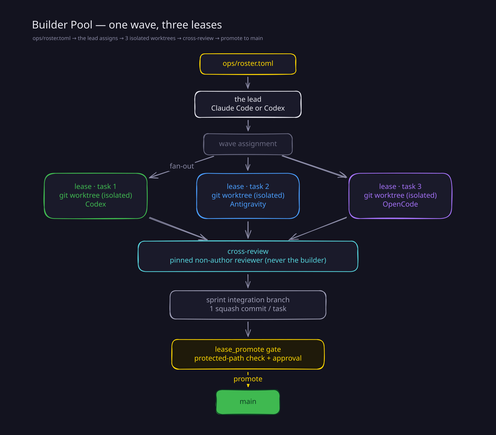
</p>

**The roster decides who does what.** Five roles — builder, reviewer, tester, analyst, documenter — each map to a CLI + model + effort with an ordered fallback chain that must terminate at a core-trio member. Optional members carry an `enabled` flag and are absent everywhere when off. Model choice is yours per role: the shipped defaults pin the newest Gemini model at its highest thinking level for `agy` — `"Gemini 3.8 Flash (High)"` today, Pro or Flash, whichever is newest (D-022) — and `cursor-grok-4.6-xhigh` for Cursor (effort rides in the model-id suffix), and a role's `model` entry selects any other variant when you explicitly want it. Since v3.1.0 you don't have to hand-edit the file: `at-setup`'s role step walks keep-current / customize / restore-shipped-defaults with validated writes.

Prefer the Pro line? Set a role's `model` to `"Gemini 3.1 Pro (High)"` (or `(Low)` — 3.1 Pro has no Medium tier) in `ops/roster.toml`; it stays the documented one-line opt-in. The July 2026 plan's never-Flash rule (AE2) is superseded by D-022 — anyone working from that plan should read the September ADR (`ops/decisions/2026-09-11-cli-deprecation-watch.md`).

<p align="center">
  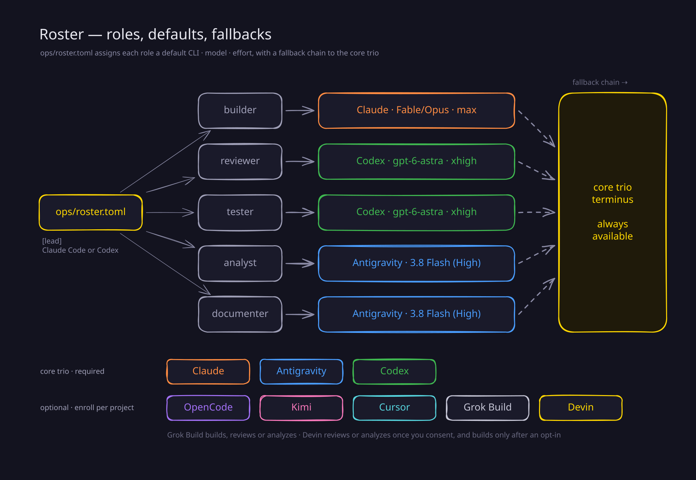
</p>

**Every builder runs under a lease.** The lead-owned ledger `ops/leases.toml` (runtime state) tracks each task through its lifecycle — with heartbeat-based orphan detection, a single requeue to a *different* builder, and escalation when a task can't converge.

<p align="center">
  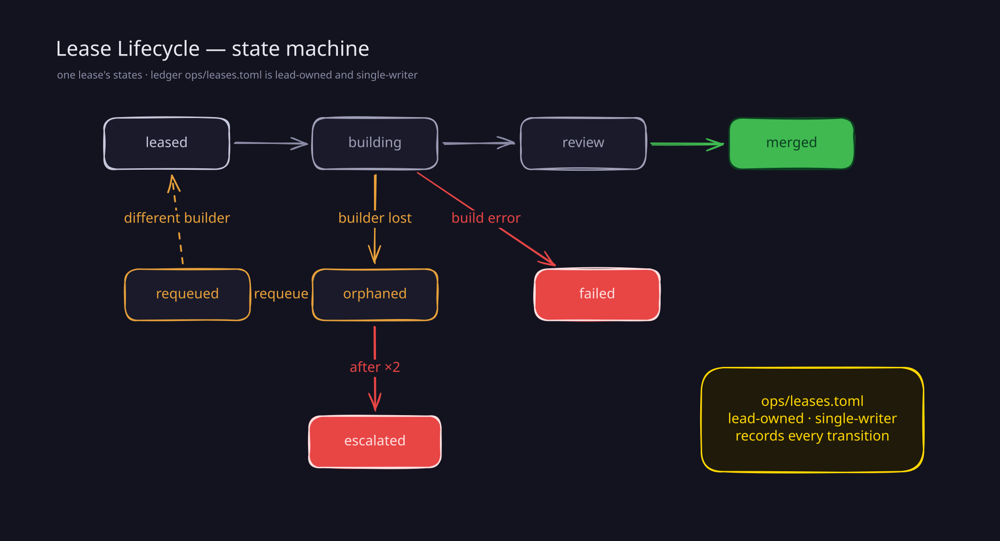
</p>

Safety comes from three mechanisms working together, not from restricting who may write code: **per-task worktrees with lead-side checks** (a builder starts in its own worktree and is contracted to stay out of the canonical `ops/` tree; the worktree limits where it starts, not where it writes, so the lead detects changes to git state and the ledger, and merges only its own collect snapshot — detection, not prevention; a write elsewhere in the main checkout is not detected), a **per-adapter environment allowlist** (no builder receives another provider's credential environment variables; credential files under `$HOME` are shared), and **mandatory cross-review** before any merge (no agent merges its own build).

---

## Project structure

The plugin provides personas, skills and hooks. Your project gets an `ops/` directory for state:

```
agent-triforge/                     (plugin — installed automatically)
├── .claude-plugin/plugin.json        Plugin manifest
├── package.json                      Pi package manifest: the portable skills only
├── personas/                         19 persona prompts plus manifest.toml (tools, model tier, turns)
├── skills/                           27 skills in one tree
│   ├── .devin-plugin/plugin.json       Devin plugin manifest (plugin root skills/): the portable skills only
│   ├── <name>/SKILL.md                 10 portable skills, copied to .agents/skills/ and lease worktrees
│   │   └── references/                 where a skill is split (wave-orchestration, verification-before-completion)
│   └── at-<name>/                      17 lead workflows (/at-<name> in Claude Code, $agent-triforge:at-<name> in a Codex prompt); never copied
│       ├── SKILL.md                      the router: goal, done condition, safe failure, invocation
│       ├── references/                   the detail the router points to
│       ├── scripts/locate-triforge.sh    finds the plugin root from either lead
│       └── agents/openai.yaml            Codex skill metadata
├── hooks/
│   ├── hooks.json                    Hook registration
│   └── handlers/                     4 lifecycle hook scripts, plus monitors.py (the monitors' state and classifier)
├── settings.json                     Default env vars
├── AGENTS.md                         The plugin's own instructions: checks, conventions, confinement, human-only actions
├── templates/                        Project bootstrapping templates (AGENTS.md pointer block, ops/ skeleton, per-CLI files)
├── scripts/coordinate.sh            Outer loop for context recovery
└── scripts/validate-*.sh            Release gates: skill structure; version lockstep + ladder one-definition + stale-pin sweep

your-project/                       (your repo — bootstrapped on first session)
├── AGENTS.md                         Your instruction file, with Triforge's pointer block (templates/AGENTS.md)
├── ops/                              Shared coordination files
│   ├── AGENTS.md                       Master operating protocol for all agents
│   ├── GOALS.md                        High-level product goals
│   ├── MEMORY.md                       Decisions, patterns, gotchas
│   ├── CHANGELOG.md                    Audit trail with agent attribution
│   ├── STATE.md                        Session continuity checkpoint
│   ├── solutions/                      Documented solved problems
│   ├── decisions/                      Architecture decision records
│   └── archive/                        Archived review + test files
└── src/                              Your source code

agent-triforge/ checkout            (maintainers only — not installed with the plugin)
├── .claude/commands/                 /cli-watch + /repo-watch — framework self-maintenance
├── .claude/skills/watch-cycle/       Shared watch methodology
├── .github/PULL_REQUEST_TEMPLATE.md  PR template: evidence table + validator results
└── ops/watch-registry.toml           Watch targets: eight CLIs + three research tools + seven reference repos
```

### Shared file protocol

All agents coordinate through markdown files in [`ops/`](ops/). This is the source of truth:

| File | Purpose | Owner |
|---|---|---|
| `TASKS.md` (runtime) | Work queue with `[ ]`/`[x]` status tracking | The lead generates, all agents read |
| [`AGENTS.md`](templates/ops/AGENTS.md) | Master operating protocol read by all agents | Manual |
| [`GOALS.md`](templates/ops/GOALS.md) | High-level product goals for sprint planning | Manual |
| [`MEMORY.md`](ops/MEMORY.md) | Architectural decisions, patterns, interface proposals | All agents append |
| [`CHANGELOG.md`](ops/CHANGELOG.md) | Audit trail with `[agent-name]` attribution | All agents append |
| [`STATE.md`](ops/STATE.md) | Session continuity — current phase, progress, next actions | The lead writes on pause/wrap |
| [`solutions/`](ops/solutions/) | Documented solved problems for institutional knowledge | The lead writes via [`at-compound`](skills/at-compound/SKILL.md) |
| [`decisions/`](ops/decisions/) | Architecture decision records (ADRs) | The lead writes via [`at-compound`](skills/at-compound/SKILL.md) |

---

## Sprint Pipeline (`at-ship`)

Every goal goes through the phases below. Run [`at-ship`](skills/at-ship/SKILL.md) (`/at-ship <goal>` under a Claude Code lead, `$agent-triforge:at-ship <goal>` in a Codex prompt) to run them all autonomously, or run each phase's lead workflow yourself.

<p align="center">
  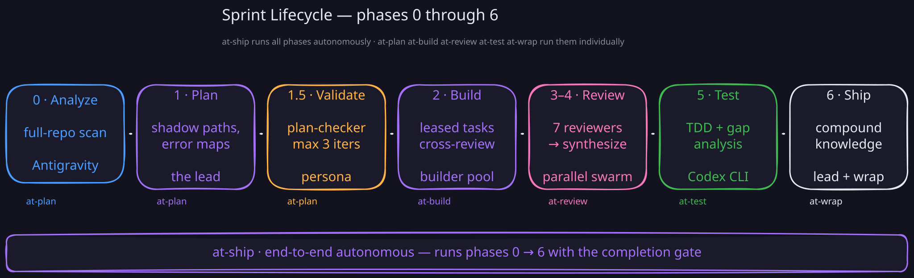
</p>

| Phase | What happens | Agent(s) | Lead workflow |
|:---|:---|:---|:---|
| **0 — Analyze** | Full-repo scan: architecture, patterns, contracts, debt | Antigravity CLI + [`codebase-mapping`](skills/codebase-mapping/SKILL.md) | [`at-plan`](skills/at-plan/SKILL.md) |
| **Pre-Plan** | Search institutional knowledge for relevant past solutions | [`learnings-researcher`](personas/learnings-researcher.md) | [`at-plan`](skills/at-plan/SKILL.md) |
| **1 — Plan** | Decompose goal into tasks with shadow paths and error maps | Lead + [`writing-plans`](skills/writing-plans/SKILL.md) | [`at-plan`](skills/at-plan/SKILL.md) |
| **1.5 — Validate** | Validate assignments, dependencies, scope, shadow paths | [`plan-checker`](personas/plan-checker.md) | [`at-plan`](skills/at-plan/SKILL.md) |
| **1.1 — Ambiguity** | Surface top 3 unverified assumptions, ask user to confirm/correct | Lead | [`at-plan`](skills/at-plan/SKILL.md), [`at-ship`](skills/at-ship/SKILL.md) |
| **2 — Build** | Wave orchestration with integration verification between waves | Leased builders, or the [`team-lead`](personas/team-lead.md) persona | [`at-build`](skills/at-build/SKILL.md) |
| **3–4 — Review** | Up to 7 parallel reviewers, synthesized with confidence tiering | Antigravity + Codex + [review agents](#review-specialists-6) | [`at-review`](skills/at-review/SKILL.md) |
| **5 — Test** | TDD test writing, gap analysis, fix cycle until green | Codex CLI ([`test_writer`](codex-agents/agents.toml)) | [`at-test`](skills/at-test/SKILL.md) |
| **6 — Ship** | Document solutions, archive reviews, write STATE.md | Lead + [`knowledge-compounding`](skills/knowledge-compounding/SKILL.md) | [`at-wrap`](skills/at-wrap/SKILL.md) |

---

## Planning Pipeline (`at-plan`)

Analyzes the full codebase with Antigravity's 1M-token context, searches institutional knowledge, decomposes the goal with shadow paths and error maps, then validates via [`plan-checker`](personas/plan-checker.md).

<p align="center">
  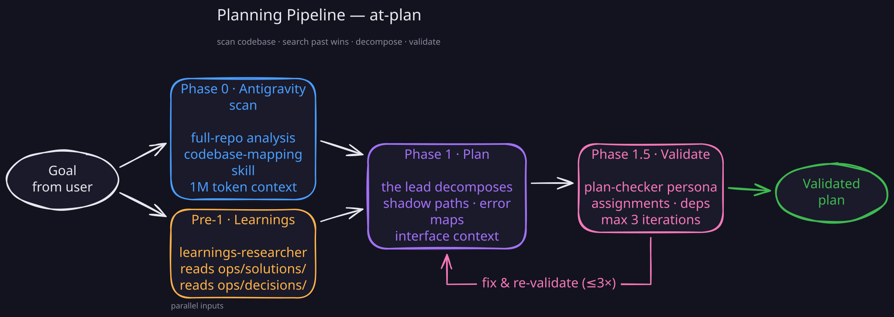
</p>

---

## Deep Research (`at-deep-research`)

Spawns 5 research agents in parallel before planning, then synthesizes findings into a unified research brief.

<p align="center">
  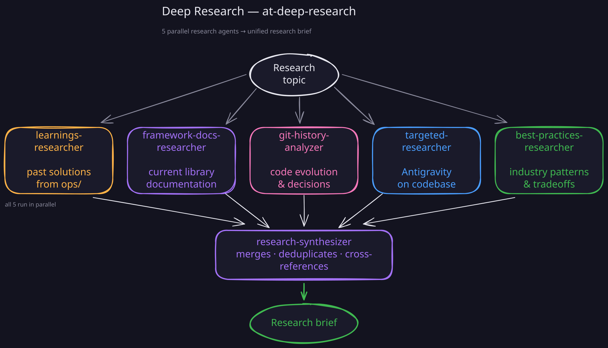
</p>

---

## Wave Orchestration (`at-build`)

Groups plan tasks by dependency into waves. Independent tasks within each wave run in parallel; an [`integration-verifier`](personas/integration-verifier.md) validates between waves.

<p align="center">
  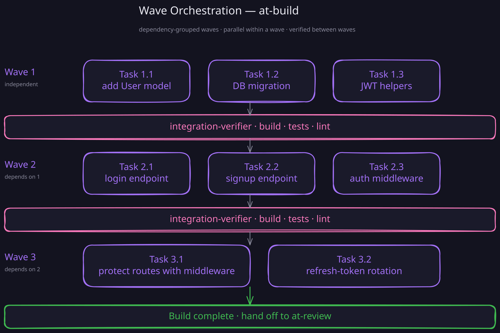
</p>

---

## Four coordination modes

| Mode | Mechanism | When to use |
|---|---|---|
| **File-based** | Shared markdown in [`ops/`](ops/) | Persistent state across sessions, audit trails |
| **Direct invocation** | `agy -p` / `codex exec` via bash | Real-time external agent delegation |
| **Personas** | `dispatch_persona` runs a [`personas/`](personas/) prompt with the tools, model and turn budget its manifest entry sets | Reviews, research, verification |
| **Agent teams** | Multi-Claude with shared task lists ([`team-lead`](personas/team-lead.md)) | Complex builds with 5+ interdependent tasks |

### Portable skill injection

Skills are model-agnostic markdown files that ANY agent can consume. This decouples *what methodology to use* from *which model executes it*:

```bash
# All external-agent invocations go through the unified helper
source ${CLAUDE_PLUGIN_ROOT}/scripts/invoke-external.sh

# Antigravity via native agent definition (skill embedded in the agent body)
invoke_antigravity "codebase-analyst" \
  "Analyze the full codebase. Write findings to ops/ARCHITECTURE.md." \
  "$AGY_OUT" 600

# Codex via native agent definition (skill embedded in the agent body)
invoke_codex "test_writer" \
  "Write tests for changed files." \
  "$CODEX_OUT" 900
```

The helper's Antigravity routing is governed by `TRIFORGE_AGY_MODE` (`injection` | `native` | `auto`; default `auto` since 4.0). The agent pack (`antigravity-agents/`) now ships the agy Markdown-agent format (`mainAgent`/`subagent`/`commandExecutionPolicy`, agy tool names) and is reinstalled by session start whenever the plugin version changes; `native` passes `--agent <name>` when `agy agents` lists it, `auto` goes native only when listed, and `injection` prepends the agent body (with its embedded skill) to the prompt. The default became `auto` after the native round-trip (AGY-12) and the native-mode negative (AGY-16) passed in two consecutive probe records (D-042); a regression in either row reverts it. Codex definitions deploy as `.codex/triforge-agents.toml` — never under `.codex/agents/`, which Codex ≥ 0.147 sweeps as standalone role files.

### Assignment heuristic

Roles come from `ops/roster.toml` (`resolve_role <role>`); the defaults below are the shipped posture, not a write-restriction — any member can be the builder, and every build merges only after cross-review.

| Question | Role (default; roster-assignable) |
|---|---|
| Produces code? | builder role — default Claude, assignable to any member; built under a lease and cross-reviewed before merge |
| Evaluates existing code? | reviewer role ([Codex](https://github.com/openai/codex) + [Antigravity](https://antigravity.google/cli)) + [review personas](#review-specialists-6) in parallel |
| Runs/executes something? | tester role (default [Codex CLI](https://github.com/openai/codex)) |
| Produces documentation? | documenter role (default [Antigravity CLI](https://antigravity.google/cli)) |
| Touches shared interfaces? | builder implements under a lease → pinned non-author reviewer cross-reviews → tester validates |
| Ambiguous? | the lead takes it as builder, flags for parallel review |

---

## Review Swarm (`at-review`)

Up to 7 reviewers analyze the same code simultaneously through different lenses (2 external CLIs + 5 specialist personas with `--full`), then a [`findings-synthesizer`](personas/findings-synthesizer.md) merges, deduplicates, and priority-ranks all findings.

<p align="center">
  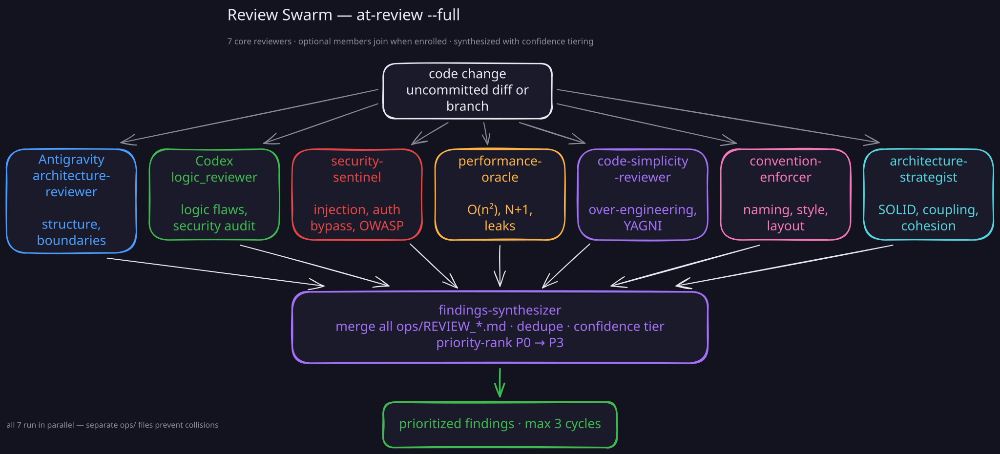
</p>

### Confidence tiering

Every finding gets a confidence score to prevent wasting time on phantom issues:

| Tier | Criteria | Rule |
|---|---|---|
| **HIGH** | Verified in codebase via grep/read. Deterministic. | Can be any priority |
| **MEDIUM** | Pattern-aggregated detection. Some false positive risk. | Can be any priority |
| **LOW** | Requires intent verification. Heuristic-only. | **Can NEVER be P1** |

### Suppressions

Each reviewer has a "Do Not Flag" list to reduce noise — readability-aiding redundancy, documented thresholds, sufficient test assertions, consistency-only style changes, and issues already addressed in the current diff. Each persona file in [`personas/`](personas/) lists its own suppressions.

---

## Test Pipeline (`at-test`)

[`test-gap-analyzer`](personas/test-gap-analyzer.md) finds the untested code paths, then [Codex CLI](https://github.com/openai/codex) writes and runs the tests in its sandbox, starting each one with a failing test.

<p align="center">
  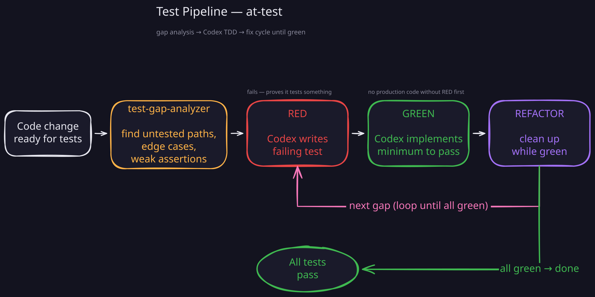
</p>

---

## Debugging (`at-debug`)

[`at-debug`](skills/at-debug/SKILL.md) reproduces the bug first, finds the root cause with evidence, and only then fixes it. A **circuit breaker** caps each issue at 3 attempts: if the same error comes back after 3 consecutive fixes, the agent stops looping and writes an escalation report.

<p align="center">
  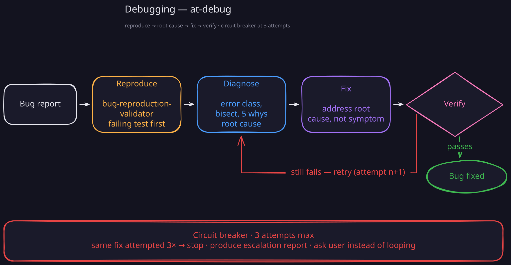
</p>

---

## Quality Gates

Six checkpoints, enforced at every stage:

<p align="center">
  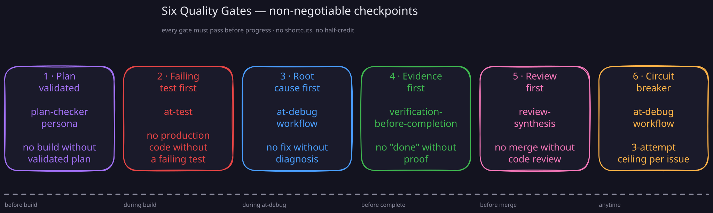
</p>

| Gate | Enforced by | Rule |
|---|---|---|
| **1 — Plan validated** | [`plan-checker`](personas/plan-checker.md) persona | No build without validated plan (max 3 iterations) |
| **2 — Failing test first** | [`at-test`](skills/at-test/SKILL.md) workflow, Codex [`test_writer`](codex-agents/agents.toml) | No production code without a failing test |
| **3 — Root cause first** | [`at-debug`](skills/at-debug/SKILL.md) workflow, Codex [`debugger`](codex-agents/agents.toml) | No fix without diagnosis |
| **4 — Evidence first** | [`verification-before-completion`](skills/verification-before-completion/SKILL.md) skill | No "done" without proof |
| **5 — Review first** | [`review-synthesis`](skills/review-synthesis/SKILL.md) skill | No merge without code review (max 3 cycles) |
| **6 — Circuit breaker** | [`at-debug`](skills/at-debug/SKILL.md) workflow, Codex [`debugger`](codex-agents/agents.toml) | 3-attempt ceiling per issue, then escalation report |

---

## Getting started

From nothing to a first sprint in five steps:

1. Install the core trio (Claude Code, Antigravity `agy` and Codex) and log in to each. The version floors and READY probes are under [Prerequisites](#prerequisites).
2. Install the plugin: `claude plugin marketplace add https://github.com/Ninety2UA/agent-triforge`, then `claude plugin install agent-triforge@agent-triforge` ([Installation](#installation)).
3. Start `claude` in your project. The first session bootstraps `ops/`.
4. Run `/at-setup`. It checks the core trio, asks which CLI leads the project, lets you keep or change the role assignments in `ops/roster.toml`, and offers each optional CLI. It also offers to add Triforge's pointer block to the project's root `AGENTS.md`, and it changes that file or a `CLAUDE.md` only after you say yes.
5. Run `/at-ship <goal>` for an autonomous sprint, or run the phases one at a time ([Typical session flow](#typical-session-flow)).

To lead from Codex instead, install the plugin with the Codex lines under [One plugin for either lead](#one-plugin-for-either-lead), start `codex` in the project, and run `$agent-triforge:at-setup` and then `$agent-triforge:at-ship <goal>` in a Codex prompt. Setup prints the full-access launch line for a Codex lead, and you type it yourself.

If you are upgrading from 3.x, the slash commands are now `at-` workflows (`/ship` is `/at-ship`); see [Upgrading from 3.x](#upgrading-from-3x).

### Prerequisites

[`at-setup`](skills/at-setup/SKILL.md) is the guided path from a fresh install to a working roster (`/at-setup` under a Claude Code lead, `$agent-triforge:at-setup` in a Codex prompt). After checking that the core trio is live, it asks which CLI leads the project, Claude Code or Codex. For Codex it shows the project trust entry, hook trust and the full-access launch line, which you type yourself. Role assignment comes next: keep the shipped defaults (recommended) or change any role's CLI, model and effort. You then enroll each optional CLI with a model you choose, or decline it. Setup lists the instruction files in the project and the directories above it, and changes one only after you say yes. Before it writes the lead, it lists which providers receive your code. It is idempotent, so you can re-run it any time. The commands below are the probes it automates; run them yourself to check a CLI before you install the plugin.

**Core trio (required):**

```bash
# Claude Code ≥ 2.1.277 — the first build that reads a root AGENTS.md (D-037);
# 2.1.267 first honored `effort:` frontmatter on pinned-default models and the
# `fable` alias resolves to Fable 5.1 from 2.1.257
claude --version

# Antigravity CLI ≥ 1.1.27 — https://antigravity.google/cli (run `agy` once interactively to log in)
agy --model "Gemini 3.8 Flash (High)" -p "Respond with only: READY"   # pin the model — agy's own default is a (Medium) variant

# Codex CLI ≥ 0.153.0 (gpt-6-astra's minimal client version) — https://github.com/openai/codex
codex exec "Respond with only: READY"

# Python 3 (used by hook handlers for JSON parsing)
python3 --version
```

**Optional tier.** Enroll these through `at-setup` to use them as builders or reviewers. An absent one is skipped cleanly in every roster fallback chain:

```bash
# OpenCode ≥ 1.18.20 — needs the OpenRouter provider connected (OPENROUTER_API_KEY or `opencode auth login`)
opencode run --format json -m openrouter/z-ai/glm-5.3 "Respond with only: READY"

# Kimi Code ≥ 0.33.0 — OAuth device-code or API key (`kimi login`)
kimi -p "Respond with only: READY"

# Cursor (date-versioned) — pin the suffixed Grok id, never the Auto router (`cursor-agent login`);
# the binary is `cursor-agent` (legacy symlink) or `agent` (primary since 2026.09.10)
cursor-agent -p --trust --model cursor-grok-4.6-xhigh "Respond with only: READY"

# Devin CLI ≥ 3000.10.31 (`devin auth login`) — a reviewer and analyst; at-setup asks for your
# consent before enrolling it, and it builds only after a separate opt-in
devin --model swe-1-6-slow --respect-workspace-trust false -p "Respond with only: READY"

# Grok Build ≥ 1.0.34 (builder, reviewer or analyst) — `grok login` (`grok login --device-code` without a browser) or XAI_API_KEY
grok --model grok-4.7 --output-format json -p "Respond with only: READY"
```

### Compatibility

Floors and tested versions come from the newest capability probe record, [`ops/research/2026-09-probe-record.md`](ops/research/2026-09-probe-record.md), generated 2026-09-27; "the current record" always means the newest `ops/research/*-probe-record.md`. v4.0.0 ships without a regenerated record. During 4.0 development these new rows ran live with `probe-capabilities.sh --only`: DVN-01 to DVN-07, CC-21 to CC-25, CDX-20 to CDX-23, GRK-02 to GRK-12 and SELF-06g. Where the table says "dev-time rows", it gives the version those rows ran on. A full run would currently record Grok Build as QUOTA-FAIL (the xAI quota ran out) and Kimi as AUTH-FAIL. Core trio required; optional tier enrolled via `at-setup`. Supersedes the July 2026 baseline (D-034).

| CLI | Tier | Floor (KTD-13) | Tested | READY probe |
|---|---|---|---|---|
| Claude Code (`claude`) | core | ≥ 2.1.277 (a claude worker: ≥ 2.1.285; a persona: a build with `--safe-mode`) | 2.1.283; dev-time rows on 2.1.289 and 2.1.291 | `claude --version` |
| Antigravity (`agy`) | core | ≥ 1.1.27 | 1.2.12 | `agy --model "Gemini 3.8 Flash (High)" -p "Respond with only: READY"` |
| Codex (`codex`) | core | ≥ 0.153.0 | 0.155.1; dev-time rows on 0.160.0 | `codex exec "Respond with only: READY"` |
| OpenCode (`opencode`) | optional | ≥ 1.18.20 | 1.18.30 | `opencode run --format json -m openrouter/z-ai/glm-5.3 "…"` |
| Kimi Code (`kimi`) | optional | ≥ 0.33.0 | 0.42.0 (AUTH-FAIL on the probe host; live rows PENDING-AUTH until `kimi login`) | `kimi -p "…"` |
| Cursor (`cursor-agent`; `agent` fallback) | optional | date-versioned | 2026.09.10 | `cursor-agent -p --trust --model cursor-grok-4.6-xhigh "…"` |
| Devin CLI (`devin`) | optional | ≥ 3000.10.31 | 3000.11.3 (dev-time rows) | `devin --model swe-1-6-slow --respect-workspace-trust false -p "…"` |
| Grok Build (`grok`) | optional | ≥ 1.0.34 | 1.0.34 (dev-time rows) | `grok --model grok-4.7 -p "…"` |

Why these floors: Claude Code 2.1.277 is the first build that reads a root `AGENTS.md`, Triforge's only instruction file (D-037; it includes the 2.1.267 fix that honors `effort:` frontmatter on pinned-default models); a claude worker needs 2.1.285, the first build that ignores the repository settings that loosen its sandbox, and refuses to start on an older one unless `TRIFORGE_CLAUDE_SANDBOX=off` is set; every persona runs with Claude Code's `--safe-mode`, so `dispatch_persona` refuses a `claude` without the flag (rc 69) and prints the fix, `claude update`; the persona lane was tested on 2.1.289 and 2.1.291, and an exec persona, which runs Bash, also needs the 2.1.285 sandbox floor; agy 1.1.27 adds `denied_actions` to the JSON envelope that `invoke_antigravity` reads as its completion signal; Codex 0.153.0 is `gpt-6-astra`'s minimal client, and `gpt-6.1-sol`, which a role can pick, answered on Codex 0.160.0 and was refused on 0.155.1; OpenCode 1.18.20 answers subagent permission asks under `run`; Kimi 0.33.0 is the agent-core-v2 engine with `--agent-file`; Devin 3000.10.31 is the first build where a deny rule wins over an allow rule, which its per-run config relies on (its versions jumped from 2026.x to 3000.x in July 2026); Grok Build 1.0.34 is the build the GRK probe rows passed on (`dontAsk` with deny rules, the workspace sandbox, streaming JSON, and the switches that stop it reading Claude Code's config). The Gemini CLI floor was removed with the Antigravity migration (Google's hosted service stopped serving consumer tiers 2026-06-18); legacy Gemini users pin plugin `v2.4.3`. An absent or declined optional CLI is silently skipped — fallback chains always terminate at a core-trio member, which can't be disabled.

### Data egress and credentials

Each dispatched CLI sends its task prompt and the code context it is handed to that CLI's model provider. Under the shipped defaults, your code + task context reaches **Anthropic** (Claude), **Google** (Antigravity → Gemini 3.8 Flash), and **OpenAI** (Codex) for the core trio; and, for any optional member you enroll, **Zhipu / Z.ai** (GLM, routed through the **OpenRouter** intermediary — which also sees the traffic), **Moonshot** (Kimi), **xAI** (Grok Build, and Grok through Cursor), and **Cognition** (Devin; a model outside Cognition's SWE family also reaches that model's provider). Cognition may train on that data unless the account opts out, so at-setup records your consent before Devin joins the roster. `ops/roster.toml` is the control surface: disable a member (`enabled = false`) or drop a provider's model from every role to remove that provider from the egress set (the core trio always stays). Credentials never live in the repo — each adapter reads its own from the OS / vendor store (CLI logins, `OPENROUTER_API_KEY`, `CURSOR_API_KEY`, `kimi login` OAuth-or-API-key, the `devin auth login` token in `~/.local/share/devin/`, `grok login` or `XAI_API_KEY`), scoped per-adapter by the lease env allowlist; captured output is scrubbed before it lands in `ops/`, and rotation follows each vendor's own token flow (revoke + re-login/re-key, then re-run `at-setup`).

### Installation

**Install as a Claude Code plugin** (Claude Code leads):

```bash
# Register the repository as a single-plugin marketplace once (it ships .claude-plugin/marketplace.json)
claude plugin marketplace add https://github.com/Ninety2UA/agent-triforge

# User scope (available in all your projects)
claude plugin install agent-triforge@agent-triforge

# Or project scope (shared with team via .claude/settings.json)
claude plugin install agent-triforge@agent-triforge --scope project
```

**Install as a Codex plugin** (Codex leads). Codex reads the same `.claude-plugin/` manifests:

```bash
codex plugin marketplace add Ninety2UA/agent-triforge
codex plugin add agent-triforge@agent-triforge
```

Claude Code registers the hooks, the env vars in `settings.json` and the skills (the portable skills and the lead workflows) automatically, and Codex registers the skills and hooks. Nothing needs configuring by hand. A Codex lead runs the plugin's hooks once you have trusted them in Codex, and `at-setup` checks that for you.

The first session in a project bootstraps its `ops/` directory. Then run `/at-setup` (`$agent-triforge:at-setup` in a Codex prompt; see [Prerequisites](#prerequisites)). It offers to add the pointer block from [`templates/AGENTS.md`](templates/AGENTS.md) to the project's root `AGENTS.md` (Triforge ships no `CLAUDE.md`). When a `CLAUDE.md` would hide `AGENTS.md` from Claude Code, it also offers the `@AGENTS.md` import line. Neither is written until you say yes.

#### Portable skills in Devin and Pi

Devin CLI and Pi can install the 10 portable skills straight from this repository. They get the skills only: no lead workflow (`at-*`), hook or agent. One of them, `wave-orchestration`, calls Triforge's lease helpers, which come only with the Triforge plugin. Without the plugin its wave rules still work as a manual method, but no lease, pinned review or integrity check runs. Installing the skills does not enroll the CLI, because `ops/roster.toml` assigns roles only to the CLIs in [the builder pool](#the-builder-pool).

| Harness | Install | Manifest | Invoke |
|---|---|---|---|
| Devin CLI | `devin plugins install Ninety2UA/agent-triforge#skills` (from a clone: `devin plugins install --local ./agent-triforge/skills`) | [`skills/.devin-plugin/plugin.json`](skills/.devin-plugin/plugin.json), plugin root `skills/` | `/agent-triforge:<name>` |
| Pi | `pi install git:github.com/Ninety2UA/agent-triforge` (`-l` writes the project's `.pi/settings.json` instead of `~/.pi/agent/settings.json`) | [`package.json`](package.json), the `pi.skills` list | `/skill:<name>` |

Run `devin auth login` before any `devin plugins` command. Install the Devin plugin from `#skills`, not from the repository root: at the root, Devin falls back to `.claude-plugin/plugin.json` and also loads the 17 lead workflows, this repository's `AGENTS.md` as an always-on rule, and the Claude Code hooks.

### Update

```bash
claude plugin update agent-triforge
```

### Upgrading from 3.x

- Each 3.x slash command is now a lead workflow with an `at-` prefix: `/setup` became `/at-setup`, `/ship` became `/at-ship`, and so on for the whole set (`$agent-triforge:at-setup`, `$agent-triforge:at-ship` in a Codex prompt). The plugin no longer ships a `commands/` directory. The [command map](#command-map) below pairs each one with its new name, and the [Lead workflows reference](#lead-workflows-reference) describes every workflow.
- Triforge 4 ships no `CLAUDE.md`. The project's instruction file is its root `AGENTS.md`, which Claude Code reads from 2.1.277, and only while no `CLAUDE.md`, `.claude/CLAUDE.md` or `CLAUDE.local.md` sits in the project or above it. If your project kept a `CLAUDE.md` from the 3.x template, add an import line to it (`@AGENTS.md` in a root `CLAUDE.md`, `@../AGENTS.md` in `.claude/CLAUDE.md`), or replace its Triforge content with the pointer block from [`templates/AGENTS.md`](templates/AGENTS.md). Session start prints a warning naming the exact line on every session until you do; it never edits the file.
- The `test-driven-development` and `systematic-debugging` skills are gone. Their rules now sit inline in `at-test`, `at-quick`, `at-debug` and the Codex `test_writer` and `debugger` agents.
- If your project's `.codex/hooks.json` is still the unchanged 3.x copy, the first 4.0 session replaces it with the empty 4.0 template and prints a notice naming the file. The 3.x hook appended a line to `ops/CHANGELOG.md` from every Codex session, lease workers included; attribution now comes from the lease ledger. Session start leaves a copy you edited alone ([decision record](ops/decisions/2026-10-04-codex-hook-trust-bypass-retired.md)).
- The 19 agents are now personas: prompt files in [`personas/`](personas/) with no frontmatter. Their tools, model tier and turn budget live in [`personas/manifest.toml`](personas/manifest.toml). The plugin ships no `agents/` directory, so Claude Code's agent list no longer shows them. The workflows run them through `dispatch_persona` under either lead. PR comment resolution now runs as a lease and lands as one reviewed commit on the PR branch.
- On resume, `lease_heartbeat_check` now collects the builders that finished while no lead was watching and adopts the ones still running; builders run detached in 4.0 and outlive the lead's turn. In 3.x it printed `run: lease_collect <task>` and left the collect to you.
- Triforge now sets up the project in the repository's top directory, the nearest one above that holds `.git`, wherever the session starts. A project that 3.x bootstrapped in a subdirectory of a larger repository keeps its `<subdir>/ops/`, and the first 4.0 session creates a new skeleton at the top. The lease ledger and the `[lead]` table already live in the top-level `ops/`, so move your other `ops/` files there and delete the subdirectory copy. Until you move it, session start and `at-setup` warn about the subdirectory's `ops/roster.toml` each time they run from that subdirectory or below it, and on the run that creates the top-level skeleton.

#### Command map

A 3.x command also ran in its namespaced form, `/agent-triforge:<name>`. From a shell, put the Codex form in single quotes so the shell leaves the `$` alone: `codex exec '$agent-triforge:at-ship <goal>'`.

| 3.x command | 4.0 under Claude Code | 4.0 in a Codex prompt |
|---|---|---|
| `/analyze` | `/at-analyze` | `$agent-triforge:at-analyze` |
| `/build` | `/at-build` | `$agent-triforge:at-build` |
| `/compound` | `/at-compound` | `$agent-triforge:at-compound` |
| `/coordinate` | `/at-coordinate` | `$agent-triforge:at-coordinate` |
| `/debug` | `/at-debug` | `$agent-triforge:at-debug` |
| `/deep-research` | `/at-deep-research` | `$agent-triforge:at-deep-research` |
| `/pause` | `/at-pause` | `$agent-triforge:at-pause` |
| `/plan` | `/at-plan` | `$agent-triforge:at-plan` |
| `/quick` | `/at-quick` | `$agent-triforge:at-quick` |
| `/resolve-pr` | `/at-resolve-pr` | `$agent-triforge:at-resolve-pr` |
| `/resume` | `/at-resume` | `$agent-triforge:at-resume` |
| `/review` | `/at-review` | `$agent-triforge:at-review` |
| `/setup` | `/at-setup` | `$agent-triforge:at-setup` |
| `/ship` | `/at-ship` | `$agent-triforge:at-ship` |
| `/status` | `/at-status` | `$agent-triforge:at-status` |
| `/test` | `/at-test` | `$agent-triforge:at-test` |
| `/wrap` | `/at-wrap` | `$agent-triforge:at-wrap` |

#### Rolling back to 3.3.3

Settle every open lease while 4.0 is still installed. A 4.0 builder runs detached, and 3.3.3's heartbeat check can't match the start time 4.0 records for it, so 3.3.3 would take a builder that is still running for dead and remove its worktree. Run `lease_wait` until it prints no `still building:` line (`lease_stop <task>` stops a builder you don't want to wait for), then merge each lease or reclaim it with `lease_reclaim`. 3.3.3 can't merge a lease whose pinned reviewer is Devin or Grok Build, and it doesn't read the approvals recorded with `lease_approve`.

Then reinstall 3.3.3 from a checkout of its tag:

```bash
git clone --branch v3.3.3 https://github.com/Ninety2UA/agent-triforge.git agent-triforge-3.3.3
claude plugin uninstall agent-triforge@agent-triforge
claude plugin marketplace remove agent-triforge
claude plugin marketplace add ./agent-triforge-3.3.3
claude plugin install agent-triforge@agent-triforge
```

If you installed at project scope, pass the same `--scope` to `uninstall` and `install`. 3.3.3 has no Codex lead, so also remove a Codex install with `codex plugin remove agent-triforge@agent-triforge`. To return to the current release later, remove the local marketplace and add the GitHub URL again.

Last, check what 4.0 left in each project:

- `ops/roster.toml`: 3.3.3 ignores the `[lead]` table and always leads from Claude Code. It rejects `[members.devin]` and `[members.grok]` as unknown members, and that error stops every role from resolving, so delete both tables and take `devin` and `grok` out of every role and fallback chain.
- The instruction file: 3.3.3's session start looks only for `CLAUDE.md` and `.claude/CLAUDE.md`. When it finds neither, it prints a `cp` line for its `templates/CLAUDE.md`, and once that file exists Claude Code stops reading `AGENTS.md`. The pointer block in your `AGENTS.md` names the 4.0 `at-` workflows, which 3.3.3 doesn't have. Restore the project's 3.x `CLAUDE.md` from git history or run the printed copy line, and move anything you still need from `AGENTS.md` into it.
- `personas/`: nothing to undo. Personas live in the plugin, not in your project, and 3.3.3 brings back its 19 subagents in `agents/`.
- `.codex/hooks.json`: if 4.0 replaced it with the empty template, 3.3.3 keeps the empty file, because it copies its template only where none exists. Delete the file and the next session restores the 3.x hook, which logs every Codex session to `ops/CHANGELOG.md`.
- `.agents/skills/`: nothing to do. 3.3.3's session start sees the version change, adds `test-driven-development` and `systematic-debugging` back, and replaces only the copies that still match their recorded digest.
- `ops/` itself: 3.3.3 sets up the project in the directory where the session starts, so start Claude Code in the repository's top directory, where 4.0 keeps `ops/`.

### Development (for contributors)

```bash
git clone https://github.com/Ninety2UA/agent-triforge.git
claude --plugin-dir ./agent-triforge
```

CI cuts the releases. When a version bump lands on `main`, [`release.yml`](.github/workflows/release.yml) tags `v<version>` and publishes the GitHub release, using this README's matching "Recent changes" entry as the notes; `bash scripts/release-notes.sh --body` previews them. The short checklist is under "Release" in [`AGENTS.md`](AGENTS.md), the full one under "Release checklist" in [`docs/agent-triforge.md`](docs/agent-triforge.md).

### Verify installation

Start Claude Code in a project. The session-start banner lists the lead workflows, and `/at-status` prints the sprint report:

```bash
claude

# You should see:
# "Multi-agent framework ready."
# "Lead workflows (/at-<name> here, $agent-triforge:at-<name> in a Codex prompt): at-setup at-ship at-plan ..."

/at-status
```

### Typical session flow

**Supervised (human in the loop).** You run each phase and check its output before the next:

```bash
claude
> /at-plan add user authentication      # Phase 0-1.5: analyze, research, plan, validate
> /at-build                              # Phase 2: wave orchestration
> /at-review                             # Phase 3-4: parallel review + synthesis
> /at-test                               # Phase 5: Codex TDD
> /at-compound JWT session handling      # Document solution for future sprints
> /at-wrap                               # Phase 6: compound knowledge, write STATE.md
```

**Autonomous (fire and forget).** One command runs every phase:

```bash
# Inside Claude — single session, won't stop until done
claude
> /at-ship add user authentication with JWT refresh tokens

# From terminal — with context-exhaustion recovery
./scripts/coordinate.sh "add user authentication" --max 5 --team
```

In a Codex prompt the same workflows are `$agent-triforge:at-<name>`. From a shell, wrap the prompt in single quotes so the shell leaves `$agent-triforge:at-ship` alone: `codex exec '$agent-triforge:at-ship add user authentication'`.

---

## Lead workflows reference

The 17 lead workflows are skills under [`skills/at-*/`](skills/) that only the lead runs. Type `/at-<name>` under a Claude Code lead or `$agent-triforge:at-<name>` inside a Codex prompt. They stay in the lead's plugin install and are never copied into `.agents/skills/` or a lease worktree (KTD12). Each `SKILL.md` states the workflow's goal, its done condition and the direction it fails safe; the detail is in its `references/` folder. In 3.x these were slash commands without the prefix (`/ship`, `/setup`); see [Upgrading from 3.x](#upgrading-from-3x).

| Lead workflow | Claude Code · Codex | Arguments | What it does |
|---|---|---|---|
| [**`at-ship`**](skills/at-ship/SKILL.md) | `/at-ship` · `$agent-triforge:at-ship` | `<goal> [--convergence fast\|standard\|deep] [--team]` | Fully autonomous sprint: analyze, plan, build, review, test, wrap; prints a copyable completion line (the `/goal` gate under Claude Code) at the start and creates `ops/.sprint-complete` last. `fast` = P1 only, `deep` = P1 + P2 + P3 below 3; `--team` for 5+ or interdependent tasks. |
| [**`at-coordinate`**](skills/at-coordinate/SKILL.md) | `/at-coordinate` · `$agent-triforge:at-coordinate` | `<goal>` | The plain Phase 0–6 sprint cycle that [`scripts/coordinate.sh`](scripts/coordinate.sh) drives across fresh sessions; same pipeline as `at-ship` without convergence or team flags. |
| [**`at-plan`**](skills/at-plan/SKILL.md) | `/at-plan` · `$agent-triforge:at-plan` | `[goal]` | Phases 0 → 1.5: codebase analysis, knowledge search, shadow paths, waves, the three-assumption ambiguity check, [`plan-checker`](personas/plan-checker.md) validation. Writes `ops/TASKS.md` with its `Ceremony:` line. |
| [**`at-build`**](skills/at-build/SKILL.md) | `/at-build` · `$agent-triforge:at-build` | `[--team] [--wave N]` | Phase 2: [wave orchestration](skills/wave-orchestration/SKILL.md) over leased builder-pool tasks, cross-review by a pinned reviewer, one squash commit per task, `integration-verifier` per wave, the `[promotion]` gate. |
| [**`at-review`**](skills/at-review/SKILL.md) | `/at-review` · `$agent-triforge:at-review` | `[--full] [--security] [--perf] [--simple] [--conventions]` | Phases 3–4: parallel roster lanes plus the selected specialists, [synthesis](personas/findings-synthesizer.md), P1/P2 fixes, `## Review dispositions — Cycle N` in `ops/TASKS.md`; escalates after 3 cycles. |
| [**`at-test`**](skills/at-test/SKILL.md) | `/at-test` · `$agent-triforge:at-test` | `[--gaps-only] [scope]` | Phase 5: [gap analysis](personas/test-gap-analyzer.md), tests from the roster tester with the failing run first, fix cycle to green in `ops/TEST_RESULTS.md`. `--gaps-only` stops after the report. |
| [**`at-wrap`**](skills/at-wrap/SKILL.md) | `/at-wrap` · `$agent-triforge:at-wrap` | — | Phase 6: [compound knowledge](skills/knowledge-compounding/SKILL.md), update the `ops/` files, archive review files to `ops/archive/<today>/`, write [`STATE.md`](ops/STATE.md), print the sprint summary with its rulings, create the completion marker last. |
| [**`at-quick`**](skills/at-quick/SKILL.md) | `/at-quick` · `$agent-triforge:at-quick` | `[change description]` | A change touching fewer than 3 files with no shared interface or protected path: TDD, self-review, no swarm; hands off to `at-review --security` / `--perf` when a lens needs it. |
| [**`at-debug`**](skills/at-debug/SKILL.md) | `/at-debug` · `$agent-triforge:at-debug` | `[bug description or error message]` | Reproduce, root-cause with evidence, fix, find sibling instances, record in `ops/MEMORY.md` and `ops/CHANGELOG.md`; 3-attempt circuit breaker, then an escalation report. |
| [**`at-setup`**](skills/at-setup/SKILL.md) | `/at-setup` · `$agent-triforge:at-setup` | `[lead\|opencode\|kimi\|cursor\|devin\|grok\|roles]` | Guided project setup: lead chosen, core trio live, Codex trust detected, roles kept, customized or restored, each optional CLI enrolled or declined, instruction files checked and changed only on a yes, egress listed; closes with the status table and a verdict. Idempotent. |
| [**`at-deep-research`**](skills/at-deep-research/SKILL.md) | `/at-deep-research` · `$agent-triforge:at-deep-research` | `[topic or goal]` | Five parallel research lenses plus [`research-synthesizer`](personas/research-synthesizer.md), every endpoint a recorded primary source; writes `ops/RESEARCH_ANTIGRAVITY.md` and hands off to `at-plan`. |
| [**`at-analyze`**](skills/at-analyze/SKILL.md) | `/at-analyze` · `$agent-triforge:at-analyze` | `[github-url or local-path]` | Read-only judgment of an external repo or resource: extractable patterns, prompt-engineering insights, verdict matrix, ranked recommendations. Nothing written. |
| [**`at-status`**](skills/at-status/SKILL.md) | `/at-status` · `$agent-triforge:at-status` | — | One report from `ops/`, git and the review files: phase, task counts, blockers, recent activity, pending reviews, uncommitted changes, available workflows. Writes nothing. |
| [**`at-pause`**](skills/at-pause/SKILL.md) | `/at-pause` · `$agent-triforge:at-pause` | — | Write the [`STATE.md`](ops/STATE.md) checkpoint a later session resumes from, and nothing else. |
| [**`at-resume`**](skills/at-resume/SKILL.md) | `/at-resume` · `$agent-triforge:at-resume` | — | Restore [`STATE.md`](ops/STATE.md), re-prove the baseline when HEAD moved, summarize, continue the recorded phase. |
| [**`at-compound`**](skills/at-compound/SKILL.md) | `/at-compound` · `$agent-triforge:at-compound` | `[solution \| decision] <description>` | Record a solved problem in [`ops/solutions/`](ops/solutions/) or a decision in [`ops/decisions/`](ops/decisions/) when it clears the counterfactual bar; otherwise one line saying why nothing was written. |
| [**`at-resolve-pr`**](skills/at-resolve-pr/SKILL.md) | `/at-resolve-pr` · `$agent-triforge:at-resolve-pr` | `<PR number or URL>` | Work through GitHub PR review comments via [`pr-comment-resolver`](personas/pr-comment-resolver.md): implement, answer or defer each, run the tests, update `ops/CHANGELOG.md`. |

### Keeping the framework current (`/cli-watch`, `/repo-watch` — maintainers)

Two **repo-local** commands keep the framework current instead of hand-running audits. They are maintainer tooling, not plugin features: they live in [`.claude/commands/`](.claude/commands/) of this checkout, so they are available when you run Claude Code inside a clone of this repo and are never installed into your projects. Both read [`ops/watch-registry.toml`](ops/watch-registry.toml) — a seeded, editable registry of watch targets — and share the [`watch-cycle`](.claude/skills/watch-cycle/SKILL.md) methodology: primary-source research window → per-target changelog → gap table vs current Triforge → adopt/defer ADR with revisit triggers → verification probes.

| Command | Targets | Produces |
|---|---|---|
| [**`/cli-watch`**](.claude/commands/cli-watch.md) | the eight CLIs + three research tools (`[cli.*]`) | Gap report + adopt/defer ADR + a re-run of [`probe-capabilities.sh`](scripts/probe-capabilities.sh) |
| [**`/repo-watch`**](.claude/commands/repo-watch.md) | seven external repos (`[repo.*]`) | Prioritized adopt/defer recommendations (Why / Concrete change / Verification). **Recommends only** — never implements. |

**The registry is the only thing you edit to add a target** — a new `[cli.<name>]` or `[repo.<name>]` block is picked up with no command changes. Targets must be public HTTPS URLs (loopback, private, and link-local addresses are rejected before *and* after redirects); fetched pages are treated as untrusted evidence, never as instructions; a dead or renamed entry is flagged in the report, never silently dropped.

**Manual:** run `/cli-watch` or `/repo-watch` any time — the report and ADR land in [`ops/research/`](ops/research/) and [`ops/decisions/`](ops/decisions/).

**Monthly (headless):** schedule either as a Claude Code cloud Routine — `/schedule` → prompt `/cli-watch` (or `/repo-watch`) → monthly cron (Routines run at a **minimum 1-hour** interval). A scheduled run preflights its environment and self-selects delivery: it commits the report to a branch and opens a **PR** when a pushable checkout exists; falls back to the Routine's **output artifact** with landing instructions when there is no pushable checkout; and opens a **draft PR** with auth-dependent probes marked pending when vendor auth is absent. A Routine missing a required binary, auth, or research tool emits a diagnostic artifact naming the gap — never a silent success.

---

## Skills reference

The plugin ships 27 skills in one `skills/` tree: the 10 portable skills below, which any agent can use (`wave-orchestration` also needs the plugin's lease helpers), and the 17 lead workflows [listed above](#lead-workflows-reference), which only the lead runs. The portable skills are embedded in the native Antigravity and Codex agent definitions (`antigravity-agents/agents/`, `codex-agents/`) at install time. When a CLI doesn't surface native agent definitions, the helper injects the agent body as a prompt prefix instead.

| Skill | Primary consumer | What it teaches the agent |
|---|---|---|
| [**`codebase-mapping`**](skills/codebase-mapping/SKILL.md) | [Antigravity](https://antigravity.google/cli) (Phase 0) | Full-repo analysis: structure, data flow, patterns, debt |
| [**`writing-plans`**](skills/writing-plans/SKILL.md) | Lead (Phase 1) | Task decomposition with shadow paths, error maps, interface context |
| [**`shadow-path-tracing`**](skills/shadow-path-tracing/SKILL.md) | Lead (Phase 1) | Enumerate every failure path alongside the happy path |
| [**`wave-orchestration`**](skills/wave-orchestration/SKILL.md) | Lead (Phase 2) | Dependency-grouped parallel execution with integration checks |
| [**`iterative-refinement`**](skills/iterative-refinement/SKILL.md) | Lead (Phase 4) | Review-fix-review loops with convergence modes |
| [**`review-synthesis`**](skills/review-synthesis/SKILL.md) | Lead (Phase 4) | Merge multi-reviewer findings with confidence tiering |
| [**`verification-before-completion`**](skills/verification-before-completion/SKILL.md) | All agents | Evidence-based completion checklist |
| [**`knowledge-compounding`**](skills/knowledge-compounding/SKILL.md) | Lead (Phase 6) | Document solutions to [`ops/solutions/`](ops/solutions/) for future sprints |
| [**`session-continuity`**](skills/session-continuity/SKILL.md) | Lead | Save and resume via [`STATE.md`](ops/STATE.md) across sessions |
| [**`scope-cutting`**](skills/scope-cutting/SKILL.md) | Lead | Systematically cut scope by unblocking value and risk |

### Portable skills across the eight CLIs

The project bootstrap (`triforge_bootstrap`, run at session start and by `at-setup`, `at-build` and `at-review`) copies the 10 portable skills from the plugin's `skills/` into `.agents/skills/`, the agentskills.io path, and refreshes the copy whenever the plugin version changes. The stamp `.agents/skills/.triforge-plugin-version` records a content digest for each directory Triforge wrote, and only Triforge's own unchanged copies are replaced or retired. An edited copy, or your own directory under a shipped name, is kept with a notice; customizations are safest in a directory with a different name. Fixture evidence from the 2026-09-11 watch cycle ([`ops/research/2026-09-11-cli-updates.md`](ops/research/2026-09-11-cli-updates.md) §3.1) shows which path each CLI reads:

| Path | Claude Code | agy | Codex | OpenCode | Cursor | Kimi (docs) |
|---|---|---|---|---|---|---|
| `.agents/skills/` (Triforge's copy) | ✗ | ✓ (workspace bound via `--add-dir` or trust) | ✓ | ✓ | ✓ | ✓ |
| `.claude/skills/` | ✓ | ✗ | ✗ | ✓ | ✓ | ✗ |
| `.codex/skills/` | ✗ | ✗ | ✓ | ✗ | ✓ | ✗ |
| `.opencode/skill(s)/` | ✗ | ✗ | ✗ | ✓ | ✗ | ✗ |
| `.cursor/skills/` | ✗ | ✗ | ✗ | ✗ | ✓ | ✗ |
| `.kimi-code/skills/` | ✗ | ✗ | ✗ | ✗ | ✗ | ✓ |

Claude Code is the one CLI that does not read `.agents/skills/`; it reads the plugin's skills directly. Grok Build reads `.agents/skills/` too, and a Grok Build worker gets this copy in its lease worktree (SELF-06g). Devin (`devin skills paths`), which Triforge can also enroll as a worker, and Pi (per its skills docs) read `.agents/skills/` as well, so inside a Triforge project they see this copy; a Devin worker gets it in its lease worktree like the others (SELF-06h). Elsewhere they install the skills [from their own manifests](#portable-skills-in-devin-and-pi).

Each harness invokes a skill in its own form: Claude `/name` · agy `agy --add-dir "$PWD" -p "/name"` (headless expansion; `agy -p "/skills"` lists them without a model call) · Codex `$name` · OpenCode `/name` through its native `skill` tool (commands via `opencode run --command <name>` from `.opencode/command/`) · Cursor `/name` in `-p` · Kimi `/skill:name` (live verification pending `kimi login`).

The 17 lead workflows (`skills/at-*/`) are not in this copy. A lead gets them only from its plugin install (KTD12) and runs them as `/at-<name>` under Claude Code or `$agent-triforge:at-<name>` in a Codex prompt. They are skills rather than slash commands because slash commands are per-harness: Codex custom prompts are deprecated and not expanded under `codex exec`. Agent definitions are never deployed into `.agents/agents/`, because agy and Kimi both scan it with incompatible tool vocabularies; agy stays on `agy plugin install`, and Kimi loads its definitions through `--agent-file`.

---

## Personas reference

19 personas in [`personas/`](personas/). A persona is a prompt with no frontmatter. Its entry in [`personas/manifest.toml`](personas/manifest.toml) sets a tool class (`read`, `read-web` or `exec`), a starting model tier and a turn budget, and `dispatch_persona` enforces all three. Each persona runs in its own context. The never-downgrade trio (`plan-checker`, `security-sentinel`, `findings-synthesizer`) always runs as top-tier Claude, whichever CLI leads.

### Core workflow (7)

| Persona | Phase | What it does |
|---|---|---|
| [**`plan-checker`**](personas/plan-checker.md) | 1.5 | Validates task plans for completeness, assignments, dependencies |
| [**`findings-synthesizer`**](personas/findings-synthesizer.md) | 4 | Merges review outputs with deduplication and confidence tiering |
| [**`integration-verifier`**](personas/integration-verifier.md) | 2 | Runs build, tests, lint between waves |
| [**`learnings-researcher`**](personas/learnings-researcher.md) | Pre-1 | Searches [`ops/solutions/`](ops/solutions/) and [`ops/decisions/`](ops/decisions/) for relevant patterns |
| [**`team-lead`**](personas/team-lead.md) | 2 | Orchestrates agent team workers with file ownership and quality gates |
| [**`research-synthesizer`**](personas/research-synthesizer.md) | 0 | Merges parallel research outputs into unified analysis |
| [**`continuous-reviewer`**](personas/continuous-reviewer.md) | 2 | Per-task quality gate during team builds — auto-reviews every completed task |

### Review specialists (6)

| Persona | Lens | What it catches |
|---|---|---|
| [**`security-sentinel`**](personas/security-sentinel.md) | Security | SQL injection, XSS, auth bypass, data exposure, OWASP |
| [**`performance-oracle`**](personas/performance-oracle.md) | Performance | O(n²) loops, N+1 queries, memory leaks, scalability |
| [**`code-simplicity-reviewer`**](personas/code-simplicity-reviewer.md) | Complexity | Over-engineering, YAGNI violations, unnecessary abstraction |
| [**`convention-enforcer`**](personas/convention-enforcer.md) | Conventions | Naming, file organization, code style consistency |
| [**`architecture-strategist`**](personas/architecture-strategist.md) | Structure | SOLID principles, coupling/cohesion, module boundaries |
| [**`test-gap-analyzer`**](personas/test-gap-analyzer.md) | Coverage | Untested code paths, missing edge cases, weak assertions |

### Research and verification (6)

| Persona | What it does |
|---|---|
| [**`best-practices-researcher`**](personas/best-practices-researcher.md) | Industry-wide patterns, anti-patterns, tradeoff analysis |
| [**`framework-docs-researcher`**](personas/framework-docs-researcher.md) | Current documentation for specific frameworks and libraries |
| [**`git-history-analyzer`**](personas/git-history-analyzer.md) | Code evolution and architectural decisions via git history |
| [**`bug-reproduction-validator`**](personas/bug-reproduction-validator.md) | Validates bugs are reproducible before fixes begin |
| [**`deployment-verifier`**](personas/deployment-verifier.md) | Post-deployment health checks, smoke tests, error monitoring |
| [**`pr-comment-resolver`**](personas/pr-comment-resolver.md) | Reads GitHub PR review comments and implements changes, as a lease builder |

---

## Context Recovery

Seven safeguards keep long sprints from dying to context limits:

<p align="center">
  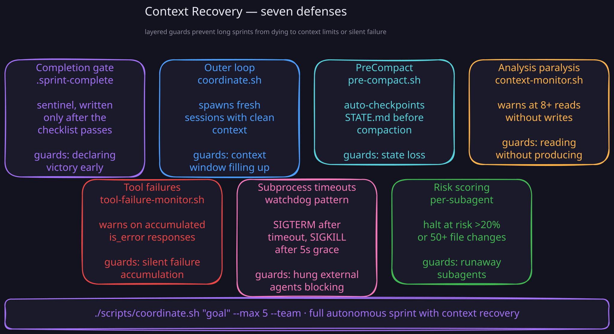
</p>

| Layer | Mechanism | Guards against |
|---|---|---|
| **Completion gating** | The `ops/.sprint-complete` sentinel, created only after verification passes, is the authoritative signal. Under a Claude Code lead the native `/goal` checklist adds a best-effort gate: [`coordinate.sh`](scripts/coordinate.sh) leads every session prompt with it and `at-ship` / `at-coordinate` print a copyable `/goal` line, but headless gating is flaky (probe CC-03 1 of 3, D-030). A Codex lead has no `/goal`, so its sessions complete on the sentinel alone | The lead declaring victory early |
| **Outer loop** | [`scripts/coordinate.sh`](scripts/coordinate.sh) starts a fresh lead session per iteration and runs the lead's launch line from the registry with the `[lead]` model and effort. It runs the git integrity check before each session, stops after one session on a login or quota failure, detects completion via the `ops/.sprint-complete` sentinel, and notifies on completion. A Codex lead's launch line runs with full access, so the script runs it only when you pass `--allow-full-access`; without the flag it prints the line and exits 77. Run it from a terminal or from the lead's own shell; under nohup, cron or CI it exits 45 | Context window filling up |
| **PreCompact** | [`pre-compact.sh`](hooks/handlers/pre-compact.sh) — auto-checkpoints `STATE.md` before context compaction | State loss during mid-sprint compaction |
| **Analysis paralysis** | [`context-monitor.sh`](hooks/handlers/context-monitor.sh) warns at 8+ consecutive reads without writes. The lead's tool vocabulary in the registry decides what counts as a read; under a Codex lead, a shell command that only reads (`cat`, `sed -n`, `git log`) counts | Reading without producing |
| **Tool failure monitor** | [`tool-failure-monitor.sh`](hooks/handlers/tool-failure-monitor.sh) — tracks and warns on accumulated tool failures | Silent failure accumulation |
| **Subprocess timeouts** | Watchdog pattern on all Antigravity/Codex calls — SIGTERM after timeout, SIGKILL after 5s grace | Hung external agents blocking pipeline |
| **Risk scoring** | Per-subagent risk accumulation — halt at >20% or more than 50 changed files | Runaway subagents |

```bash
# Full autonomous sprint with context recovery
./scripts/coordinate.sh "Build the authentication module" --max 5 --convergence deep --team

# With completion notification via webhook
NOTIFY_WEBHOOK_URL="https://hooks.slack.com/..." ./scripts/coordinate.sh "Build auth" --max 5

# Under a Codex lead: preview the launch line and prompt, then run with full access acknowledged
./scripts/coordinate.sh "Build auth" --dry-run --lead codex
./scripts/coordinate.sh "Build auth" --max 5 --allow-full-access
```

### Key constraints

- `CONTRACTS.md` is never modified directly during review — changes must be proposed in [`MEMORY.md`](ops/MEMORY.md) first
- Any roster member is an eligible builder — the single-writer rule is retired. Safety is per-task leases + worktree isolation + mandatory cross-review by a pinned non-author reviewer, not write-restriction; no agent self-merges, and the lead promotes to the main branch only after the wave's integration check
- Parallel reviews are safe because reviewers write to separate `ops/REVIEW_*.md` files
- Maximum 3 review cycles per task before escalating to user
- Phase 0 can be skipped for small bug fixes, same-session continuations, or unchanged codebases (use [`at-quick`](skills/at-quick/SKILL.md))
- Completion requires creating the `ops/.sprint-complete` runtime marker only after the [verification checklist](skills/verification-before-completion/SKILL.md) passes

---

## How it compares

This framework was informed by analyzing the [Claude Code Blueprint](https://github.com/Ninety2UA/claude-code-blueprint) and selectively adopting patterns that complement our heterogeneous multi-model architecture.

| Dimension | [Claude Code Blueprint](https://github.com/Ninety2UA/claude-code-blueprint) | This framework |
|---|---|---|
| **Agent model** | Homogeneous (Claude-only) | Heterogeneous eight-CLI builder pool (core trio + optional OpenCode/Kimi/Cursor/Devin/Grok Build) |
| **Review agents** | 6 Claude subagents | 7 reviewers (2 external + 5 specialist personas) |
| **Codebase analysis** | Claude subagent | [Antigravity CLI](https://antigravity.google/cli) (1M token context) |
| **Test execution** | Claude subagent | [Codex CLI](https://github.com/openai/codex) (sandboxed execution) |
| **Coordination** | Native subagents + git | File protocol + bash + personas + teams |
| **Skills** | Claude-only | Portable across all roster CLIs via [injection](#portable-skill-injection) |
| **Dependencies** | Zero (markdown only) | Core trio required (Claude + Antigravity + Codex); optional tier adds OpenCode/Kimi/Cursor/Devin/Grok Build |

<details>
<summary><strong>What we adopted from Blueprint</strong></summary>

Confidence tiering, suppressions lists, review synthesis, wave orchestration, quality gates, institutional knowledge compounding, dual-loop context management, risk scoring, shadow path tracing, session continuity. The Blueprint's completion-promise pattern and ship-loop Stop-hook architecture were also adopted, then retired in 2026-07 when Claude Code's native `/goal` gating covered them (probe CC-03) — completion is now signaled via the `ops/.sprint-complete` sentinel.
</details>

<details>
<summary><strong>What we added beyond Blueprint</strong></summary>

Multi-model coordination, portable skill injection into external agents, agent teams as a build mode, Antigravity Phase 0 analysis with 1M token context, Codex sandboxed testing, file-based coordination protocol for cross-model state sharing.
</details>

---

## When NOT to use this framework

| Situation | What to do instead |
|---|---|
| Trivial task (< 30 minutes) | Just use Claude Code directly, or [`at-quick`](skills/at-quick/SKILL.md) |
| Pure exploration / brainstorming | Single agent conversation |
| Tight deadline, no tests needed | Claude Code solo, skip review + test |
| Non-code deliverables | [Antigravity CLI](https://antigravity.google/cli) solo with its large context |

---

## FAQ

<details>
<summary><strong>Can I use this with an existing project?</strong></summary>

Yes. Install the plugin as described under <a href="#installation">Installation</a> and start a session in the project. The framework is additive: it adds <code>ops/</code> and doesn't modify your existing code.
</details>

<details>
<summary><strong>Do I need all the CLIs?</strong></summary>

The <strong>core trio</strong> (Claude, Antigravity, Codex) is the supported baseline; run <a href="skills/at-setup/SKILL.md"><code>at-setup</code></a> to get them live. The <strong>optional tier</strong> (OpenCode, Kimi, Cursor, Devin, Grok Build) is optional: enroll any subset through <code>at-setup</code>, and an absent one is skipped cleanly in every roster fallback chain. Claude alone can still run the pipeline in a degraded mode, without the multi-model review, test and analysis lanes.
</details>

<details>
<summary><strong>Do I need all the skills?</strong></summary>

No. Skills activate contextually. If you never cut scope, the <a href="skills/scope-cutting/SKILL.md">scope-cutting</a> skill won't activate. You can delete any skill directory you don't want.
</details>

<details>
<summary><strong>How do personas differ from skills?</strong></summary>

<strong>Skills</strong> are methodology documents that guide an agent's behavior. <strong>Personas</strong> are separate processes that <code>dispatch_persona</code> starts, each with its own context and only the tools its manifest entry allows. Skills can be injected into any agent (including external ones like Antigravity and Codex).
</details>

<details>
<summary><strong>What are Agent Teams?</strong></summary>

<a href="personas/team-lead.md">Agent Teams</a> spawn multiple Claude Code instances that collaborate through a shared task list and messaging. Unlike review swarms (read-only analysis), Agent Teams are peers that divide file ownership and coordinate builds. Enable with <code>CLAUDE_CODE_EXPERIMENTAL_AGENT_TEAMS: "1"</code> in settings.json.
</details>

<details>
<summary><strong>Do small bug fixes need the full pipeline?</strong></summary>

No. Use <a href="skills/at-quick/SKILL.md"><code>at-quick</code></a> for changes touching fewer than 3 files. It skips Phase 0, plan validation, and the full review swarm.
</details>

<details>
<summary><strong>How does context exhaustion recovery work?</strong></summary>

Two layers. <strong>Inside</strong> a session, the <code>ops/.sprint-complete</code> sentinel is the authoritative completion signal — created only after the verification checklist passes. Under a Claude Code lead, the native <code>/goal</code> checklist is a best-effort assist on top: <a href="scripts/coordinate.sh"><code>coordinate.sh</code></a> leads every composed prompt with a <code>/goal</code> line, and <code>at-ship</code>/<code>at-coordinate</code> print a copyable one for interactive runs, but headless gating is model-behavior-dependent (probe CC-03 passed 1 of 3 runs in the 2026-09 cycle, D-030), so nothing relies on it. <strong>Outside</strong> a session, <a href="scripts/coordinate.sh"><code>coordinate.sh</code></a> spawns fresh lead processes with clean context windows, detecting completion via the sentinel; state persists via git and <code>ops/STATE.md</code>. A PreCompact hook auto-checkpoints STATE.md before context compaction.
</details>

<details>
<summary><strong>What is knowledge compounding?</strong></summary>

After solving a non-trivial problem, <a href="skills/at-compound/SKILL.md"><code>at-compound</code></a> saves it as a structured document in <a href="ops/solutions/"><code>ops/solutions/</code></a>. Later <a href="skills/at-plan/SKILL.md"><code>at-plan</code></a> and <a href="skills/at-deep-research/SKILL.md"><code>at-deep-research</code></a> runs search this directory before they start new work.
</details>

---

<a name="recent-changes"></a>
## Release history

Each version's full notes are one file in [`docs/releases/`](docs/releases/), and the release workflow publishes that file as the GitHub release.

<details>
<summary>All releases (19)</summary>

| Version | Date | Summary |
|---|---|---|
| [v4.1.0](docs/releases/v4.1.0.md) | 2026-10-13 | the 4.0 review's residuals fixed: a small reader, bounded reads, process-group time bounds, watched promotion targets, CLAUDE_CONFIG_DIR |
| [v4.0.0](docs/releases/v4.0.0.md) | 2026-10-12 | lead choice (Claude Code or Codex), at- lead workflows, personas, AGENTS.md, Grok Build and Devin |
| [v3.3.3](docs/releases/v3.3.3.md) | 2026-10-01 | protected-path registry, digest-stamped skills, lead git integrity |
| [v3.3.2](docs/releases/v3.3.2.md) | 2026-09-28 | release gate green, OpenCode V2 guard, Cursor Grok 4.7 ids |
| [v3.3.1](docs/releases/v3.3.1.md) | 2026-09-12 | mechanical no-push backstop, quota failure class, split control-plane files |
| [v3.3.0](docs/releases/v3.3.0.md) | 2026-09-11 | September 2026 models, trustworthy completion signals, native agent formats |
| [v3.2.0](docs/releases/v3.2.0.md) | 2026-09-11 | Watch commands become repo-local maintainer tooling |
| [v3.1.0](docs/releases/v3.1.0.md) | 2026-07-22 | Role customization in guided onboarding |
| [v3.0.1](docs/releases/v3.0.1.md) | 2026-07-21 | Landing-page copy + release hygiene |
| [v3.0.0](docs/releases/v3.0.0.md) | 2026-07-18 | CLI modernization + six-CLI builder pool |
| [v2.4.3](docs/releases/v2.4.3.md) | 2026-05-12 | Sequential downgrade ladder for narrow runtime tasks |
| [v2.4.2](docs/releases/v2.4.2.md) | 2026-05-12 | Third audit pass — both prior passes missed siblings of the same anti-pattern |
| [v2.4.1](docs/releases/v2.4.1.md) | 2026-05-12 | Second audit pass — surviving blocker + 27 findings actioned |
| [v2.4.0](docs/releases/v2.4.0.md) | 2026-04-20 | Framework self-audit — two blockers + four HIGH fixes |
| [v2.3.0](docs/releases/v2.3.0.md) | 2026-04-20 | Subagent hardening pass (Gemini + Codex docs alignment) |
| [v2.2.0](docs/releases/v2.2.0.md) | 2026-04-06 | Opus max effort, reliability patterns, and framework audit |
| [unversioned](docs/releases/2026-04-02-reliability-hardening-and-tactical-enhancements.md) | 2026-04-02 | Reliability hardening and tactical enhancements |
| [v2.0.0](docs/releases/v2.0.0.md) | 2026-03-31 | Claude Code plugin conversion |
| [unversioned](docs/releases/2026-03-31-four-pass-audit-and-blueprint-alignment.md) | 2026-03-31 | Four-pass audit and Blueprint alignment |

</details>

---

## License

MIT

---

<p align="center">
  <sub>Built for teams that believe AI-assisted development should get better with every sprint.</sub>
</p>

<p align="center">
  <a href="docs/agent-triforge.md">Full Documentation</a> ·
  <a href="AGENTS.md">AGENTS.md</a> ·
  <a href="https://antigravity.google/cli">Antigravity CLI</a> ·
  <a href="https://github.com/openai/codex">Codex CLI</a>
</p>
