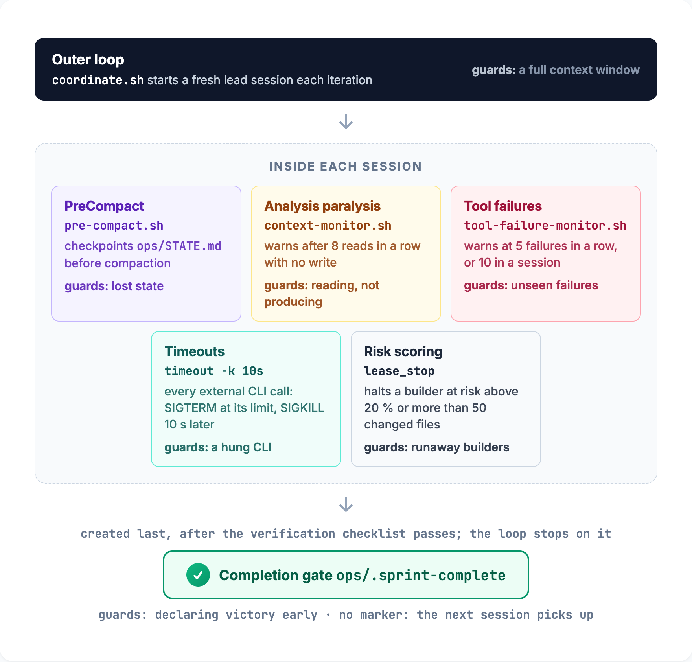

[← Agent Triforge](../README.md#documentation)

# How it works under the hood

The mechanics behind the workflows. The [design document](agent-triforge.md) covers the full design: phases, coordination modes, the shared `ops/` files and the security model.

## Portable skill injection

Skills are model-agnostic markdown files that any agent can consume, so the methodology an agent follows is decoupled from the model that executes it:

```bash
# All external-agent invocations go through the unified helper
source ${CLAUDE_PLUGIN_ROOT}/scripts/invoke-external.sh

# Antigravity via native agent definition (skill embedded in the agent body)
invoke_antigravity "codebase-analyst" \
  "Analyze the full codebase. Write findings to ops/ARCHITECTURE.md." \
  "$AGY_OUT" 600

# Codex via native agent definition (skill embedded in the agent body)
invoke_codex "test_writer" \
  "Write tests for changed files." \
  "$CODEX_OUT" 900
```

`TRIFORGE_AGY_MODE` (`injection` | `native` | `auto`; default `auto` since 4.0) governs how the helper routes Antigravity. The agent pack (`antigravity-agents/`) ships in agy's Markdown-agent format (`mainAgent`/`subagent`/`commandExecutionPolicy`, agy tool names), and session start reinstalls it whenever the plugin version changes. `native` passes `--agent <name>` when `agy agents` lists it, `auto` goes native only when it is listed, and `injection` prepends the agent body (with its embedded skill) to the prompt. The default became `auto` after the native round-trip (AGY-12) and the native-mode negative (AGY-16) passed in two consecutive probe records (D-042); a regression in either row reverts it. Codex definitions deploy as `.codex/triforge-agents.toml`, never under `.codex/agents/`, which Codex ≥ 0.147 sweeps as standalone role files.

## Context Recovery

Seven safeguards keep long sprints from dying to context limits:

<p align="center">
  
</p>

| Layer | Mechanism | Guards against |
|---|---|---|
| Completion gating | The `ops/.sprint-complete` sentinel, created only after verification passes, is the authoritative signal. Under a Claude Code lead the native `/goal` checklist adds a best-effort gate: [`coordinate.sh`](../scripts/coordinate.sh) leads every session prompt with it and `at-ship` / `at-coordinate` print a copyable `/goal` line, but headless gating is flaky (probe CC-03 1 of 3, D-030). A Codex lead has no `/goal`, so its sessions complete on the sentinel alone | The lead declaring victory early |
| Outer loop | [`scripts/coordinate.sh`](../scripts/coordinate.sh) starts a fresh lead session per iteration with the lead's registry launch line and the `[lead]` model and effort, runs the git integrity check before each session, stops after one session on a login or quota failure, detects completion through the sentinel, and notifies you. A Codex lead's launch line needs `--allow-full-access` (otherwise it prints the line and exits 77), and under nohup, cron or CI the script exits 45. [Unattended runs](unattended-runs.md) walks through it | Context window filling up |
| PreCompact | [`pre-compact.sh`](../hooks/handlers/pre-compact.sh) checkpoints `STATE.md` before context compaction | State loss during mid-sprint compaction |
| Analysis paralysis | [`context-monitor.sh`](../hooks/handlers/context-monitor.sh) warns at 8+ consecutive reads without writes. The lead's tool vocabulary in the registry decides what counts as a read; under a Codex lead, a shell command that only reads (`cat`, `sed -n`, `git log`) counts | Reading without producing |
| Tool failure monitor | [`tool-failure-monitor.sh`](../hooks/handlers/tool-failure-monitor.sh) warns at 5 consecutive or 10 total tool failures in a session | Silent failure accumulation |
| Subprocess timeouts | Every Antigravity and Codex call runs under `timeout -k 10s`: SIGTERM at its limit, SIGKILL 10 s later | Hung external agents blocking the pipeline |
| Risk scoring | Per-builder risk accumulation; a builder is halted at risk above 20 % or more than 50 changed files | Runaway builders |

## Key constraints

- `CONTRACTS.md` is never modified directly during review; changes are proposed in [`MEMORY.md`](../ops/MEMORY.md) first.
- Any roster member is an eligible builder, and the single-writer rule is retired. Safety comes from per-task leases, worktree isolation and mandatory cross-review by a pinned non-author reviewer. No agent self-merges, and the lead promotes to the main branch only after the wave's integration check.
- Parallel reviews are safe because reviewers write to separate `ops/REVIEW_*.md` files.
- A task gets at most 3 review cycles before it escalates to you.
- Phase 0 can be skipped for small bug fixes, same-session continuations, or unchanged codebases (use [`at-quick`](../skills/at-quick/SKILL.md)).
- Completion requires creating the `ops/.sprint-complete` runtime marker only after the [verification checklist](../skills/verification-before-completion/SKILL.md) passes.

## Data egress and credentials

Each dispatched CLI sends its task prompt and the code context it is handed to that CLI's model provider. Under the shipped defaults, your code and task context reach Anthropic (Claude), Google (Antigravity, Gemini 3.8 Flash) and OpenAI (Codex) for the core trio. Each optional member you enroll adds its provider: Zhipu / Z.ai for GLM, routed through the OpenRouter intermediary, which also sees the traffic; Moonshot for Kimi; xAI for Grok Build, and for Grok through Cursor; and Cognition for Devin (a model outside Cognition's SWE family also reaches that model's provider). Cognition may train on that data unless the account opts out, so `at-setup` records your consent before Devin joins the roster.

`ops/roster.toml` is the control surface: disable a member (`enabled = false`) or drop a provider's model from every role to take that provider out of the egress set. The core trio always stays.

Credentials never live in the repo. Each adapter reads its own from the OS or vendor store: CLI logins, `OPENROUTER_API_KEY`, `CURSOR_API_KEY`, `kimi login` (OAuth or API key), the `devin auth login` token in `~/.local/share/devin/`, `grok login` or `XAI_API_KEY`. The lease environment allowlist scopes them per adapter, and captured output is scrubbed before it lands in `ops/`. Rotation follows each vendor's own token flow: revoke, log in again or set a new key, then rerun `at-setup`.
