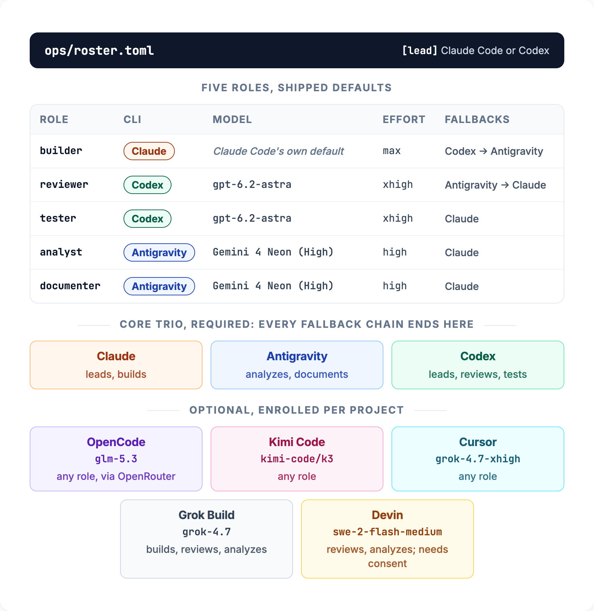

[← Agent Triforge](../README.md#documentation)

# Model and effort

Each role's CLI, model and effort come from `ops/roster.toml`. A field you leave unset inherits the shipped default (the role table in `scripts/lib/roster.sh` and the CLI registry in `scripts/lib/registry.sh`), so deleting the file is safe. `at-setup`'s role step edits it for you (`at-setup roles` jumps straight there), and a hand edit is checked when the roster loads.

  

| Role | CLI | Model | Effort | Fallbacks |
|---|---|---|---|---|
| builder | Claude | Claude Code's own default (the roster's `model` is empty) | `max` | Codex → Antigravity |
| reviewer | Codex | `gpt-6.2-astra` | `xhigh` | Antigravity → Claude |
| tester | Codex | `gpt-6.2-astra` | `xhigh` | Claude |
| analyst | Antigravity | `Gemini 4 Neon (High)` | `high` | Claude |
| documenter | Antigravity | `Gemini 4 Neon (High)` | `high` | Claude |

How each CLI takes its model and effort:

- Antigravity always gets an explicit `--model`, because its own default changes with the plan and the release. The shipped pin is the newest Gemini, Gemini 4 Neon (2026-11-18), at (High), the default level (D-085, superseding the every-tier rule of D-022 and D-060); both (XHigh) and (High) answered READY on agy 1.5.14 on 2026-11-23. The suffix is agy's effort control, so a role's `effort` maps into it: `low` to (Low), `medium` to (Medium), `high` to (High), and `xhigh` and `max` to (XHigh) on Neon and Hydrogen, (High) elsewhere. So (XHigh) runs only when you choose `xhigh` or `max` for an agy role in `at-setup`.
- Neon, Gemini 4 Argon and Gemini 4 Hydrogen are on paid Google AI Pro, Ultra and Enterprise plans only, not on Free or Google AI Plus, and Gemini 4 Carbon on Ultra and Enterprise only. So before each agy call Triforge reads `agy models`: when the account's list lacks the asked Gemini 4 model, the call runs the first one it does list of Gemini 4 Hydrogen, Carbon and Argon (newest launch first), else Gemini 3.8 Flash, the newest model on every plan, at the same level ((XHigh) runs as (High) on a family without it), and prints a NOTE. A listing that fails changes nothing. To pin Flash outright, set a role's `model` to `"Gemini 3.8 Flash (High)"`. `"Gemini 4 Argon (High)"` answered READY on agy 1.5.1 on 2026-11-05.
- Gemini 3.1 Pro (`"Gemini 3.1 Pro (High)"` or `(Low)`; no Medium tier) is Enterprise only on that page. Elsewhere `agy models` does not list it and agy refuses it as an unknown model, as it did on the account that ran Argon.
- The July 2026 plan's never-Flash rule (AE2) is superseded by D-022, the September 2026 decision; if you work from that plan, D-022 wins.
- Codex runs `gpt-6.2-astra` at `xhigh` (D-085, replacing `gpt-6-astra` from D-021 and ruling s4). It needs Codex 0.166.0 or later and answered READY on 0.171.0 on 2026-11-23. A role can pick another Codex model: `gpt-6.2-sol` (same floor; Codex 0.169.1 made it Codex's own default), `gpt-6-astra` (the previous pin), and `gpt-6.1-sol`, which answered on 0.160.0.
- Cursor runs a suffixed Grok id, `grok-4.7-xhigh`, never the Auto router. Its effort is the id's suffix (`low`, `medium`, `high`, `xhigh`).
- The claude builder lane runs Claude Code's own default model at `max` effort. Claude personas and sub-agents follow the ladder below.
- The optional members' pins are OpenCode `openrouter/z-ai/glm-5.3`, Kimi `kimi-code/k3`, Devin `swe-2-flash-medium` (the newest model a Devin Free account runs; `swe-2-high` and `swe-2-max` need Pro) and Grok Build `grok-4.7` (its effort rides in `--effort`).
- A role that sets only `effort` keeps its default CLI and model. Roster model overrides reach each CLI through its registry `model_env`.

The lead takes its model and effort from the `[lead]` table (`cli`, `model`, `effort`). Left out, a Codex lead runs `gpt-6.2-astra` at `xhigh`, and a Claude Code lead runs your session's model and effort setting. `coordinate.sh` and the launch line `at-setup` prints add them as flags.

Claude personas and sub-agents step down one ladder for narrow runtime tasks: Fable 5.2 (the `fable` alias since Claude Code 2.1.321) at `max` for the lead and the never-downgrade tier (the latest Opus at `max` where Fable isn't available), then Opus 5.5 at `xhigh` (Claude Code ≥ 2.1.280), Opus 5.5 at `high`, and Sonnet 5.5 at `high`. `security-sentinel`, `plan-checker` and `findings-synthesizer` are never downgraded. Each persona's starting tier is in [`personas/manifest.toml`](../personas/manifest.toml). The ladder has one definition, `TRIFORGE_MODEL_LADDER` in [`scripts/lib/registry.sh`](../scripts/lib/registry.sh); `triforge_ladder` prints it, and `validate-versions.sh` fails when another file restates it.

## Assignment heuristic

Roles come from `ops/roster.toml` (`resolve_role <role>`). The defaults below are the shipped posture and restrict no one: any member can be the builder, and every build merges only after cross-review.

| Question | Role (default; roster-assignable) |
|---|---|
| Produces code? | builder role: default Claude, assignable to any member; built under a lease and cross-reviewed before merge |
| Evaluates existing code? | reviewer role ([Codex](https://github.com/openai/codex) + [Antigravity](https://antigravity.google/cli)) + [review personas](personas.md#review-specialists-6) in parallel |
| Runs/executes something? | tester role (default [Codex CLI](https://github.com/openai/codex)) |
| Produces documentation? | documenter role (default [Antigravity CLI](https://antigravity.google/cli)) |
| Touches shared interfaces? | builder implements under a lease → pinned non-author reviewer cross-reviews → tester validates |
| Ambiguous? | the lead takes it as builder, flags for parallel review |
