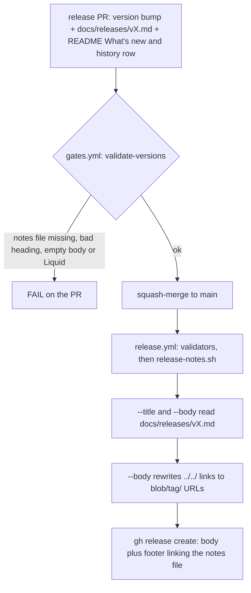
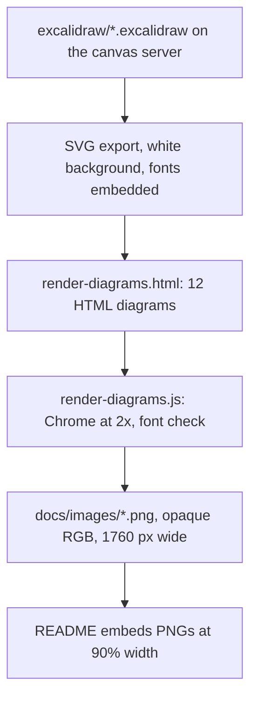

# README in Blueprint's Structure - Plan

## Goal Capsule

- **Objective:** A reader who opens Agent Triforge on GitHub, in light or dark mode, on a desktop or a phone, finds what Triforge is, how to install and run it, and what changed in the latest release in the order agent-blueprint's README uses, with light diagrams they can read (inline on a desktop, opened full size on a phone), and the next release still publishes its GitHub release notes without a manual step.
- **Means:** The README is rewritten to blueprint's section flow; its diagrams are rebuilt the way blueprint builds them (KTD5, KTD6); the release ledger moves to one notes file per version under `docs/releases/`, which the release tooling reads (KTD1).
- **Authority:** the Product Contract's R-IDs win on what the reader sees and what the release tooling does; KTDs win on mechanism within them; a unit overrides neither. Key Decisions below were settled with the user and are not reopened during execution.
- **Stop conditions:**
  - Stop and ask when evidence shows a settled decision cannot work.
  - Stop and ask before touching the hero banner (`docs/images/hero-forge.svg`) or the website (`docs/index.html`), both out of scope by the user's decision.
  - Stop when a unit would change more than 50 files (AGENTS.md halt rule): split it.
- **Execution profile:** units are built in their own worktrees by workers or the lead and integrated by the lead with path-limited commits, as 4.1.0 was. The worker model is chosen with the user at the start of `ce-work` (the 4.1 precedent was Opus 5.5 at xhigh).
- **Who finishes:** `ce-work` builds and verifies; `ce-code-review` (the user's review setup: Fable reviewers at high plus Codex `gpt-6-astra` at xhigh) reviews; the lead opens one PR to `main`; the user approves the merge (protected paths); the merge is a squash.

---

## Product Contract

### Summary

The README is restructured to follow agent-blueprint's README: hero, tagline and nav, why, the latest release's What's new, install, quick start, unattended runs, upgrade and update, what you get, workflow, team work and swarms, model and effort, references, customization, how it works, compatibility, a collapsed release history, FAQ, contributing and license. Its 13 dark diagrams are replaced by light diagrams built like blueprint's, plus two new ones for the install and unattended-run sections. The 520-line release ledger moves out of the README into `docs/releases/`, and the release script and validators read it from there.

### Problem Frame

The README opens with long release notes and carries 13 dark diagrams that are hard to read, worst on GitHub's light theme and on phones. Its order grew release by release and no longer leads a new reader from "what is this" to "it runs". Agent-blueprint, by the same author, has a README whose order and diagrams the user wants Triforge to share. The ledger in the README is also what `scripts/release-notes.sh` reads to publish each GitHub release, so moving it has to keep that path working.

### Key Decisions

- **The README shows only the latest What's new** (session-settled: user-directed — chosen over keeping a What's new block per version: the older blocks belong in the release notes). Governs R1, R7.
- **Diagrams are made blueprint's way** (session-settled: user-directed — chosen over restyling all diagrams in Excalidraw: blueprint draws most diagrams as HTML/CSS rendered to PNG and the free-form ones in clean Excalidraw). Governs R9, R10.
- **Release notes move to `docs/releases/`, one file per version, with a short collapsed table in the README** (session-settled: user-directed — chosen over keeping the full notes in the README). Governs R12, R13, R14.
- **The hero banner and the website stay as they are for now** (session-settled: user-directed — the user will redo both later). Governs R11.

### Requirements

**Reader-facing README**

- R1. The README follows blueprint's section order (the target outline in KTD8), with one What's new block, for the current version, under the heading `## What's new (v<version>)`.
- R2. Every fact the current README states stays true and findable: the lead choice, the builder pool and roster, leases and their safety mechanisms, the coordination modes, the 17 lead workflows, the 10 portable skills and their per-CLI paths, the 19 personas, prerequisites and compatibility floors, data egress, upgrading from 3.x and rolling back to 3.3.3, the FAQ, how it compares and when not to use it.
- R3. Headings that other files cite by name keep their text, so their anchors and citations still resolve (KTD9).
- R4. Old links keep working: `#recent-changes` and `#whats-new` land on the release history and the current What's new; every in-README link resolves.
- R5. A 3.x user who follows the session-start warning to "Upgrading from 3.x" finds it from the nav and the install section, not only from the current What's new.
- R6. The Codex install step states the `[projects."<abs-path>"] trust_level = "trusted"` entry that `templates/.codex/config.toml` points readers to.

**Release history**

- R7. Each version's old What's new block and its ledger entry live together in its notes file, so no fact from either is lost (KTD2).
- R8. The README ends its reference sections with a collapsed release history table: one row per notes file with version, date and a one-line summary, each linking its file.

**Diagrams**

- R9. Every README diagram is a light, opaque 2x PNG whose labels read at desktop width on GitHub's light and dark themes; on a 390 px phone, tapping it opens the full-size image, whose labels read (KTD5).
- R10. Each diagram's text matches the current framework (4.1.0): names, counts, pins and flows.
- R11. `docs/images/hero-forge.svg` and the website's four SVGs (`hero-forge`, `builder-pool`, `roster`, `lease-lifecycle`) stay in place unchanged.

**Release tooling**

- R12. A release published after this change takes its title and body from `docs/releases/v<version>.md`, and its links work on the GitHub release page.
- R13. The validators fail a PR whose plugin version has no notes file, and keep checking the README sections outside the release history.
- R14. AGENTS.md, the PR template, `docs/agent-triforge.md` and `docs/rule-inventory.md` name the notes file wherever they named the README ledger, within AGENTS.md's size budget.

### Success Criteria

- A reader on a desktop, in each GitHub theme, can read every diagram's labels inline; on a 390 px phone, every diagram's labels read once the image is opened.
- `bash scripts/release-notes.sh --title 4.1.0` prints the same title as the published v4.1.0 release, and `--target 4.1.0` the same commit.
- The README's line count drops by roughly the 520 ledger lines, with no fact lost (the coverage check in U1 and the review in U5 show it).

### Scope Boundaries

- The hero banner (`docs/images/hero-forge.svg`) and the website (`docs/index.html`, its v4.0.0 badge, its What's New section, its 404 "Documentation" footer link) are untouched.
- No version bump: the new README, diagrams and release tooling first ship with the next release.
- No change to how Triforge runs: skills, scripts other than the two release tools, hooks and personas are untouched.

#### Deferred to Follow-Up Work

- Refresh the website and switch it to the new diagrams (the user's later pass).
- Redraw the hero banner (the user's later pass).
- release.yml's `--target` fallback to `GITHUB_SHA` when an old version's bump commit is not found (pre-existing; it only matters for back-publishing).

#### Considered and not built

- A validator check that the README's release history links the current version's notes file: a missing row is visible in review and harms nothing; build it if a release ships without its row.
- Vendored font files for the renderer: blueprint loads Inter and JetBrains Mono from Google Fonts; the renderer fails loudly when they do not load (KTD6) instead of shipping fallback fonts silently.
- `<picture>` dark variants of each diagram: blueprint ships one light image with its own opaque card; two variants would double the maintenance.

### Sources

- agent-blueprint README and diagram sources: `https://github.com/Ninety2UA/agent-blueprint` (`README.md`, `docs/images/render-diagrams.html`, `docs/images/render-diagrams.js`, `docs/images/eight-tools.excalidraw`, `docs/images/ship-runner.png`).
- Release ledger consumers: `scripts/release-notes.sh` (ledger_title, ledger_body, whats_new_body, footer, `--target`), `scripts/validate-versions.sh` (lockstep check 1, release-notes check, `README_HISTORY_START` used by checks 2, 4, 5, 9 and 11, `SWEEP_EXCLUDE_RE`), `scripts/fixtures/validate-versions/` (`clean`, `lockstep-marketplace-drift`, `lockstep-marketplace-entry-drift`), `.github/workflows/release.yml`, `.github/PULL_REQUEST_TEMPLATE.md`, `AGENTS.md` (Versions and Release), `docs/agent-triforge.md` (release checklist), `docs/rule-inventory.md` (rows 174 and 175).
- Heading citations: `scripts/lib/bootstrap.sh` ("Upgrading from 3.x", asserted by SELF-21), `.claude/commands/cli-watch.md` and `.claude/commands/repo-watch.md` ("Keeping the framework current"), `docs/agent-triforge.md` ("Compatibility"), `docs/rule-inventory.md` (section names in many rows).
- Rendering precedent on this machine: `_tools/triforge-hero/build/capture.js` loads Playwright from the global `@playwright/cli` install and launches system Chrome; the Excalidraw canvas server pipeline is in the project memory note on diagrams.

---

## Planning Contract

### Key Technical Decisions

- KTD1. **The notes file is the release source of truth.** `docs/releases/v<version>.md` starts with `# <YYYY-MM-DD> — v<version>: <title>` (the old ledger heading with one `#`), has no front matter, and its body is every line after that heading. The body's first section is `## What's new`, holding that version's README What's new text, followed by the details. `release-notes.sh` keeps its "text after the first `: `" title rule and reads the body to end of file; the README What's new fallback is removed, so a missing notes file fails the release (exit 1). The two unversioned ledger entries become `docs/releases/2026-04-02-reliability-hardening-and-tactical-enhancements.md` and `docs/releases/2026-03-31-four-pass-audit-and-blueprint-alignment.md`, headed `# <date> — <title>`. (session-settled: user-directed — chosen over keeping the notes in the README: governs R12, R13.)
- KTD2. **Notes files are generated from the committed README, then checked.** A scratch script builds all 19 files (17 versions plus the 2 dated entries) from `git show 64bedd7:README.md`: the version's What's new block first as `## What's new` (its subheadings shifted to fit), then the ledger entry with its headings shifted up two levels (the stray `### Verification` under the 2026-03-31 entry becomes `##`), in-README anchors rewritten to `../../README.md#…`, repo-relative links prefixed with `../../`, and links to files gone from `main` rewritten to `blob/v<version>/…` when that version has a tag, else to `blob/<sha>/…`, where `<sha>` is the oldest commit whose `README.md` carries that entry's heading (v2.4.0, v2.4.2, v2.4.3 and the two dated entries have no tag). The `## What's new (v3.3.0)` block in that README nests other content and is split: its lines up to `### v3.2.0` plus `### Also recent (history)` go to `v3.3.0.md`; the nested `### v3.2.0`, `### v3.1.0` and `### v3.0.0` subsections (with their `####` parts) become the `## What's new` of `v3.2.0.md`, `v3.1.0.md` and `v3.0.0.md`; `### One plugin for either lead` and `### Automatic project bootstrapping` are current README content for U5, not release notes. A second scratch script checks that every non-blank line of every old What's new block and ledger entry lands in exactly one notes file, and in the file this rule assigns it to, after those rewrites. The uncommitted README edit on the branch is superseded by U5.
- KTD3. **Release bodies carry absolute links.** `release-notes.sh --body` rewrites `](../../<path>)` to `](https://github.com/Ninety2UA/agent-triforge/blob/<tag>/<path>)`, using awk or sed that runs under both GNU (release.yml runs on Ubuntu) and BSD. The footer links the notes file at the tag when the tag (or the `--target` commit) contains it, else at `main`; the compare link stays.
- KTD4. **The validators' README boundary becomes a section.** Checks 2, 4, 5, 9 and 11 skip the README from `^## Release history` to the next `^## ` heading, not to end of file, so FAQ, Contributing and License stay checked. `docs/releases` joins `SWEEP_EXCLUDE_RE` (old notes hold old pins on purpose). The release-notes check requires `docs/releases/v<plugin version>.md` with a matching `v<version>: ` heading, a non-empty title and a non-empty body, and fails when a non-blank line of the README's What's new block for that version (heading excluded, after KTD2's link rewrites) is missing from the notes file, so each release's What's new text is kept when the next release replaces it. A Liquid check fails when any Markdown file under `docs/` holds a Liquid output or tag delimiter (a doubled opening brace, or an opening brace followed by a percent sign): GitHub Pages builds `docs/` with Jekyll, and one such delimiter corrupts the page or stops the site from updating. The lockstep check keeps reading `## What's new (v<version>)`.
- KTD5. **HTML/CSS diagrams follow blueprint's design system.** `docs/images/render-diagrams.html` holds one `.diagram` container per diagram: an 880 px card, 48 px by 44 px padding, 16 px radius, white on `#f8fafc`, Inter for text and JetBrains Mono for code, Tailwind-scale pastel fills with matching strokes, a navy (`#0f172a`) title block or gradient badges, spaced uppercase captions and slate arrows. Each CLI keeps its identity hue in light form (Claude orange, Antigravity blue, Codex green, OpenCode violet, Kimi pink, Cursor cyan, Devin amber, Grok slate). Text is at least 15 px and a row holds at most about six boxes, as in blueprint; inline on a phone the card scales to about 0.4, so phone readers open the image, as they do on blueprint's README. Every PNG is opaque RGB.
- KTD6. **The renderer is blueprint's script, hardened.** `docs/images/render-diagrams.js` serves its folder over HTTP on a free port, launches system Chrome (`channel: 'chrome'`) and falls back to bundled Chromium, resolves Playwright from `require('playwright')`, then the global npm root, then the global `@playwright/cli` copy (the error names the install command), waits for `document.fonts.ready`, and exits non-zero unless `document.fonts` holds a FontFace for Inter and one for JetBrains Mono with status `loaded` (`document.fonts.check` alone returns true when no face for the family exists, so it passes when the stylesheet never loads), when an `--only` id is unknown, or when nothing rendered. It screenshots each `.diagram` at `deviceScaleFactor: 2`. A full render writes `docs/images/render-diagrams.sha256` with the sha256 of `render-diagrams.html` and of each `docs/images/excalidraw/*.svg`; validate-versions fails when the stamp does not match those files, naming `node docs/images/render-diagrams.js` as the fix, so a source edited without a re-render cannot pass the gates with stale PNGs. It lives under `docs/images/`, not `scripts/`, because the root `package.json` may hold no dependencies and SELF-27 counts `scripts/*.sh`. The stale-pin sweep, the count check and the bare-`$at-` check scan `render-diagrams.html` (a carve-out from the `docs/images` exclusion), so a model bump that leaves a diagram stale fails the gates.
- KTD7. **Free-form diagrams are clean Excalidraw.** The install routes, the unattended-run loop and the lease lifecycle are drawn on the local canvas server with the `/excalidraw` skill: every element `roughness: 0`, text `fontFamily: 6` (Nunito), white background, the KTD5 palette. Each is exported as SVG with its background (fonts embedded) and committed with its `.excalidraw` source under `docs/images/excalidraw/`; `render-diagrams.html` places each SVG in its own `.diagram` card, so the same renderer rasterizes it at 2x inside the same frame as the HTML diagrams.
- KTD8. **Target README outline.** Hero (unchanged) · tagline · nav · Why Agent Triforge · What's new · Install (Prerequisites, Installation for both leads, Portable skills in Devin and Pi, Verify installation) · Getting started · Unattended runs · Upgrading from 3.x (Command map, Rolling back to 3.3.3) · Update · What you get (Project structure, Automatic project bootstrapping, Shared file protocol) · Workflow (Sprint Pipeline, Planning Pipeline, Test Pipeline, Debugging, Quality Gates) · Team work and swarms (The builder pool, Four coordination modes, Wave Orchestration, Review Swarm, Deep Research, the knowledge loop) · Model and effort (roster pins, the ladder, Assignment heuristic) · Lead workflows reference · Skills reference (Portable skills across the eight CLIs) · Personas reference · Customization · How it works under the hood (Portable skill injection, Context Recovery, Data egress and credentials) · Compatibility · How it compares · When NOT to use this framework · Release history · FAQ · Contributing (Development, Keeping the framework current) · License. Sections demoted from H2 to H3 keep their heading text, so their anchors do not change.
- KTD9. **Cited heading texts stay verbatim.** "Upgrading from 3.x", "Keeping the framework current (`/cli-watch`, `/repo-watch` — maintainers)", "Compatibility", "Prerequisites", "Portable skills across the eight CLIs", "The builder pool", "Data egress and credentials", "Getting started", "Installation", "Development (for contributors)", "Shared file protocol", "Quality Gates", "Project structure", "Skills reference", "Personas reference", "Assignment heuristic" and "Context Recovery" keep their text; blueprint's names are used only for new grouping sections. Nothing protected that cites a heading is edited.
- KTD10. **Stable anchors.** `` sits before the What's new heading and `` before `## Release history`; the nav links `#whats-new`, `#upgrading-from-3x` and `#recent-changes`. No link target sits inside a `
` block.
- KTD11. **AGENTS.md changes fit its budget.** Line 54 (Versions), line 91 (Release step 3) and line 92 name `docs/releases/v<version>.md` and its heading instead of the README ledger; the net change stays within the 7 bytes left (16377 of 16384), checked with `validate-versions.sh --only budget`.
- KTD12. **Orphaned dark SVGs are deleted.** The ten SVGs no longer embedded anywhere (`knowledge-loop`, `sprint-lifecycle`, `planning-flow`, `research-swarm`, `wave-orchestration`, `review-swarm`, `testing-flow`, `debug-flow`, `quality-gates`, `context-recovery`) are removed; git keeps them. The four the website embeds stay.

### High-Level Technical Design

The release path after the change:

The diagram build:

Diagram inventory:

| Diagram | README section | Built with | Replaces |
|---|---|---|---|
| install-routes (new) | Install | Excalidraw | none |
| coordinate-loop (new) | Unattended runs | Excalidraw | none |
| lease-lifecycle | Team work and swarms (The builder pool) | Excalidraw | lease-lifecycle.svg in README |
| builder-pool | Team work and swarms (The builder pool) | HTML | builder-pool.svg in README |
| roster | Team work and swarms (The builder pool) | HTML | roster.svg in README |
| knowledge-loop | Team work and swarms | HTML | knowledge-loop.svg |
| sprint-lifecycle | Workflow (Sprint Pipeline) | HTML | sprint-lifecycle.svg |
| planning-flow | Workflow (Planning Pipeline) | HTML | planning-flow.svg |
| wave-orchestration | Team work and swarms (Wave Orchestration) | HTML | wave-orchestration.svg |
| review-swarm | Team work and swarms (Review Swarm) | HTML | review-swarm.svg |
| research-swarm | Team work and swarms (Deep Research) | HTML | research-swarm.svg |
| testing-flow | Workflow (Test Pipeline) | HTML | testing-flow.svg |
| debug-flow | Workflow (Debugging) | HTML | debug-flow.svg |
| quality-gates | Workflow (Quality Gates) | HTML | quality-gates.svg |
| context-recovery | How it works under the hood | HTML | context-recovery.svg |

### Implementation Constraints

- Protected paths touched: `scripts/release-notes.sh`, `scripts/validate-versions.sh`, `scripts/fixtures/validate-versions/`, `.github/workflows/release.yml`, `.github/PULL_REQUEST_TEMPLATE.md`, `AGENTS.md`. They need the lead's review plus the user's approval of the PR.
- Shell lines follow AGENTS.md's conventions (macOS `/bin/bash` 3.2 and zsh, `set -euo pipefail`, no `grep -P`); `release-notes.sh` also runs on Ubuntu in release.yml; Python in the two protected scripts starts with their prelude copy (SELF-27 compares them byte for byte).
- Never run `git grep -E` with an alternation on this Mac (it leaked hundreds of GB over binary files on 2026-10-13); use the Grep tool, `rg`, `git grep -P` or `-F`.
- New README sentences obey the validators' vocabulary: no stale pins, surface counts only where they are true (19 personas, 27 skills, 10 portable, 17 lead workflows), "more than 50 changed files" wording for the halt rule, and the Codex form `$agent-triforge:at-<name>`.
- Human-facing copy (README, notes intros, alt text) goes through `/no-ai-slop` then `/humanizer`.

### Risks

| Risk | Mitigation |
|---|---|
| A fact from the old README is dropped in the move. | The U1 coverage check, and U5's review against the committed README. |
| The next release body links break on GitHub's release page. | KTD3's rewrite, verified by a `--body` dry run on v4.1.0 and v2.4.0. |
| A diagram renders with fallback fonts and nobody notices. | KTD6's loaded-FontFace check; U6 compares a fresh render with the committed PNGs. |
| The section-scoped boundary exempts or over-scans part of the README. | New fixtures in U2: a halt-rule hit inside the history passes, the same hit in a following `## FAQ` fails. |
| A diagram goes stale at the next model bump. | KTD6's carve-out puts `render-diagrams.html` under the sweep and count checks, and its render stamp fails the gates when the source changed without a re-render. |

### System-Wide Impact

- Every future release changes shape: the maintainer writes `docs/releases/v<version>.md` and a release history row instead of a README ledger entry. AGENTS.md, the PR template and `docs/agent-triforge.md` say so (R14).
- GitHub Pages publishes `docs/releases/*.md` and the new PNGs as static pages; the KTD4 Liquid check keeps a notes file from breaking the site build.
- Plugin installs clone about 1 MB more (15 PNGs) and about 0.6 MB less (10 SVGs).

---

## Implementation Units

### U1. Release notes files from the committed README

- **Goal:** Write the 19 notes files under `docs/releases/`, each combining a version's old What's new block and its ledger entry, with no fact lost.
- **Requirements:** R7, R12 (KTD1, KTD2).
- **Dependencies:** none.
- **Files:** `docs/releases/v4.1.0.md` through `docs/releases/v2.0.0.md` (17 versions), `docs/releases/2026-04-02-reliability-hardening-and-tactical-enhancements.md`, `docs/releases/2026-03-31-four-pass-audit-and-blueprint-alignment.md`; the generator and coverage scripts stay in the session scratchpad, not the repo.
- **Approach:**
  1. Generate every file from `git show 64bedd7:README.md` per KTD2.
  2. Run the coverage check and fix the generator until it reports every old line placed exactly once.
  3. Spot-read the v4.1.0, v3.3.3, v3.0.0 and 2026-03-31 files on GitHub's file view for heading levels and links.
- **Patterns to follow:** the ledger's own heading format; blueprint's `docs/releases/` folder.
- **Test scenarios:**
  - The coverage check over all 19 files reports 0 missing, 0 duplicated and 0 misplaced lines.
  - `docs/releases/v3.2.0.md`, `v3.1.0.md` and `v3.0.0.md` each open their body with the What's new text that sat nested under v3.3.0's block (v3.0.0's with "Migrating from v2.4.x"), and no notes file holds the "One plugin for either lead" or "Automatic project bootstrapping" sections.
  - `docs/releases/v4.1.0.md` begins `# 2026-10-13 — v4.1.0: the 4.0 review's residuals fixed`, then `## What's new`, then the ledger paragraphs.
  - `docs/releases/v3.3.3.md` carries the 3.3.3 upgrade notes (the unsigned squash, `lease_rebaseline` after hand commits).
  - No notes file holds `](#` (a bare in-README anchor) or a Liquid output or tag delimiter.
  - Every `../../` link in the notes files names a path that exists on `main`; every other repository link is a `blob/v<version>/` or `blob/<sha>/` URL whose file exists at that ref.
- **Verification:** the coverage check passes; the four spot-read files render with correct headings and working links.

### U2. Release tooling reads docs/releases

- **Goal:** Make the release script, the validators and their documentation read the notes files, and replace the README ledger with the release history table in the same commit, so the gates stay green.
- **Requirements:** R8, R12, R13, R14 (KTD1, KTD3, KTD4, KTD10, KTD11).
- **Dependencies:** U1.
- **Files:** `scripts/release-notes.sh`, `scripts/validate-versions.sh`, `scripts/fixtures/validate-versions/clean/`, `scripts/fixtures/validate-versions/lockstep-marketplace-drift/`, `scripts/fixtures/validate-versions/lockstep-marketplace-entry-drift/`, new negative fixture roots under `scripts/fixtures/validate-versions/` (missing notes file; a README What's new line missing from the notes file; a Liquid delimiter in a notes file and in a plan; a halt-rule hit in a section after the release history; a stale pin in `docs/images/render-diagrams.html`; a render stamp that does not match), `.github/workflows/release.yml` (comment), `.github/PULL_REQUEST_TEMPLATE.md`, `AGENTS.md`, `docs/agent-triforge.md`, `docs/rule-inventory.md`, `README.md` (the `## Recent changes` ledger replaced by `## Release history` and its anchor).
- **Approach:**
  1. `release-notes.sh`: title and body from the notes file (KTD1), the link rewrite and footer (KTD3), the fallback removed, header comment and error text updated.
  2. `validate-versions.sh`: the release-notes check and Liquid check (KTD4), the section-scoped boundary for checks 2, 4, 5, 9 and 11, `docs/releases` in `SWEEP_EXCLUDE_RE`, the `render-diagrams.html` carve-out and the render-stamp check (KTD6), header comments.
  3. Fixtures: each existing root gains `docs/releases/v1.2.3.md` and its expected lines; `clean` moves its halt-boundary case under `## Release history` with a scanned `## FAQ` after it; the negative roots fail as named.
  4. The README swaps the ledger for the collapsed table (R8) and adds the `recent-changes` anchor (KTD10).
  5. AGENTS.md (KTD11), the PR template's checkbox, `docs/agent-triforge.md`'s release checklist and rule-inventory row 174 name the notes file.
- **Execution note:** Write the new fixtures first and watch them fail against the current validator.
- **Patterns to follow:** the fixture `EXPECT` format (`check:`, `rc:`, `line:`); `RN_PY_PRELUDE` stays byte-identical to `_PY_PRELUDE`.
- **Test scenarios:**
  - `validate-versions.sh --self-test` passes, including every new negative root, each failing with the line it names.
  - A fixture whose `docs/releases/v1.2.3.md` is missing fails the release-notes check with rc 1.
  - A fixture whose notes file holds an Actions expression (a doubled opening brace) fails the Liquid check, and one whose `docs/plans/` file holds a Liquid tag opener fails it too.
  - A fixture whose README What's new block has a line missing from its notes file fails the release-notes check.
  - A fixture with a stale pin planted in `docs/images/render-diagrams.html` fails the sweep (the KTD6 carve-out).
  - A fixture whose `docs/images/render-diagrams.sha256` does not match its `render-diagrams.html` fails the stamp check, naming `node docs/images/render-diagrams.js`.
  - "50+ changed files" inside `## Release history` passes; the same line under the following `## FAQ` fails check 11.
  - The real tree passes `validate-versions.sh`, including the stale-pin sweep with the old notes excluded.
  - `release-notes.sh --title 4.1.0` prints the published v4.1.0 title; `--target 4.1.0` prints the same commit as before the change.
  - `release-notes.sh --body 4.1.0` and `--body 2.4.0` contain no `](../` and no `](#`, and every rewritten link is `https://github.com/Ninety2UA/agent-triforge/blob/<tag>/…`.
  - `release-notes.sh --title 9.9.9` (no notes file) exits 1 with a message naming the expected path.
  - `validate-versions.sh --only budget` passes after the AGENTS.md edit.
- **Verification:** both validators and their self-tests exit 0; the release-notes dry runs match; `/bin/bash -n` and `zsh -n` pass on both scripts.

### U3. Diagram renderer and HTML diagrams

- **Goal:** Build `render-diagrams.html` and `render-diagrams.js` and render the twelve HTML diagrams as 2x PNGs in blueprint's style.
- **Requirements:** R9, R10 (KTD5, KTD6).
- **Dependencies:** none (U4 adds its SVGs to the same HTML page).
- **Files:** `docs/images/render-diagrams.html`, `docs/images/render-diagrams.js`, `docs/images/render-diagrams.sha256`, `docs/images/builder-pool.png`, `roster.png`, `knowledge-loop.png`, `sprint-lifecycle.png`, `planning-flow.png`, `wave-orchestration.png`, `review-swarm.png`, `research-swarm.png`, `testing-flow.png`, `debug-flow.png`, `quality-gates.png`, `context-recovery.png` (all under `docs/images/`).
- **Approach:**
  1. Port blueprint's page skeleton and the KTD5 tokens; keep a comment at the top of the HTML naming the website's three dark twins (`builder-pool.svg`, `roster.svg`, `lease-lifecycle.svg`).
  2. Draw each diagram from the facts in the current SVG's text and the README prose next to it, checked against the code where a fact is a count, a pin or a step order.
  3. Render with the script; read each PNG back as an image at full size and at phone scale, then fix and re-render.
- **Execution note:** Mostly visual work; prove it with renders read back as images, not with unit tests.
- **Patterns to follow:** blueprint's `render-diagrams.html` and `render-diagrams.js`; blueprint's `review-swarm.png`, `wave-orchestration.png` and `quality-gates.png` for layout; the user's design preferences (uniform card sizes, no decorative numbers inside cards).
- **Test scenarios:**
  - `node docs/images/render-diagrams.js` renders twelve PNGs, each 1760 px wide, opaque RGB.
  - `--only no-such-id` exits non-zero and renders nothing.
  - With Google Fonts unreachable, the script exits non-zero instead of writing PNGs in a fallback font.
  - Two runs on the same machine produce byte-identical PNGs.
  - A full render writes `docs/images/render-diagrams.sha256`, and `validate-versions.sh` passes with it; a render with `--only` leaves the stamp unchanged.
- **Verification:** every PNG reads cleanly at desktop width and at full size; every label states a current fact.

### U4. Excalidraw diagrams

- **Goal:** Draw the install routes, the unattended-run loop and the lease lifecycle in clean Excalidraw and render them through the U3 page.
- **Requirements:** R9, R10 (KTD7).
- **Dependencies:** U3.
- **Files:** `docs/images/excalidraw/install-routes.excalidraw`, `docs/images/excalidraw/install-routes.svg`, `docs/images/excalidraw/coordinate-loop.excalidraw`, `docs/images/excalidraw/coordinate-loop.svg`, `docs/images/excalidraw/lease-lifecycle.excalidraw`, `docs/images/excalidraw/lease-lifecycle.svg`, `docs/images/install-routes.png`, `docs/images/coordinate-loop.png`, `docs/images/lease-lifecycle.png`, `docs/images/render-diagrams.html`, `docs/images/render-diagrams.sha256`.
- **Approach:**
  1. Run the canvas server and a headless Chrome client as the diagram memory note describes; build each diagram with `/excalidraw`, then read its screenshot and fix overlaps until no arrow crosses text.
  2. Export each as SVG with a white background, save the `.excalidraw` source next to it, and stop the server and Chrome.
  3. Add a `.diagram` card per SVG to `render-diagrams.html` and render the three PNGs.
- **Patterns to follow:** blueprint's `eight-tools.excalidraw` (roughness 0, Nunito, slate strokes, pastel fills) and `ship-runner.png`.
- **Test scenarios:**
  - Each `.excalidraw` source has `roughness: 0` on every shape and `fontFamily: 6` on every text element.
  - Each exported SVG has an opaque white background; each PNG is opaque RGB, 1760 px wide.
  - The lease-lifecycle diagram shows the steps the lease helpers implement (create, dispatch, collect, review by a pinned reviewer, squash merge from the lead's snapshot, promote through the protected-path gate) and the escalation paths.
- **Verification:** the three PNGs read cleanly at desktop width and at full size; the canvas server and Chrome are stopped.

### U5. README restructure

- **Goal:** Rewrite the README to the KTD8 outline with the new PNGs, then delete the orphaned SVGs.
- **Requirements:** R1, R2, R3, R4, R5, R6, R8, R9, R11 (KTD8, KTD9, KTD10, KTD12).
- **Dependencies:** U2, U3, U4.
- **Files:** `README.md`; deletes the ten SVGs in KTD12.
- **Approach:**
  1. Rebuild from the committed README's sections in the KTD8 order, keeping KTD9's heading texts, adding the new grouping sections and the Unattended runs and Update content, fixing the stale lines the research found ("Six checkpoints" against five gates, "The heart of v3.0.0", the probe-record line, the Update section's missing Codex line, the release-flow line that cites "Recent changes").
  2. Add the stable anchors and nav (KTD10), the 3.x pointer in the nav and Install section (R5) and the Codex trust entry (R6).
  3. Swap every diagram reference to its PNG at `width="90%"` with alt text that describes the new diagram; keep the hero SVG.
  4. Run the copy through `/no-ai-slop` then `/humanizer`; delete the orphaned SVGs.
- **Patterns to follow:** blueprint's README for section openings, numbered install steps, tables and `
` FAQ entries.
- **Test scenarios:**
  - A heading-slug check resolves every `](#…)` and `href="#…"` in the README, reports no duplicate slug, and resolves every `../../README.md#…` in `docs/releases/`.
  - `## Upgrading from 3.x` and `## What's new (v4.1.0)` each appear exactly once.
  - Every README `` points at an existing PNG except the hero, which stays `docs/images/hero-forge.svg`.
  - Every KTD9 heading text appears verbatim.
  - Each fact listed in R2 is found in the new README (a checklist walk against the committed README).
  - `validate-versions.sh` and `validate-skills.sh` pass with the new README.
- **Verification:** the README reads top to bottom in blueprint's order, and the checks above pass.

### U6. Browser inspection and final gates

- **Goal:** Inspect the rendered README and diagrams with the Chrome DevTools CLI until they are right, then run the full gates.
- **Requirements:** R4, R9, R11 (KTD5).
- **Dependencies:** U5.
- **Files:** none expected; fixes land in the files of U3 to U5.
- **Approach:**
  1. Push the branch and open its README on GitHub with `/chrome-devtools-cli`, in the light and dark color schemes, at desktop width and at 390 px; screenshot each section with a diagram, and click the nav links.
  2. Open the website once to confirm it still shows its SVGs.
  3. Fix what the screenshots show, re-render, and repeat until nothing is off.
  4. Run the Verification Contract.
- **Test scenarios:**
  - Each diagram's labels read at desktop width in both themes, and at 390 px each diagram opens full size on tap with readable labels.
  - Each nav link lands on its section, `#recent-changes` and `#whats-new` included.
  - The release history opens and every row's link opens its notes file.
  - The website renders its four SVGs as before.
- **Verification:** screenshots show no unreadable label, overlap or dead link; every Verification Contract command passes.

---

## Verification Contract

| Check | Command or method | Applies to |
|---|---|---|
| Manifests | `claude plugin validate --strict .claude-plugin/plugin.json` and `.claude-plugin/marketplace.json` | all |
| Skills | `bash scripts/validate-skills.sh`, and with `--self-test` | all |
| Versions, notes, boundary | `bash scripts/validate-versions.sh`, and with `--self-test`; `--only budget` after the AGENTS.md edit | U2, U5 |
| Release dry runs | `bash scripts/release-notes.sh --title 4.1.0`, `--body 4.1.0`, `--body 2.4.0`, `--target 4.1.0`, `--title 9.9.9` (must fail) | U2 |
| SELF gate | `bash scripts/probe-capabilities.sh --self-only` under Python 3.14 and 3.12 | final |
| Shell syntax | `/bin/bash -n` and `zsh -n` on `scripts/release-notes.sh` and `scripts/validate-versions.sh`; the AGENTS.md loop over `scripts/*.sh scripts/lib/*.sh hooks/handlers/*.sh` | U2, final |
| Notes coverage | the U1 coverage script | U1 |
| Anchors | the U5 heading-slug script | U5, U6 |
| Renders | `node docs/images/render-diagrams.js --out <temp dir>` then `cmp` against the committed PNGs; `file docs/images/*.png` shows RGB at 1760 px | U3, U4, U6 |
| Browser | `/chrome-devtools-cli` screenshots of the README on GitHub, light and dark, desktop and 390 px | U6 |
| CI | `gates.yml` green on the PR | final |
| Review | `ce-code-review` with the user's reviewer setup; every confirmed P0 to P2 fixed | final |

## Definition of Done

- Every unit's verification passes, and every row of the Verification Contract passes on the PR head.
- The coverage check shows no fact from the old README lost; every README link resolves.
- The README matches the KTD8 outline; the hero and the website are unchanged.
- The PR to `main` is open with the review result and the screenshots, waiting for the user's approval.
- No scratch scripts, test renders or abandoned diagram attempts are left in the repository.
