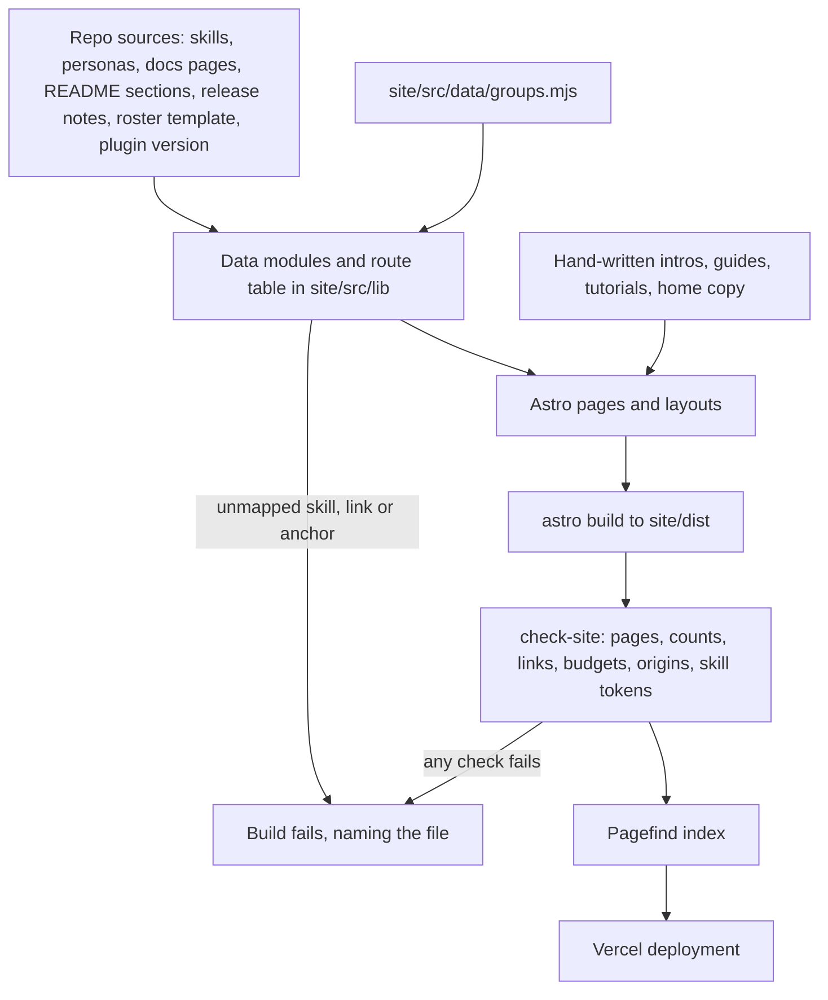
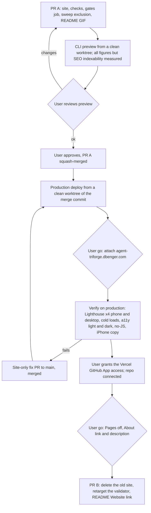

# The Agent Triforge Website - Plan

## Goal Capsule

- **Objective:** A visitor to agent-triforge.dbenger.com, on a phone or a desktop, learns what Agent Triforge does, finds any skill, guide or docs page, and installs it with the commands for the CLI they lead with, from pages that load fast and match the current repo. The old GitHub Pages site is gone, and GitHub and the README point to the new one.
- **Means:** an Astro and shadcn static site under `site/`, ported from the approved prototype and built the way Agent Blueprint's site is (KTD1), generated from the repo's own files (KTD2, KTD4), deployed to Vercel in a fixed order (KTD11).
- **Authority:** the Product Contract's R-IDs win on what visitors see and what stays true in the repo. KTDs win on mechanism within them. A unit overrides neither. Key Decisions were settled with the user and are not reopened during execution.
- **Stop conditions:**
  - Stop and ask before each outward step: the production domain going live, connecting the repo to Vercel, turning GitHub Pages off, and changing the About link and description (R16).
  - Stop and show the user screenshots once the first page of each inner type is built (a skill page, personas, a docs page, a guide, a tutorial, roster, sprint, the changelog), before the rest are built.
  - Stop and ask when evidence shows a settled decision cannot work.
  - Stop and ask before editing a protected path other than the two maintainer gates KTD9 and KTD10 name (for example `AGENTS.md`, `skills/`, the manifests or `templates/`).
  - Stop when a unit would change more than 50 source files (the AGENTS.md halt rule): split it.
- **Execution profile:** units are built in their own worktrees by workers or the lead and integrated by the lead with path-limited commits. The worker model is chosen with the user at the start of `ce-work` (the 4.1 precedent was Opus 5.5 at xhigh). The design and copy skills run as real skill invocations (R6).
- **Who finishes:** `ce-work` builds and verifies. `ce-code-review` (Fable reviewers at high plus Codex `gpt-6-astra` at xhigh) reviews. The lead opens PR A and later PR B to `main`. The user approves both merges (both touch protected paths), the merges are squashes, and the user gives the go at every outward step.

---

## Product Contract

### Summary

A multi-page website at agent-triforge.dbenger.com in the approved Ultramarine design: home, a skills catalog with a page per skill and a personas page, roster, sprint, three tutorials, five guides, docs, a changelog and a 404, with the home film, four loops, the live dot field and the animated header mark. Skill, persona, docs and changelog pages are built from the repo's own files on every deploy. GitHub Pages is then turned off, the GitHub About section points to the new site, and the README opens with the animated hero.

### Problem Frame

The current site is one long dark page (`docs/index.html`, served by GitHub Pages from `main:/docs`) that has drifted from the product. Its version badge says v4.0.0, several of its numbers are wrong, and it does not explain how a sprint works. The GitHub About description still describes the pre-4.0 framework ("Gemini CLI", "19 specialized subagents"). Agent Blueprint, the sibling project, has a multi-page site built from its repo, and the user wants Triforge at that level: a premium design without AI-sounding copy, motion that explains the system in plain words, and pages that are fast on a phone. Three design rounds led to the approved design: round 3 example 1 (Ultramarine) with example 3's headline and a larger dot field.

### Key Decisions

- **The approved design is Ultramarine, with the headline "Put Claude Code, Codex and Antigravity on one team.", the larger dot field and the animated header mark** (session-settled: user-directed — chosen over examples 2 to 4 and the round 1 and round 2 directions: the user picked example 1 with example 3's headline and approved the recorded final design). Governs R5.
- **The logo is the header mark in the approved design** (session-settled: user-approved — the approval page showed three alternatives and the user approved it without picking another). Governs R5.
- **Motion shows no code, paths or config on screen, only plain words and CLI names** (session-settled: user-directed — chosen over round 2's loops that showed config files and refusal codes, which the user rejected as too technical). Governs R7.
- **The site is multi-page, with skills.addy.ie's page types minus its compare page** (session-settled: user-directed — chosen over the current single long page). Governs R1.
- **Skill, persona, docs and changelog pages are generated from repo files; page intros, guides without a docs page, tutorials and the home copy are hand-written** (session-settled: user-approved — chosen over hand-written copies, which drift from the product). Governs R2, R3.
- **Inner pages reuse the four loops; there are no new films** (session-settled: user-approved — chosen over a film per page). Governs R7.
- **The site's source lives in this repo under `site/`** (session-settled: user-approved — chosen over a separate repository, with the plugin download growing by the site's code and media). Governs R12.
- **GitHub Pages is deleted, not kept as a redirect, so old ninety2ua.github.io links stop working** (session-settled: user-approved — chosen over keeping Pages on with a single redirect page). Governs R15.
- **Deploys start with the Vercel CLI; then the repo is connected so pushes to `main` redeploy** (session-settled: user-approved — chosen over deploying by hand every time). Governs R14.
- **Any new raster image comes from GPT image through Codex** (session-settled: user-directed — chosen over Nano Banana through agy). Governs R7.
- **The speed budget** (session-settled: user-directed — the user asked for a site that is "super fast and perfectly optimized"). Governs R9, R10.

### Requirements

**Pages and content**

- R1. The site has a home page; `/skills/` with one page per skill and a `/skills/personas/` page; `/roster/`; `/sprint/`; three tutorials; five guides; docs pages for getting started, how it works, workflows, project layout, portable skills, compatibility, upgrading and the FAQ; `/changelog/`; and a 404. It has no compare page, and the media kit exists only in local development (KTD15).
- R2. Skill pages, the personas page, docs pages, the FAQ, the install commands, the changelog, the version and every count are built from the repo at deploy time. A skill, persona, release or docs page added to the repo appears on the next deploy without a site edit, apart from a new skill's catalog group (R4).
- R3. Hand-written copy (the home page, intros, the leases guide, tutorials, roster and sprint pages) states only facts the repo supports, names only skills and flags that exist, and passes a /humanizer and /no-ai-slop pass.
- R4. Every skill belongs to exactly one catalog group. The build fails, naming the skill, when a skill has no group or two.

**Design and motion**

- R5. Every page uses the approved design: the Ultramarine tokens, Familjen Grotesk, light by default with a dark theme, shadcn components, and the header mark that draws itself once per page load and stays static under reduced motion.
- R6. Design quality is checked with /impeccable, the fitting taste skills and /shadcn, and copy with /humanizer and /no-ai-slop, each invoked as a skill. PR A records which skill drove which change.
- R7. The motion is the home hero's live dot field, the 55 s film with chapters, four 8 s loops (reused on the inner pages they explain) and the README hero. None of it shows code. Loops and the film play while at least half visible. Under reduced motion nothing autoplays and the dot field shows its final frame. Videos have no pause buttons, and a Play button appears whenever autoplay is refused or a video fails to start.
- R8. The film's two weak moments are fixed (the sparse move to the main branch and the comb-like merge), and the README hero's line matches the site's sub-line.

**Speed and access**

- R9. On the production domain, every page scores 100 in all four Lighthouse categories on phone and desktop (the 404 is exempt from SEO), LCP is under 2 s on Slow 4G with 4x CPU throttling, CLS is 0, and every interaction has an INP under 100 ms on the phone profile with 4x CPU throttling.
- R10. Before any interaction a page loads less than 25 KB of gzipped JavaScript on the home page and less than 10 KB on every other page, makes no third-party request, uses self-hosted fonts, and fetches videos and posters only when they are about to be seen.
- R11. Without JavaScript every page is readable, every page is reachable from the footer, and install commands can be selected. Keyboard and screen-reader users can reach and operate every control. A lead chosen once (Claude Code or Codex) stays chosen across pages, a link into a tab opens that tab, and a copy button that fails says so and selects the text.

**Repo and delivery**

- R12. The site lives in `site/` with its own `package.json`. Plugin behaviour, skills, manifests, templates and `AGENTS.md` do not change, and there is no release.
- R13. The repo's checks pass in CI and in a local run after a site build, and every PR to `main` builds the site and runs its checks.
- R14. Production serves a recorded, pushed commit built from a clean checkout. Once the repo is connected, each push to `main` that changes a site input redeploys, and each PR gets a preview.
- R15. GitHub Pages is off, `docs/index.html` and the assets only it used are deleted, and the GitHub About link and description point to and describe the new site.
- R16. Each outward step (the production domain going live, the Vercel and GitHub connection, Pages off, the About change) happens only after the user's go, in the order KTD11 sets.
- R17. The README opens with the animated hero GIF, keeps its section structure and its What's new block, and gains a Website link in its nav row once the domain serves.
- R18. Paper holds a copy of the final design: the home page's first screen and one skill page.

### Success Criteria

- A first-time visitor on a 390 px phone gets from the home page to a copied install command for their lead in two taps.
- Adding a skill folder with its group entry, or a release notes file, needs no other site edit, and the next deploy shows it.
- Site media under `site/public/` total at most 8 MB, and the README GIF is at most 500 KB. At these caps the plugin download still grows from 8.6 MB to about 17 MB; the prototype's renders alone are 15 MB. A Codex lead's install clones every branch with full history, so media are pushed only in their final encoding (U10).
- The Lighthouse, LCP, CLS, INP and JavaScript figures in R9 and R10 hold on every page, measured on production and recorded in PR B.

### Scope Boundaries

- No plugin code, skill, manifest, template or `AGENTS.md` change, no version bump and no release (R12). Two maintainer gates change: `scripts/validate-versions.sh` and `.github/workflows/gates.yml` (KTD9, KTD10).
- No compare page and no public media kit.
- No redirect from the old GitHub Pages URL.
- The README's What's new block and the release notes stay untouched; check 1 keeps them in lockstep.
- No new films and no dark-theme renders of the videos (KTD16).
- Considered and not built:
  - Skew protection for tabs left open across a redeploy, beyond the palette's reload fallback (KTD14). A stale tab loses only the palette chunk, and a reload fixes it. A user report of broken pages after a deploy would change this.
  - One OG image per page. One site image is enough for link previews. Evidence that shared links are a main way people arrive would change this.

#### Deferred to Follow-Up Work

- Rendering each skill's `references/*.md` files as site pages; they link to GitHub for now (KTD2).
- Redirects for renamed skills, added with the first rename; the site gate already checks that every redirect target exists (U11).

---

## Planning Contract

### Key Technical Decisions

- KTD1. **Port Agent Blueprint's site architecture onto the approved prototype.** The stack and pins stay the prototype's, which already match Blueprint's: Astro 7.3.7, React 19.3 islands, shadcn `base-lyra` on Base UI, Tailwind 4.3.3, plus Pagefind and the sitemap integration. Output is static. Data modules are plain Node with no `astro:` imports, so pages, the content config and `node:test` share them. The prototype's comparison plumbing (the `EXAMPLES` map, per-example tokens and theme key, `base: '/r3/'`, `publish.mjs`) is dropped, and example 1's palette becomes `site/src/styles/tokens.css`.
- KTD2. **One route table resolves every link.** `site/src/lib/routes.mjs` maps each source (the docs map, README sections, skills, personas, releases) to its route. It resolves each relative link against its own source file, in Markdown and in raw HTML alike, and skips code. Skill `references/` files and other repo paths go to GitHub `blob/main` or `tree/main`. Release-note links go to `blob/v<ver>/`, except a fixed list of untagged versions (v2.4.0, v2.4.2, v2.4.3 and the two unversioned notes), which go to `blob/main`; Vercel's shallow clone has no tags, so the list is static and tested. An unmapped relative link, or an anchor that matches no heading, fails the build and names the file.
- KTD3. **Personas get their own page, `/skills/personas/`,** reached as the second of two tab-styled links on the catalog, with one anchor per persona and per group. Rejected: a second tab panel on `/skills/`, because the 44 docs links to personas would land inside a hidden panel, which browsers do not scroll to. The legacy anchor `personas.md#review-specialists-6` maps to the group's anchor.
- KTD4. **Every `DOC_PAGES` entry publishes** (`scripts/validate-versions.sh`), and a test keeps it so. An entry with no explicit mapping gets `/docs/<file name>/` and uses its own first paragraph as the intro, so a new docs page needs no site edit; the explicit mappings below override the default.
  - Getting started: `docs/installation.md` plus the README's "Getting started" section, with install tabs built from the README's install block.
  - How it works, workflows, project layout, compatibility and upgrading: their own files. Portable skills: `docs/skills.md`. FAQ: the README's "FAQ" section.
  - Guides: unattended runs from `docs/unattended-runs.md`, team builds from `docs/team-work.md`, models and effort from `docs/models.md`, data egress from the "Data egress and credentials" section of `docs/how-it-works.md` (that page then links to the guide instead of repeating it). The leases and cross-review guide is hand-written from `docs/agent-triforge.md` and `skills/wave-orchestration/SKILL.md`.
  - `docs/personas.md` feeds `/skills/personas/`. The design doc links to GitHub. `docs/plans/`, `docs/brainstorms/`, `docs/rule-inventory.md` and `docs/residual-review-findings/` never publish.
- KTD5. **The skill group map lives in `site/src/data/groups.mjs`.** Rejected: a `metadata.triforge-group` key in each SKILL.md, a protected `skills/` change that would alter shipped skill digests without a release. Portable skills (no `at-` prefix) group as Portable without an entry.
- KTD6. **Behaviour that must work on page load or inside a real tap is plain script; React is used only for the palette, the mobile sheet and the catalog filter**, all three `client:interaction` (Blueprint's KTD7).
  - Tabs select the panel that holds `location.hash` on load and on `hashchange`. They store the lead choice (with storage wrapped in try/catch) and apply it to every lead tab group.
  - Copy checks both clipboard paths. On failure it selects the command and says "Press ⌘C" (Ctrl+C off a Mac).
  - shadcn's markup and classes stay, so the look does not change.
  - Rejected: the prototype's React tab and copy islands. They cannot select a tab from the hash before hydration, and the click they replay after hydration loses Safari's tap gesture, so the clipboard write fails on an iPhone.
- KTD7. **Fonts are self-hosted through Astro's Fonts API with the local provider.** Familjen Grotesk is preloaded with `display: block` and metric-matched fallback faces. Sometype Mono and Doto use `swap` and are not preloaded; Doto appears only on the sprint numerals. The source files are the variable fonts already cut for the motion work. Blueprint learned this the hard way: `swap` gave a CLS of 0.24 on a cold Slow 4G load (its commits `ecc10f3` and `5836a85`).
- KTD8. **Scripts are split per page.**
  - Theme set-up runs inline in the head.
  - The search loader runs on every page.
  - The video player is a dynamic import, only on pages with a video figure.
  - The dot field and the lease stations run on the home page only.
  - Posters are lazy `` elements behind `preload="none"` videos (Blueprint `fee4c92`). Media URLs carry a content-hash query, since `/media/` is cached for a day (Blueprint `5eafd3a`).
- KTD9. **Site checks run in two places:** inside `npm run build`, so Vercel fails a broken deploy, and in a new `site` job in `.github/workflows/gates.yml` (ubuntu, Node 24: `npm ci`, `astro check`, build, `node --test`). Without the CI job, a plugin PR that breaks the site build can merge (`main` has no branch protection), and production silently stops updating while Vercel serves the last good build. The job is a protected `.github/` edit, which the user reviews.
- KTD10. **Two protected validator edits.**
  - PR A adds `site/dist`, `site/.astro` and `.vercel` to the exclusions of the whole-tree sweeps in `scripts/validate-versions.sh` (checks 2, 4 and 9), with a fixture. Otherwise a local validator run after a site build fails on rendered changelog text that carries model pins the sweep bans.
  - PR B retargets checks 5, 9 and 11, the HERO block and the scope text that read `docs/index.html`, with their fixtures, as Blueprint's PR #24 did. Check 5 fails when that file is missing.
  - Conflict call-out: R12 promises no plugin change, and this script ships with the plugin. The edits change only maintainer gates, not plugin behaviour, and PR #43 already changed this script in a docs-only PR without a release.
  - Rejected: keeping a stub `docs/index.html` whose only job is to satisfy a check.
- KTD11. **Two PRs and a fixed cutover order** (Blueprint's KTD12):
  1. PR A: the site, its checks, the gates job, the sweep exclusion and the README hero GIF.
  2. A CLI preview from a clean worktree of PR A's head, measured against every R9 and R10 figure except SEO indexability, for the user to review.
  3. PR A merged.
  4. A production deploy from a clean worktree of the merge commit. The domain is attached after the user's go.
  5. Production verified (U14).
  6. The user grants the Vercel GitHub App access to the repo, and the repo is connected.
  7. After the user's go: Pages off, then the About link and description.
  8. PR B: delete `docs/index.html`, its three dark SVGs and `hero-forge.svg`, retarget the validator, and add the README Website link.
- KTD12. **Deploys come only from a clean worktree of a pushed commit.** The deploy is refused when the tree is dirty, and the commit is recorded in the deployment. The CLI is linked at the repo root to the project `agent-triforge`, named explicitly because the Vercel team already has an unrelated project called `site`. Settings: Root Directory `site`, framework Astro, Node 24, files outside the root directory included, preview protection off. The root `.gitignore` carries an exact `.vercel` line, because the CLI appends one to `.gitignore` whenever it is missing, which would dirty every fresh worktree. A new worktree has no `.vercel/`, so each clean worktree is linked to the project again before its deploy. `site/scripts/ignore-build.sh` skips a build only when no input changed and fails open, and a test keeps its input list equal to what the build reads.
- KTD13. **Media are re-encoded to the budget with Blueprint's recipe**: `libx264 -preset slow`, `+faststart`, no `-tune animation` (it ghosts hairlines), the film at display size, loops at about 800 px wide, and the GIF through `palettegen` with few colours and no dither. The README GIF lives once, at `docs/images/readme-hero.gif`, and the site serves that same file through an endpoint (Blueprint's `media/readme-hero.gif.ts`).
- KTD14. **Search is Pagefind**, loaded on the first ⌘K, "/" or button press.
  - Keys typed while it loads are buffered and replayed, and Escape cancels.
  - A load failure shows visible text. A hashed chunk that 404s after a redeploy falls back to the catalog search page.
  - On `/skills/`, "/" focuses the catalog's own search; ⌘K opens the palette everywhere.
  - Changelog pages get a lower weight, so old release notes do not outrank current docs. Copy buttons, breadcrumbs and GitHub links are excluded from the index.
- KTD15. **Two defaults follow the user's own decisions on Blueprint:** the media kit is dev-only (injected under `astro dev`, absent from the build, the sitemap, `llms.txt` and the footer), and videos have no pause controls. This plan applies both unless the user says otherwise.
- KTD16. **The videos stay light renders on the card ground in both themes**, as in the approved design. Rejected: dark twins, which would double the media weight.
- KTD17. **Counts are data unless the design fixes them.** Skills, lead workflows, portable skills, personas, CLIs, roles and releases render from data inside `data-claim` elements that the site gate checks against the repo. Phases 0 to 6, the five quality gates, the five at-ship review lanes and the three fix cycles are written as text.

### High-Level Technical Design

How a deploy turns repo files into pages, and where it stops on a broken promise:



The delivery order, with the user's go at each outward step:



### Output Structure

```text
site/
  package.json, package-lock.json, astro.config.mjs, tsconfig.json, components.json, vercel.json, README.md
  scripts/          ignore-build.sh, check-site.mjs
  motion/           RENDER.md, build.py, finish.sh, src/ (film, four loops, README hero, shared styles)
  public/
    brand/          favicon.svg, og.png
    media/          film and loop MP4s, WebP posters, film-chapters.json
  src/
    assets/fonts/   Familjen Grotesk, Sometype Mono, Doto (variable woff2)
    components/     Header, Footer, Mark, DotField, VideoFigure, FilmPlayer, CodeBlock, MobileMenu, SkillFilter, search/, home/, docs/, ui/
    content/        docs/ and guides/ intros, guides/leases.md, tutorials/
    content.config.ts
    data/           groups.mjs, nav.ts
    dev/            kit route and page (dev-only)
    directives/     client:interaction
    layouts/        Base.astro, DocsLayout.astro
    lib/            repo, skills, personas, docs, readme, releases, roster, routes, media, markdown/
    pages/          index, skills/ (index, [name], personas), roster, sprint, tutorials/[slug], guides/[slug], docs/[slug], changelog, 404, robots.txt, llms.txt, media/readme-hero.gif
    scripts/        theme, tabs, copy, video, home, dotfield
    styles/         tokens.css, global.css
  test/             data, client-script, built-page, budget and ignore-build tests
```

### Sequencing

Foundation first (U1 to U3), then pages (U4 to U9) with motion (U10) in parallel. Within U5 to U8, the first page of each inner type is built and shown to the user as screenshots before the rest of that type (the stop condition in the Goal Capsule). Then come the gates and repo integration (U11, U12), the README hero (U13) and the review pass (U15). PR A carries all of those. U14 and U16 follow PR A's merge in KTD11's order. U17 waits for Paper's weekly limit to reset, around 2026-10-16, and blocks nothing.

### Risks

| Risk | Mitigation |
|---|---|
| A page misses Lighthouse 100 on a phone (docs pages with diagrams near the top are the likeliest) | Images go through Astro's pipeline at display width, with `fetchpriority` on the one above the fold (U6). Each page is measured on the preview before the merge and again on production (U14); a production miss is fixed in a site-only PR before Pages goes off. |
| The media cannot reach 8 MB because dot fields compress poorly | Lower the film's frame size before shortening anything. If the budget still fails, bring the measured size to the user rather than shipping silently over it. |
| The user does not grant the Vercel GitHub App access | The CLI deploys keep working. Auto-deploys and PR previews wait, and the PR B description says so. |
| A future skill PR fails the site build on a missing group | That is the intended signal (R4). The gates job shows it on the PR, and the error names the skill and the file to edit. |
| The 15-minute SELF gate runs on every site PR (`gates.yml` has no paths filter) | Accepted. Adding a paths filter would be another protected edit for little gain. |

### System-Wide Impact

- **Plugin installs:** every install copies the whole repo (`.claude-plugin/marketplace.json` uses `"source": "./"`), so the site's source and media ship to every user. This is why the media budget exists.
- **Future plugin work:** a new lead skill PR must add one line to `site/src/data/groups.mjs`; a new portable skill needs none. New release notes and docs pages appear on the site without site edits.
- **Maintainers:** after a local site build, the validators skip the build output (KTD10). `site/README.md` documents the deploy procedure and the rule to install the plugin only from a clean checkout, since a checkout with `site/node_modules` would copy it into the install.

---

## Implementation Units

| U-ID | Title | Key files | Depends on |
|---|---|---|---|
| U1 | Production scaffold | `site/astro.config.mjs`, `site/src/styles/tokens.css`, `site/src/layouts/Base.astro`, `.gitignore` | none |
| U2 | Repo data layer and route table | `site/src/lib/*`, `site/src/data/groups.mjs`, `site/src/content.config.ts` | U1 |
| U3 | Layout shell and shared behaviour | `site/src/components/Header.astro`, `Footer.astro`, `site/src/scripts/tabs.ts`, `copy.ts` | U1 |
| U4 | Home page | `site/src/pages/index.astro`, `site/src/components/home/*`, `site/src/scripts/video.ts` | U2, U3 |
| U5 | Skills catalog, skill pages, personas page | `site/src/pages/skills/*`, `site/src/components/SkillFilter.tsx` | U2, U3 |
| U6 | Docs and guides | `site/src/pages/docs/[slug].astro`, `site/src/pages/guides/[slug].astro` | U2, U3 |
| U7 | Roster, sprint, tutorials | `site/src/pages/roster.astro`, `sprint.astro`, `tutorials/[slug].astro` | U2, U3, U10 |
| U8 | Changelog, metadata, redirects | `site/src/pages/changelog.astro`, `site/vercel.json`, `site/src/dev/*` | U2, U3 |
| U9 | Search | `site/src/components/search/*` | U3, U5 to U8 |
| U10 | Motion finishing and media | `site/motion/*`, `site/public/media/*`, `docs/images/readme-hero.gif` | U1 |
| U11 | Site gates | `site/scripts/check-site.mjs`, `site/test/*` | U4 to U10 |
| U12 | Repo integration | `.github/workflows/gates.yml`, `scripts/validate-versions.sh`, `site/scripts/ignore-build.sh` | U11 |
| U13 | README hero | `README.md` | U10 |
| U14 | Preview, production and verification | Vercel project settings | U12, U13, U15; PR A merged for production |
| U15 | Design and copy review | hand-written content and components | U4 to U9 |
| U16 | Cutover (PR B) | `docs/index.html`, `scripts/validate-versions.sh`, `README.md` | U14 |
| U17 | Paper copy | the Paper file | U4, U5 |

### U1. Production scaffold

**Goal:** `site/` builds a production Astro site with the approved design's tokens, fonts and theme handling, without the prototype's comparison plumbing.

**Requirements:** R5, R10, R12; KTD1, KTD7.

**Dependencies:** none.

**Files:**
- Create: `site/package.json`, `site/package-lock.json`, `site/astro.config.mjs`, `site/tsconfig.json`, `site/components.json`, `site/README.md`, `site/src/styles/tokens.css`, `site/src/styles/global.css`, `site/src/layouts/Base.astro`, `site/src/assets/fonts/` (three woff2 files), `site/src/directives/` (the `client:interaction` directive), `site/src/components/ui/`
- Modify: `.gitignore`
- Test: `site/test/font-fallbacks.test.mjs`, `site/test/built-pages.test.mjs`

**Approach:**
1. Copy the prototype's site source (no `node_modules`, `dist` or `.vite`) into `site/`. Drop the `EXAMPLES` map, the four example pages and `publish.mjs`. Move example 1's light and dark palettes into `tokens.css`, and make the hero values (even split, headline size) fixed styles.
2. Set the config: the production site URL, `trailingSlash: 'always'`, directory output, `inlineStylesheets: 'always'`, the React, sitemap and Pagefind integrations, the interaction directive, and cache directories under `node_modules`.
3. Fonts per KTD7, with metric-matched fallback faces.
4. Theme set-up: the stored choice wins (storage access in try/catch), otherwise the system preference. Drop the prototype's `?theme=` parameter and per-example key.
5. Add `site/node_modules/`, `site/dist/`, `site/.astro/`, `site/motion/.work/` and an exact `.vercel` line to `.gitignore` (KTD12).
6. Write `site/README.md`: how to build, the checks, the deploy procedure (KTD12), the clean-up before running the repo validators, and the rule to install the plugin only from a clean checkout.

**Patterns to follow:** Blueprint's `site/astro.config.mjs`, `site/src/layouts/BaseLayout.astro`, `site/src/components/theme.ts` and `site/test/font-fallbacks.test.mjs` (in the sibling repo `claude-eng/project-template`).

**Test scenarios:**
- The built home page loads no stylesheet, script or font from another origin.
- With "dark" stored, the inline theme script sets `data-theme="dark"` before first paint. When storage throws, it falls back to the system preference without an error.
- The fallback faces' ascent, descent and size adjustment match Familjen Grotesk's metrics within the test's tolerance.

**Verification:** `npm run build` succeeds, and the home page matches the approved design's recording at 390, 1024 and 1440 px in both themes.

### U2. Repo data layer and route table

**Goal:** Node modules that read every site fact from the repo, and one route table that every generated link goes through.

**Requirements:** R2, R4; KTD2, KTD4, KTD5, KTD17.

**Dependencies:** U1.

**Files:**
- Create: `site/src/lib/repo.mjs`, `skills.mjs`, `personas.mjs`, `docs.mjs`, `readme.mjs`, `releases.mjs`, `roster.mjs`, `routes.mjs`, `site/src/lib/markdown/` (the skill-body HTML escape), `site/src/data/groups.mjs`, `site/src/content.config.ts`
- Test: `site/test/skills.test.mjs`, `personas.test.mjs`, `docs-map.test.mjs`, `routes.test.mjs`, `releases.test.mjs`, `readme.test.mjs`, `roster.test.mjs`, `groups.test.mjs`

**Approach:**
1. Find the repo root by walking up to the folder holding `.claude-plugin/plugin.json` and `README.md`.
2. Skills come from `skills/*/SKILL.md` frontmatter, with lead skills marked by the `at-` prefix. One-line summaries come from the "Lead workflows reference" table in `docs/workflows.md` and the table in `docs/skills.md`. Groups come from `groups.mjs`.
3. Personas come from `personas/*.md`, `personas/manifest.toml` and the groups in `docs/personas.md`.
4. Roles come from `templates/ops/roster.toml`. CLIs come from the tables in `docs/compatibility.md` and `docs/models.md`, and a test cross-checks the CLI ids against the registry in `scripts/lib/registry.sh`.
5. The docs map follows KTD4. `DOC_PAGES` is read from `scripts/validate-versions.sh`.
6. From the README come the FAQ section, the install block, the "Getting started" section and the release-history table.
7. Release notes come from `docs/releases/*.md`. Each header is split on its first " — ", then an optional `v<ver>: `. Notes are ordered by version, and unversioned notes are placed by date with date-based anchors.
8. Build `routes.mjs` per KTD2. Skill bodies keep raw text such as `<base-branch>` visible (Blueprint's `escape-skill-html.mjs`).
9. Export the counts that `data-claim` elements render.

**Patterns to follow:** Blueprint's `site/src/lib/site.mjs`, `readme.mjs`, `readme-map.mjs` and `site/src/content.config.ts`.

**Test scenarios:**
- The skill records equal the `skills/*` folders, and the lead and portable split equals the folder split; the test compares with the tree, not with literals.
- A lead skill folder (`at-` prefix) missing from `groups.mjs` fails with the skill's name; a skill listed in two groups fails the same way. A portable skill with no entry lands in Portable.
- Every `DOC_PAGES` entry has exactly one route. A `DOC_PAGES` entry with no explicit mapping gets `/docs/<file name>/` with its first paragraph as the intro.
- Each of these links, written in `docs/workflows.md`, resolves as stated:
  - `../skills/at-ship/SKILL.md` goes to `/skills/at-ship/`.
  - `../personas/security-sentinel.md` goes to `/skills/personas/#security-sentinel`.
  - A sibling `team-work.md#review-swarm-at-review` goes to `/guides/team-builds/#review-swarm-at-review`.
  - `../README.md#documentation` is removed.
  - `../README.md#faq` goes to `/docs/faq/`, and `#recent-changes` to `/changelog/`.
- `references/claude.md` inside a skill resolves to its GitHub `blob/main` URL.
- A link inside a fenced code block is left unchanged.
- The README FAQ's raw-HTML link `docs/installation.md#installation` resolves against the repo root.
- An anchor that matches no heading throws, naming the file and the anchor.
- Release parsing:
  - The v2.4.0 title, which contains extra dashes, parses whole.
  - An unversioned note gets a date anchor.
  - Two notes on the same date are ordered by version.
  - An untagged version's links point at `blob/main`; a tagged version's point at `blob/v<ver>`.
- The roster's CLI ids equal the registry's eight ids, and every role's fallback chain ends at a core-trio member.

**Verification:** the data tests pass without a build.

### U3. Layout shell and shared behaviour

**Goal:** the header, footer and docs layout, and the plain scripts every page uses.

**Requirements:** R5, R7, R11; KTD6, KTD8, KTD15.

**Dependencies:** U1.

**Files:**
- Create: `site/src/components/Header.astro`, `Footer.astro`, `Mark.astro` (from the prototype's `Logo.astro`), `MobileMenu.tsx`, `CodeBlock.astro`, `site/src/data/nav.ts`, `site/src/layouts/DocsLayout.astro`, `site/src/components/docs/SidebarNav.astro`, `site/src/scripts/tabs.ts`, `copy.ts`, `theme.ts`, `site/src/pages/404.astro`, `site/public/brand/favicon.svg`
- Test: `site/test/client-scripts.test.mjs`, `site/test/nav.test.mjs`, `site/test/section-order.test.mjs`

**Approach:**
1. The header follows the approved design. Nav state (`aria-current`) comes from `nav.ts`, and the mark keeps the prototype's load animation. The header's Install link follows the stored lead (`#claude-code` or `#codex`).
2. The footer lists every section page, which makes it the no-JS site map. There is no `/kit/` link.
3. The mobile menu button is a link to the footer's site map, which a script upgrades to the sheet on interaction.
4. Tabs, copy and theme follow KTD6. Tabs keep the tablist, tab and tabpanel roles with `aria-selected` and `aria-controls`, a roving tabindex, and Left, Right, Home and End keys that move and select. A noscript style shows every tab panel and hides copy buttons, chips and the search button.
5. The docs layout has a sidebar, on-page contents, and previous and next links from one section-order helper. Below tablet width, the sidebar and on-page contents collapse into one native `details` block above the content, which works without JavaScript, as Blueprint's docs layout does.
6. The 404 page has no canonical link.

**Patterns to follow:** Blueprint's `site/src/components/Header.astro`, `nav.ts`, `site/src/layouts/DocsLayout.astro`, `site/src/lib/section-order.mjs`, `site/test/client-scripts.test.mjs`, and the noscript block in `BaseLayout.astro`.

**Test scenarios:**
- Tabs:
  - A page loaded with `#codex` selects the Codex panel.
  - A `hashchange` to `#skills-only` selects that panel.
  - A stored lead of "codex" selects Codex in every lead tab group on a page with no hash.
  - When storage throws, the first tab stays selected and nothing errors.
  - With focus on the first tab, Right selects the second tab and moves focus to it, and End selects the last; only the selected tab is in the Tab order.
- Copy:
  - When `writeText` rejects and `execCommand('copy')` returns false, the button says the copy failed, the command text is selected, and the live region says "Press ⌘C" (Ctrl+C off a Mac).
  - When the copy succeeds, the button says "Copied".
- The theme toggle stores the choice, flips `data-theme`, and works when storage throws.
- `/skills/at-ship/` marks Skills as the current section, and `/docs/faq/` marks Docs.
- The first docs page has no previous link, and the last has no next link.

**Verification:** every page has one skip link and one `h1`, and every header control is reachable by Tab. With JavaScript off, the footer reaches every page.

### U4. Home page

**Goal:** the approved home page, built from data and within the budget.

**Requirements:** R1, R5, R7, R10; KTD8, KTD15, KTD16, KTD17.

**Dependencies:** U2, U3. U10's media drop in when ready; until then the prototype's renders stand in locally and are never committed (U10).

**Files:**
- Create: `site/src/pages/index.astro`, `site/src/components/home/` (one component per section of the prototype's `Home.astro`), `site/src/components/DotField.astro`, `VideoFigure.astro`, `FilmPlayer.astro`, `site/src/scripts/home.ts`, `dotfield.ts`, `video.ts`
- Test: `site/test/home.test.mjs`, `site/test/client-scripts.test.mjs`

**Approach:**
1. Split the prototype's `Home.astro` into section components, with counts rendered through `data-claim`.
2. Remove the three pause controls. `video.ts` plays at half visibility, pauses off screen, and shows the Play button when `play()` rejects or the video errors. A chapter press plays even under reduced motion.
3. The film's chapters are labelled buttons, so the film's outline reads without the video.
4. The dot field script loads on the home page only. The canvas draws over a static SVG of the final frame, which stays under reduced motion and without JavaScript.
5. The hero's Install button follows the lead switch.

**Patterns to follow:** the prototype's `Home.astro`; Blueprint's `site/src/components/video-figures.ts` and `VideoMedia.astro`.

**Test scenarios:**
- The built home page has no pause or play toggle markup on loops, the film or the dot field.
- When `play()` rejects, the Play button appears. When the video errors, the poster stays and the Play button appears.
- Under reduced motion, no video starts on becoming visible, and a chapter press seeks to the chapter and plays.
- Switching the hero to Codex makes the hero's Install link end in `#codex`.

**Verification:** the home page matches the approved recording, and its JavaScript before interaction is under 25 KB gzipped (U11 measures it).

### U5. Skills catalog, skill pages and personas page

**Goal:** a visitor can find and read any skill or persona.

**Requirements:** R1, R2, R4, R11; KTD2, KTD3, KTD6, KTD14.

**Dependencies:** U2, U3.

**Files:**
- Create: `site/src/pages/skills/index.astro`, `site/src/pages/skills/[name].astro`, `site/src/pages/skills/personas.astro`, `site/src/components/SkillFilter.tsx`, `site/src/components/SkillCard.astro`
- Test: `site/test/skills-pages.test.mjs`, `site/test/client-scripts.test.mjs`

**Approach:**
1. The catalog's filter is a `client:interaction` island with:
   - text search, focused by "/" on this page and cleared by Esc
   - group chips with counts
   - a live "N of total" count
   - an empty state with a clear button
   Without JavaScript every card shows.
2. A skill page shows:
   - the name, group and lead or portable badge, and the description
   - "Run it" tabs per lead: `/at-<name>` for Claude Code, `$agent-triforge:at-<name>` for Codex, and the per-CLI paths from `docs/skills.md` for portable skills
   - the SKILL.md body through the route table, with references linked to GitHub
   - related skills from the same group
3. The personas page shows the groups from `docs/personas.md` and, for each persona, its manifest class and whether it may be downgraded, with an anchor per persona and per group.

**Test scenarios:**
- Each skill folder has exactly one built page, and no SKILL.md is copied into `dist`.
- A Codex invocation renders as `$agent-triforge:at-ship`, never in the bare form. The test builds the bare string from parts (a dollar sign joined to `at-ship`), so no tracked file under `site/` contains it; validate-versions check 9 sweeps `site/test/` too.
- Filter:
  - Typing "review" shows only matching cards and updates "N of total".
  - Esc clears the search and shows every card.
  - A chip with no matches after a search shows the empty state, and its clear button restores the cards.
- On `/skills/`, "/" focuses the catalog search and does not open the palette.
- `/skills/personas/#security-sentinel` exists, and the legacy `review-specialists-6` anchor lands on its group.
- A skill body containing `<base-branch>` shows it as visible text.

**Verification:** the catalog and a sample of skill pages have no horizontal scroll at 320 to 390 px.

### U6. Docs and guides

**Goal:** the docs and guide pages, generated from the repo inside the docs layout.

**Requirements:** R1, R2, R3, R9; KTD2, KTD4.

**Dependencies:** U2, U3.

**Files:**
- Create: `site/src/pages/docs/[slug].astro`, `site/src/pages/guides/[slug].astro`, `site/src/content/docs/` (intros), `site/src/content/guides/` (intros and `leases.md`), `site/src/components/docs/`
- Test: `site/test/docs-pages.test.mjs`

**Approach:**
1. Pages come from the docs map: a hand-written intro where the map names one, otherwise the page's own first paragraph (KTD4).
2. Getting started puts the install tabs (Claude Code leads, Codex leads, skills only) at the top. They are built from the README's install block, followed by the prerequisites and the first run.
3. Images go through Astro's image pipeline at display width, lazy except the one in the first screen, which gets `fetchpriority="high"`. Each image links to its full-size file. Wide tables scroll inside their own box.
4. The leases guide is hand-written (KTD4). The data egress guide renders the section from `docs/how-it-works.md`.

**Test scenarios:**
- Every `DOC_PAGES` file has exactly one built page.
- `/docs/getting-started/#codex` opens the Codex tab (with U3's tab script).
- The comment lines inside `docs/installation.md`'s fenced block are not read as headings.
- `/docs/how-it-works/` links to `/guides/data-egress/` in place of the egress section.
- Every docs image has width, height and alt text, and at most one image per page has `fetchpriority="high"`.

**Verification:** on Slow 4G with 4x CPU throttling, `/guides/unattended-runs/` and `/guides/models-and-effort/`, which open with a diagram, have an LCP under 2 s (measured in U14).

### U7. Roster, sprint and tutorials

**Goal:** the two concept pages and the three tutorials.

**Requirements:** R1, R3, R7; KTD17.

**Dependencies:** U2, U3, U10.

**Files:**
- Create: `site/src/pages/roster.astro`, `site/src/pages/sprint.astro`, `site/src/pages/tutorials/[slug].astro`, `site/src/content/tutorials/` (three files), `site/src/lib/tutorials.mjs`
- Test: `site/test/tutorials.test.mjs`

**Approach:**
1. Roster covers the core trio and the optional members, default roles and fallbacks, which provider sees the code for each CLI, and how to edit `ops/roster.toml`, with the team loop.
2. Sprint covers phases 0 to 6 with their skills and roles from `docs/workflows.md`, the review lanes, the convergence modes and the quality gates, with the review loop and a link to the film.
3. The three tutorials:
   - your first sprint with `/at-ship` in a new project
   - a supervised sprint in an existing codebase
   - an unattended run with `coordinate.sh`, including a Codex lead
   Each step has the prompt to paste, what happens, why it matters and a checkpoint. A strict parser fails the build, naming the file and the step, when a field is missing. The source of "what happens" is Open Question 1.
4. The unattended loop goes on the unattended guide, and the lease loop on the leases guide.

**Test scenarios:**
- A tutorial step without a checkpoint fails the build, naming the file and the step.
- The roster page lists every role in `templates/ops/roster.toml` with its full fallback chain.

**Verification:** U15's copy pass covers these pages, and U11's skill-token gate checks every command they name.

### U8. Changelog, metadata and redirects

**Goal:** the changelog, robots, sitemap, `llms.txt`, OG image and redirects, plus the dev-only kit.

**Requirements:** R1, R2, R9; KTD2, KTD15.

**Dependencies:** U2, U3.

**Files:**
- Create: `site/src/pages/changelog.astro`, `site/src/pages/robots.txt.ts`, `site/src/pages/llms.txt.ts`, `site/src/dev/kit-route.mjs`, `site/src/dev/kit.astro`, `site/vercel.json`, `site/public/brand/og.png`
- Test: `site/test/built-pages.test.mjs`

**Approach:**
1. The changelog lists releases newest first, with an anchor per version or date, using the README release table's summaries next to each note's title.
2. `robots.txt` allows all and names the sitemap. `llms.txt` is built from the data layer.
3. One OG image is rendered from the approved design.
4. `vercel.json` sends `/docs`, `/tutorials` and `/guides` to their first pages with 307 redirects, and sets the cache headers for `/_astro/`, `/pagefind/` and `/media/`.
5. The kit is injected only under `astro dev`.

**Test scenarios:**
- The changelog lists every release file once, newest first, and the v2.4.0 title keeps its inner dashes.
- The sitemap lists every page except the 404, with canonical URLs, and `robots.txt` names the sitemap.
- No kit route, kit link or kit media is in `dist`, the sitemap or `llms.txt`.
- Every page has a unique title and description, and a canonical link everywhere except the 404.

**Verification:** an unknown path on the preview returns the 404 page with status 404.

### U9. Search

**Goal:** ⌘K search across the whole site.

**Requirements:** R10, R11; KTD14.

**Dependencies:** U3, U5 to U8.

**Files:**
- Create: `site/src/components/search/loader.ts`, `pagefind.ts`, `mount.tsx`, `CommandPalette.tsx`
- Modify: page templates (Pagefind body, filter, weight and ignore attributes)
- Test: `site/test/client-scripts.test.mjs`

**Approach:** port Blueprint's loader with its hardening (commit `c623b86`), replace the prototype's hand-built JSON index with Pagefind, and set the weights and exclusions per KTD14.

**Test scenarios:**
- Keys typed while the palette chunk loads appear in the palette's input.
- Escape during loading cancels, and the palette does not open afterwards.
- A failed index or chunk load shows visible error text with a link to the catalog search.
- No search, React or Base UI bytes load before the first ⌘K, "/" or button press.

**Verification:** a search for "lease" lists the leases guide first, and changelog results are labelled as releases.

### U10. Motion finishing and media

**Goal:** the final motion sources in `site/motion/`, rendered and encoded to the budget.

**Requirements:** R7, R8, R10, R17; KTD13, KTD16.

**Dependencies:** U1.

**Files:**
- Create: `site/motion/RENDER.md`, `site/motion/build.py`, `site/motion/finish.sh`, `site/motion/src/` (the film, four loops, README hero and shared styles, in example 1's palette only), `site/public/media/` (MP4s, WebP posters, `film-chapters.json`), `docs/images/readme-hero.gif`, `site/src/pages/media/readme-hero.gif.ts`, `site/src/lib/media.mjs`
- Test: `site/test/media.test.mjs`

**Approach:**
1. Move the round 3 motion sources into `site/motion/`, with HyperFrames pinned at 0.8.140 and the render recipe written down.
2. Fix the film's sparse move to the main branch and its comb-like merge.
3. Change the README hero's line to the site's sub-line: "One agent leads. The others build, review and test, and nothing merges until a different agent has checked it."
4. Re-encode per KTD13 to the budgets in Success Criteria. `media.mjs` reads frame size and duration from the MP4 boxes, and fails when `film-chapters.json` is missing instead of inventing chapters.
5. Review every frame again for code on screen.
6. Commit media only in their final encoding, never as stand-ins or intermediate encodes, and delete PR A's branch after its squash merge. A Codex lead's marketplace install clones every branch with full history, so any media file ever pushed reaches every Codex install for good.

**Test scenarios:**
- Every MP4 in `site/public/media/` has its `moov` box before `mdat` and has a poster.
- `site/public/media/` totals at most 8 MB, and `docs/images/readme-hero.gif` is at most 500 KB.
- A missing `film-chapters.json` fails the build.
- Every media URL in the built pages carries a content-hash query.

**Verification:** at both fixed moments the film reads clearly, and a frame review finds no code, paths or config on screen.

### U11. Site gates

**Goal:** the build fails on any broken promise the site makes.

**Requirements:** R2, R3, R4, R9, R10, R13; KTD9, KTD17.

**Dependencies:** U4 to U10.

**Files:**
- Create: `site/scripts/check-site.mjs`, `site/test/budget.test.mjs`
- Modify: `site/package.json` (the build script runs the gate), `site/test/built-pages.test.mjs`

**Approach:** after `astro build`, `check-site.mjs` checks:
1. One page per skill folder and per `DOC_PAGES` entry.
2. Every `data-claim` value equals the repo.
3. Every root-relative `href` and `src` resolves, and every redirect target exists.
4. Every page has a title, a description and a canonical link (the 404 excepted).
5. No SKILL.md is copied into `dist`.
6. No page loads from another origin.
7. Every skill token in hand-written content names an existing skill.
8. No literal count sits in `site/src` next to a counted noun. In the motion compositions under `site/motion/src`, counts (spelled-out numbers included) and CLI names are compared with the repo data (`scripts/lib/registry.sh`, `templates/ops/roster.toml`); a mismatch fails the build, naming the composition to re-render.

The budget test sums the gzipped bytes of every script a built page loads before interaction, including static imports.

**Test scenarios:**
- A built page linking `/skills/at-nope/` fails `check-site`, naming the page.
- A `data-claim` that reads one fewer than the skill folders fails.
- A content page whose scripts total 11 KB gzipped fails, while the home page's limit is 25 KB.
- A script or stylesheet from another origin fails.
- Hand-written text naming `/at-nonexistent` fails.

**Verification:** `npm run build` fails on each seeded fault and passes on the real tree.

### U12. Repo integration

**Goal:** the repo's own checks cover the site and stay green.

**Requirements:** R12, R13; KTD9, KTD10, KTD12.

**Dependencies:** U11.

**Files:**
- Modify (protected; the user reviews): `.github/workflows/gates.yml`, `scripts/validate-versions.sh`
- Create (protected): a new fixture under `scripts/fixtures/validate-versions/` for the sweep exclusion
- Create: `site/scripts/ignore-build.sh`, `site/test/ignore-build.test.mjs`, `ops/decisions/2026-10-14-website.md`
- Modify: `site/vercel.json` (framework, install and build commands, output directory, trailing slash, `ignoreCommand`)

**Approach:**
1. Add the `site` job to `gates.yml` per KTD9.
2. Add the sweep exclusions to `validate-versions.sh` per KTD10, with a fixture.
3. Write `ignore-build.sh` with `:/`-anchored inputs:
   - `site`, `skills`, `personas`, `docs` and `README.md`
   - `.claude-plugin/plugin.json`
   - `templates/ops/roster.toml`
   - `scripts/lib/registry.sh` and `scripts/validate-versions.sh`, because the build reads the CLI ids and `DOC_PAGES` from them
4. The decision record (Date, Sprint, Decided by, Related, Decision, Why, Evidence) covers the host, the generation sources, why `site/` is not plugin content for the version-bump rule, and the two validator edits.

**Patterns to follow:** Blueprint's `site/scripts/ignore-build.sh`, `site/vercel.json` and the `site` job in its `.github/workflows/ci.yml`; `ops/decisions/2026-10-07-ops-at-checkout-top.md` for the record's shape.

**Test scenarios:**
- `validate-versions.sh --self-test` passes with the new fixture: a banned pin inside `site/dist/` no longer fails the sweep, while the same text under `docs/` still fails.
- `ignore-build.sh`:
  - exits 1 (build) when `VERCEL_GIT_PREVIOUS_SHA` is empty or missing from the clone
  - exits 0 when only a path outside its inputs changed
  - exits 1 when a file under `skills/` changed
- The ignore-build input list equals the set of repo paths the build reads.

**Verification:** every repo check in the Verification Contract passes locally after `npm run build`, `/bin/bash -n` passes on `ignore-build.sh`, and the new `site` job is green on PR A.

### U13. README hero

**Goal:** the README opens with the animated hero.

**Requirements:** R17; KTD13.

**Dependencies:** U10.

**Files:**
- Modify: `README.md` (the hero at the top; the nav row's Website link waits for U16)

**Approach:** replace the `hero-forge.svg` image with `docs/images/readme-hero.gif` in the same centred block, with alt text that avoids the count words check 5 reads. Every section and the What's new block stay as they are.

**Test scenarios:** Test expectation: none -- README markup only; check 5 covers the alt text, and the GIF is checked on GitHub.

**Verification:** GitHub renders the GIF in its light and dark themes, and the repo validators pass.

### U14. Preview, production and verification

**Goal:** the site is live on the domain, verified there, and connected for auto-deploys.

**Requirements:** R9, R10, R11, R14, R16; KTD11, KTD12.

**Dependencies:** U12, U13, U15. PR A must be merged before the production half.

**Files:** none in the repo; the Vercel project settings change.

**Approach:**
1. Link the CLI to the project `agent-triforge` with KTD12's settings, in each clean worktree before its deploy.
2. Deploy a preview from a clean worktree of PR A's head. Measure every figure in step 4 except SEO indexability on the preview, and fix misses on PR A's branch before the merge. The user reviews the preview (stop).
3. After the merge, deploy production from a clean worktree of the merge commit, and attach agent-triforge.dbenger.com after the user's go (stop).
4. Verify on production:
   - every page with standalone Lighthouse 13.5.0 (Performance) and the Chrome DevTools CLI (the other three categories), on phone and desktop
   - cold loads on Slow 4G with 4x CPU throttling, and CLS
   - INP from a performance trace of the first tap on the mobile menu, a catalog chip, a lead tab, a copy button and the search button
   - an accessibility audit in the dark theme
   - a pass on a phone with JavaScript off
   - copy on a real iPhone
   - the 404's status, a range request on the film (206), and the redirects
   - no horizontal scroll at 320, 360 and 390 px
   - an empty console and no third-party requests
5. The user grants the Vercel GitHub App access to the repo (stop). Connect the repo, then confirm that a push changing no input skips the build and that a PR gets a preview.

**Test scenarios:** Test expectation: none -- operational; the verification below is the proof.

**Verification:** the R9 and R10 figures are recorded per page in PR B's description. A miss found on production is fixed in a site-only PR to `main`, merged and deployed before Pages goes off.

### U15. Design and copy review

**Goal:** the skills the user named run over the built site and its hand-written copy.

**Requirements:** R3, R5, R6.

**Dependencies:** U4 to U9.

**Files:** hand-written content and components, as the findings require.

**Approach:**
1. Invoke /impeccable (audit and critique) and the taste skills that fit (high-end-visual-design, minimalist-ui, redesign-existing-projects) over the built pages, and /shadcn on the component usage.
2. Run /humanizer and /no-ai-slop on every hand-written page.
3. Fix the findings, and record in PR A which skill drove which change.

**Test scenarios:** Test expectation: none -- a review pass; behavioural fixes land with their own tests.

**Verification:** PR A lists each skill invoked and what it changed.

### U16. Cutover (PR B)

**Goal:** GitHub Pages is off, the About section is updated, the old site is deleted, and the repo's checks are retargeted.

**Requirements:** R15, R16, R17; KTD10, KTD11.

**Dependencies:** U14.

**Files:**
- Delete: `docs/index.html`, `docs/images/builder-pool.svg`, `docs/images/roster.svg`, `docs/images/lease-lifecycle.svg` (the three dark twins only the old page used), `docs/images/hero-forge.svg`
- Modify (protected; the user reviews): `scripts/validate-versions.sh`, `scripts/fixtures/validate-versions/clean/EXPECT`, `scripts/fixtures/validate-versions/halt-inclusive/EXPECT`, and the fixtures' `docs/index.html` stubs
- Modify: `README.md` (the Website link in the nav row)

**Approach:**
1. After the user's go, turn Pages off through the GitHub API and confirm that the old URL returns 404.
2. At KTD11 step 7, propose the new About description (after a /humanizer pass) together with the request for the go. After the user approves the wording, set the About homepage and description.
3. In PR B: the deletions, the validator retargeting with its fixtures, and the README's Website link.
4. Leave the stale comment in `docs/images/render-diagrams.html` alone. Editing it would change the diagram stamp and force a re-render of every diagram.

**Test scenarios:**
- `validate-versions.sh` passes with `docs/index.html` absent, and its self-test fixtures pass.
- The README's nav row links to `https://agent-triforge.dbenger.com/`.

**Verification:** `gates` is green on PR B, the About section shows the new link and description, and the Pages API reports no site.

### U17. Paper copy

**Goal:** the final design is in Paper.

**Requirements:** R18.

**Dependencies:** U4, U5, and Paper's weekly limit resetting (around 2026-10-16).

**Files:** none in the repo; the existing Paper file gets the pages.

**Approach:** write the home page's first screen and one skill page into the existing Paper file through the Paper MCP, using the site's tokens, and check them against the built pages with screenshots.

**Test scenarios:** Test expectation: none -- a design artifact.

**Verification:** the Paper screenshots match the built pages.

---

## Open Questions

1. **Tutorials: written from real test sprints, or from the docs?** (Deferred; decide before U7.) A real `/at-ship` run on a scratch project shows exactly what happens at each step, but it spends tokens with Anthropic, Google and OpenAI. Default: write from the skill docs and check every command against the skills (U11), with no live runs.
2. **The new About description.** (Deferred; decide at KTD11 step 7.) The wording is proposed with the request for the go on Pages and About, for the user to approve.

---

## Verification Contract

| Gate | Command or tool | When |
|---|---|---|
| Plugin manifests | `claude plugin validate --strict .claude-plugin/plugin.json` and `... marketplace.json` | locally, before each PR |
| Skills | `bash scripts/validate-skills.sh` and `--self-test` | every PR (`gates.yml`) |
| Versions and docs | `bash scripts/validate-versions.sh` and `--self-test`, also after a local `npm run build` | every PR (`gates.yml`) and locally |
| SELF gate | `bash scripts/probe-capabilities.sh --self-only` | every PR (`gates.yml`) |
| Shell syntax | `/bin/bash -n` on `scripts/*.sh`, `scripts/lib/*.sh`, `hooks/handlers/*.sh` and `site/scripts/ignore-build.sh` | every PR |
| Site build and gate | in `site/`: `npm ci`, `npx astro check`, `npm run build` (runs `check-site.mjs`) | every PR (`gates.yml` site job) and every Vercel build |
| Site tests | from the repo root: `node --test 'site/test/**/*.test.mjs'` | every PR (`gates.yml` site job) |
| Browser checks | Chrome DevTools CLI (a new page each time, closed afterwards) and Playwright on the Chrome channel for recordings | U4 to U9 locally, U14 on the preview and production |
| Performance | `npx lighthouse@13.5.0` on phone and desktop; cold loads on Slow 4G with 4x CPU throttling | U14, on production (previews are noindex, so SEO is proven only there) |

---

## Definition of Done

- Every requirement R1 to R17 holds when PR B merges, and each unit's Verification is met. R18 holds when U17 lands, after Paper's weekly limit resets.
- Every check in the Verification Contract passes on PR A and on PR B.
- The user has reviewed and approved both PRs (both touch protected paths), and gave the go at each outward step.
- PR A records which named skill drove which design or copy change. PR B records the measured Lighthouse, LCP, CLS, INP and JavaScript figures per page.
- No experimental or abandoned code remains: no prototype plumbing, no unused example styles, no dead components.
- `ops/decisions/2026-10-14-website.md` is committed, and `site/README.md` describes the deploy procedure.
