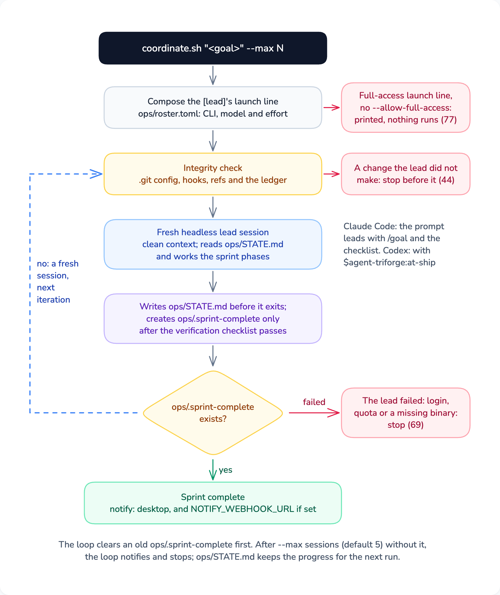

[← Agent Triforge](../README.md#documentation)

# Unattended runs

<p align="center">
  
</p>

A sprint can run with nobody watching in two ways. `at-ship` runs every phase in one lead session. [`scripts/coordinate.sh`](../scripts/coordinate.sh) drives the same sprint from a terminal through as many fresh lead sessions as it needs, so a full context window doesn't end the run. Either way the sprint is done only when `ops/.sprint-complete` exists. The lead creates that file as its last step, after the verification checklist passes.

## In one session: `at-ship`

Run `/at-ship <goal>` under Claude Code or `$agent-triforge:at-ship <goal>` in a Codex prompt. `--convergence` sets when review stops: `fast` once no P1 finding is left, `standard` (the default) once no P1 or P2 is left, and `deep` once, on top of that, fewer than 3 P3 findings remain. `--team` builds in agent-team mode, for 5 or more tasks or interdependent ones.

At the start `at-ship` prints a copyable completion line. Under Claude Code it is a `/goal` gate: type it, and Claude Code holds the session to the checklist. A Codex lead has no `/goal`, so it completes on the marker alone. The checklist:

1. Every phase is done, or skipped with a stated reason.
2. The `verification-before-completion` checklist passes with evidence.
3. `ops/STATE.md` is written for the next session.
4. Temporary review files are archived to `ops/archive/`.
5. `ops/.sprint-complete` is created last, only after 1 to 4 hold.

If any item fails, the lead creates no marker and records the blocker in `ops/TASKS.md` and `ops/STATE.md`.

## Across sessions: `scripts/coordinate.sh`

1. Open a terminal in the project's top directory. The script ships in the plugin install, and session start records that path as the last line of `.agents/triforge-plugin-root.local`:

   ```bash
   TRIFORGE="$(tail -n 1 .agents/triforge-plugin-root.local)"
   ```

2. Preview the run. `--dry-run` prints the lead's launch line and the prompt for the first session, and runs nothing; add `--lead codex` or `--lead claude` to compose it for the other lead:

   ```bash
   bash "$TRIFORGE/scripts/coordinate.sh" "Build the authentication module" --dry-run
   ```

3. Start it. `--max N` caps the sessions (default 5), and `--convergence` and `--team` pass through to the sprint:

   ```bash
   # Full autonomous sprint with context recovery
   bash "$TRIFORGE/scripts/coordinate.sh" "Build the authentication module" --max 5 --convergence deep --team

   # With completion notification via webhook
   NOTIFY_WEBHOOK_URL="https://hooks.slack.com/..." bash "$TRIFORGE/scripts/coordinate.sh" "Build auth" --max 5

   # Under a Codex lead: preview the launch line and prompt, then run with full access acknowledged
   bash "$TRIFORGE/scripts/coordinate.sh" "Build auth" --dry-run --lead codex
   bash "$TRIFORGE/scripts/coordinate.sh" "Build auth" --max 5 --allow-full-access
   ```

Run it from a terminal or from the lead's own shell. Under nohup, cron or CI there is no terminal, so the script stops with exit 45 before any session starts.

## What the loop does

1. It resolves the lead from `[lead]` in `ops/roster.toml`, checks that the lead's CLI is on `PATH` and that `TMPDIR` is private, and deletes any stale `ops/.sprint-complete`.
2. Before every session it runs the lead's git integrity check. When `.git/config`, the hooks, the refs, a worktree pointer or the lease ledger changed in a way the lead did not make, it restores what it can, escalates the open leases and stops with exit 44 before the session starts. Check the change, accept it with `lease_rebaseline` if you made it, then rerun.
3. Each session is a fresh lead process started with the registry's launch line plus the `[lead]` model and effort. Under Claude Code the prompt opens with the `/goal` checklist. Under Codex it opens with `$agent-triforge:at-ship` and carries the checklist as text. The session reads `ops/STATE.md` first. When `ops/leases.toml` still holds open leases, the prompt tells the session to rebuild the wave from the ledger instead of starting it again, and to bring up any failed or escalated lease for a decision.
4. After each session the loop looks for `ops/.sprint-complete`. If it exists, the sprint is complete. If the session failed in a way every new session would repeat (not logged in, quota spent, binary missing), the loop stops with exit 69 and prints the fix. Otherwise it starts the next session.
5. When the sprint completes, stops on a failure or runs out of sessions, the loop posts a message to `NOTIFY_WEBHOOK_URL` when you set one, and shows a desktop notification (`osascript` on macOS, `notify-send` on Linux).

## Under a Codex lead

A Codex lead's launch line runs with full access: `-s danger-full-access` and no approval prompts. `coordinate.sh` runs it only when you pass `--allow-full-access`. Without the flag it prints the line and the statements of what confines it, then exits 77 having run nothing. `at-setup` prints the same line for an interactive session, and typing it is your step. The "Confinement, stated as it is" section of [`AGENTS.md`](../AGENTS.md) says what confines a full-access lead and what doesn't.

## When a run stops

| Exit | Meaning |
|---|---|
| 0 | The sprint is complete, the dry run printed, or the sessions ran out without completion (the closing lines say which) |
| 1 | Usage error, a lead that can't be resolved, its CLI not on `PATH`, the helper library missing, or a `TMPDIR` other users could change |
| 44 | The integrity check found a change before a session (restored and escalated; inspect it, then `lease_rebaseline`) or could not run |
| 45 | This shell may not run the lead's loop: another CLI's shell, or no terminal (nohup, cron, CI) |
| 69 | The lead failed in a way that would repeat (not logged in, quota spent, binary missing); the fix is printed |
| 77 | The launch line needs full access and `--allow-full-access` was not given; nothing ran |

When the sessions run out, `ops/STATE.md` and `ops/TASKS.md` hold the progress. Run the script again to continue, or review by hand.

### Stopping a run early

Press Ctrl-C in the terminal running the script. That ends the loop and the lead session it is waiting on. Builders that session started keep running, because each runs detached in its own process group, and their leases stay open in `ops/leases.toml`. Run the script again with the same goal to continue. The next session finds the open leases, collects the builders that finished and carries on with the wave.

To stop the builders too, load the helpers in the same terminal (in the project's top directory, with `TRIFORGE` set as in step 1), list the leases and stop each one still running. `lease_stop` leaves the lease in the ledger, for the next session to reclaim or requeue:

```bash
source "$TRIFORGE/scripts/invoke-external.sh"
lease_status
lease_stop <task_id>
```
